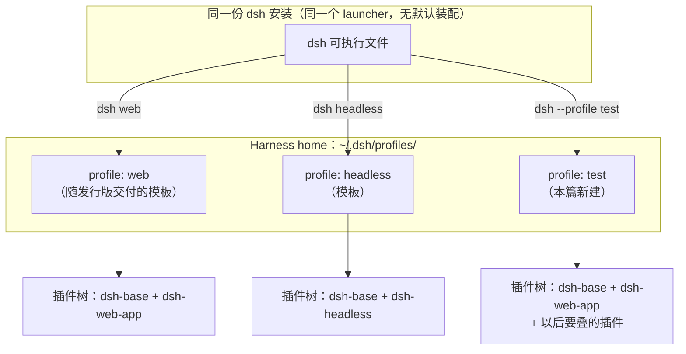
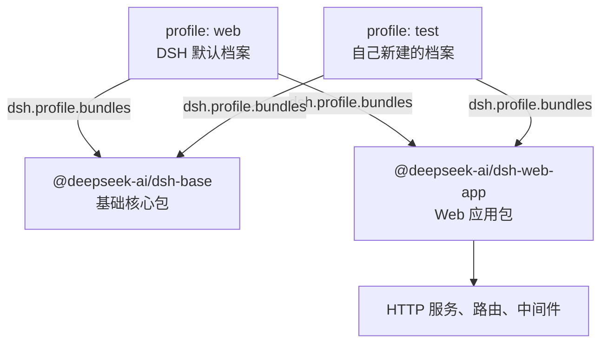

> **读完这篇你能**：说清 profile、bundle、插件三者的关系，并建好一个干净的 test profile。
> 
> **前置**：无。约 10 分钟。

## DSH 设计

为什么「建 profile = 写一个 package.json」，由 DSH 的三条装配设计决定（依据 `local/deepseek-harness-dsh-v0.2.0-rc.2/docs/architecture.zh.md` 的「Profile 与组合包」一节）。

**没有特权内核，「装什么」只能外置成清单。** 运行中的 dsh 是一棵插件树，由启动时按序叠加的各层组合而成；内核不做任何插件做不到的事，连 agent loop 本身都是插件。既然装哪些插件不可能写死在程序里，就必须有一个地方把清单列出来——profile 就是这个具名容器：列出自己叠放的组合包，存放自己安装的树外插件，保存自己的 `cordis.patch.yml`。本篇说的「插件集合隔离」，落到实处就是这份清单按名字各存一份。

**一份安装，多个界面。** profile 是同一套 dsh 安装提供不同应用界面的方式：`web`、`headless`、`sdk`、`sdk-minimal`、`acp` 从同一个 launcher 启动出不同组合（依据 `local/deepseek-harness-dsh-v0.2.0-rc.2/packages/boot/app-boot/README.zh.md`）。所以这几个模板同时是 CLI 子命令——`dsh web` 就是 `dsh --profile web`；也所以启动必须点名：不存在「默认界面」，选一个 profile 就是选一个界面。

**组合包是可安装的分发格式，不是「内核的一部分」。** bundle 的定义是「Cordis 配置项及其挂载代码的分发格式」，它插进树里的内容始终可被其上各层 patch。profile 与 bundle 都在各自的 `package.json` 里用 `dsh` 字段声明身份：`dsh.profile` 列出组合包，`dsh.bundle` 指向 patch 文件。所以建一个 profile 的全部工作就是写一个带 `dsh.profile.bundles` 的 `package.json`——本篇的 test profile 只有一个文件，不是精简，是 profile 的定义本来就这么大。至于预置的两个包：`dsh-base` 是 web、headless、sdk、acp 共享的第一层（模型适配器、工具、持久化、审批这些底座），`dsh-web-app` 在上面加浏览器应用；test 照抄的就是 web 模板的最小骨架。



后面装插件、写 patch，全都是往这棵树上叠层——profile 是叠加的出发点。

## profile 的含义
如下是dsh 插件安装命令，我们来理解一下 profile 的含义。

```
dsh plugin --profile <档案名> add <插件来源>
````

以我为例，我和我老婆在家里共用这一台电脑。我俩使用场景不同，我老婆会使用 A， B， C 插件， 而我使用 A， E， F 插件。因此，就为 我俩每个人各自创建一个profile。
她在她的 wife_profile 下安装 A， B， C插件。我在我的 husband_profile 下安装 A， E， F插件。
现在是不是就好理解了，其实 profile 就是一个插件集合隔离。

DSH 不自带默认 profile——`--profile` 必须点名。自带的几个表面模板（`web`、`headless`、`sdk`、`acp` 等）同时也是 CLI 子命令，`dsh web` 用的就是 `web` 那一套，所以插件文档里的安装命令常写成 `dsh plugin --profile web add dsh-better-sidebar` 这样。
DSH 快速启动执行的命令也是 `dsh web`。 所以，可以理解了 这里的 web 原来是指定 profile 启动呀。

dsh profile 的存放路径是 `~/.dsh/profiles`。 可以看到这个目录下有个web文件夹，这个web文件夹就是web profile。

我们先搞一个最小可用的 test profile。创建一个 test 目录，在目录中创建 profile 描述文件 package.json，预置两个组件：一个基础组件，一个web页面组件。

直接复制如下内容执行即可

```sh
cd ~/.dsh/profiles
mkdir test
cd test
touch package.json
echo '{"name":"dsh-profile-test","private":true,"dsh":{"profile":{"bundles":["@deepseek-ai/dsh-base","@deepseek-ai/dsh-web-app"]}}}' >> package.json
pnpm install
```

我们向 package.json 中写入的内容如下
```json
{
	"name": "dsh-profile-test",  // 项目名称，用于标识和日志
	"private": true, // 设为私有，不发布到 NPM 仓库
	"dsh": {
	  "profile": {
	    "bundles": [
	      "@deepseek-ai/dsh-base", // 基础核心包：日志、配置、生命周期等底层能力
	      "@deepseek-ai/dsh-web-app" // Web 应用包：提供 HTTP 服务、路由、中间件等 Web 能力
	    ]
	  }
	}
}
```

bundle 如何理解，事实上这就是插件包，也就是我们理解的插件。一个插件包包含多种能力，例如 dsh-web-app 提供 HTTP 服务、路由、中间件等 Web 能力。



现在我们打开 这个 profile 看一下
```sh
dsh --profile test
```


---

**下一篇**：[最小插件的结构与装配](02-最小插件的结构与装配.md)——profile 建好了，往里放第一个插件。

profile 目录里哪些文件能改、哪些是生成物，见[profile 与插件包结构](参考/profile与插件包结构.md)。

