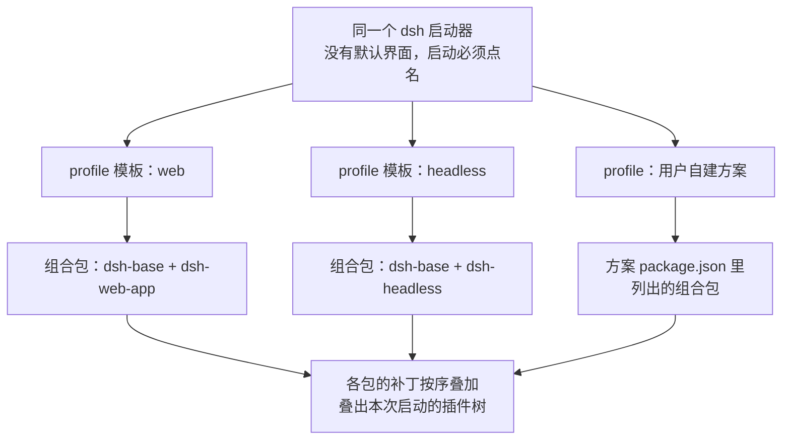
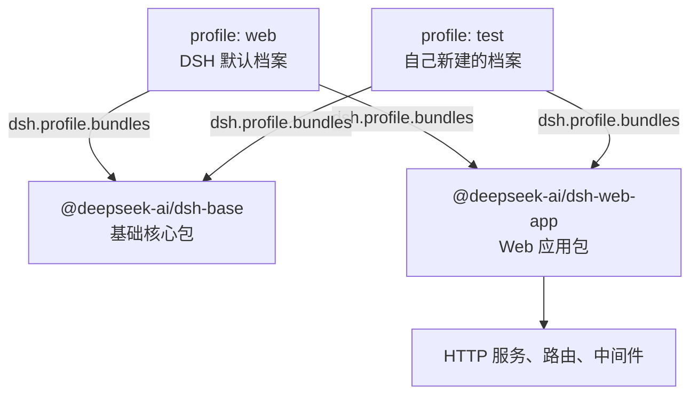

> **配置对照图**：[由行组成的树](参考/由行组成的树.html)——四层补丁逐条叠成插件树，左行右树悬停对照。
> 
> **读完这篇你能**：说清 profile、bundle、插件三者的关系，并建好一个干净的 test profile。
> 
> **前置**：无。约 10 分钟。

## DSH 设计

这一节不依赖本文其他任何内容，单独讲清 DSH 配置体系里的三层概念——插件、组合包（bundle）、profile（配置方案），依据源码快照 `local/deepseek-harness-dsh-v0.2.0-rc.2/docs/architecture.zh.md` 的「Profile 与组合包」一节与 `local/deepseek-harness-dsh-v0.2.0-rc.2/packages/boot/app-boot/README.zh.md`。

**一切功能都是插件，所以「装什么」只能外置成清单。** 在 DSH 里，一个插件就是一段带名字的代码：一个名字，加一个挂载进系统时执行的函数。DSH 自己的全部功能——对接模型、注册工具、保存会话、驱动对话的循环——也都是插件，和用户写的插件没有身份差别；系统里不存在「内核能做、插件做不到」的事。既然没有任何功能写死在程序里，「这次启动装哪些功能」就必须有一份程序之外的清单：运行中的 DSH 是一棵插件树（启动时各层清单叠加出来的功能总表），这棵树完全由外部清单叠出来。

**组合包是插件的正规分发格式。** 光有代码不够，系统还得知道「这段代码怎么进树」。组合包（bundle）把两样东西打包在一起分发：一批插件的代码，加上它们的挂载补丁（补丁是一份 YAML 文件，逐行声明往树里插一行、改一行的参数、或停用一行）。组合包在自己的 `package.json` 里用 `dsh.bundle` 字段指出补丁文件的位置；它插进树里的每一行，始终可以被后续各层再改——分发默认配置和允许别人改默认配置，是同一个格式的一体两面。

**profile 是一份具名的配置方案。** profile 存放在 DSH 的用户配置目录（叫 harness home，通常是 `~/.dsh`，方案放在 `profiles/<名字>/`）里，内容就三样：要叠放哪些组合包、另外单独安装的插件、以及方案自己的那份覆盖补丁。和组合包一样，profile 也在自己的 `package.json` 里声明身份：`dsh.profile.bundles` 字段列出组合包名单。所以建一个 profile 的全部工作，就是写一个带这个字段的 `package.json`——这不是精简玩法，而是 profile 的定义本来就这么大。

**一份安装，多个界面。** profile 是同一套 DSH 安装提供不同应用界面的方式：`web`（浏览器界面）、`headless`（无界面的一次性运行）、`sdk`、`sdk-minimal`、`acp` 这些模板随发行版交付，从同一个启动器启动出不同组合；它们同时也是命令行子命令，`dsh web` 就是 `dsh --profile web`。系统没有「默认界面」：启动时必须点名一个 profile，选哪个 profile 就是选哪个界面。预置组合包的分工跟着界面走：`dsh-base` 是 web、headless、sdk、acp 共享的第一层底座（模型适配器、工具、持久化、沙箱与审批等），`dsh-web-app`、`dsh-headless` 等再各自在上面加自己界面的东西。



三层各管一件事：插件是功能本身，组合包是功能的分发方式，profile 是决定哪些分发进入本次启动的方案。之后装插件、改配置、停用功能，都是在这套叠加体系里动清单。而「动清单」这步通常由安装命令代劳：`dsh plugin add` 只是把包名登记进 profile 的清单，真正的配置永远发生在下一次启动的叠加过程里。

## profile 的含义
如下是dsh 插件安装命令，我们来理解一下 profile 的含义。

```
dsh plugin --profile <档案名> add <插件来源>
````

以我为例，我和我老婆在家里共用这一台电脑。我俩使用场景不同，我老婆会使用 A， B， C 插件， 而我使用 A， E， F 插件。因此，就为 我俩每个人各自创建一个profile。
她在她的 wife_profile 下安装 A， B， C插件。我在我的 husband_profile 下安装 A， E， F插件。
现在是不是就好理解了，其实 profile 就是一个插件集合隔离。

DSH 不自带默认 profile——`--profile` 必须点名。自带的几个表面模板（`web`、`headless`、`sdk`、`acp` 等）同时也是 CLI 子命令，`dsh web` 用的就是 `web` 那一套，所以插件文档里的安装命令常写成 `dsh plugin --profile web add dsh-better-sidebar` 这样。
DSH 快速启动执行的命令也是 `dsh web`。 所以，可以理解了 这里的 web 原来是指定 profile 启动呀。

dsh profile 的存放路径是 `~/.dsh/profiles`。 可以看到这个目录下有个web文件夹，这个web文件夹就是web profile。

我们先搞一个最小可用的 test profile。创建一个 test 目录，在目录中创建 profile 描述文件 package.json，预置两个组件：一个基础组件，一个web页面组件。

直接复制如下内容执行即可

```sh
cd ~/.dsh/profiles
mkdir test
cd test
touch package.json
echo '{"name":"dsh-profile-test","private":true,"dsh":{"profile":{"bundles":["@deepseek-ai/dsh-base","@deepseek-ai/dsh-web-app"]}}}' >> package.json
pnpm install
```

我们向 package.json 中写入的内容如下
```json
{
	"name": "dsh-profile-test",  // 项目名称，用于标识和日志
	"private": true, // 设为私有，不发布到 NPM 仓库
	"dsh": {
	  "profile": {
	    "bundles": [
	      "@deepseek-ai/dsh-base", // 基础核心包：日志、配置、生命周期等底层能力
	      "@deepseek-ai/dsh-web-app" // Web 应用包：提供 HTTP 服务、路由、中间件等 Web 能力
	    ]
	  }
	}
}
```

bundle 如何理解，事实上这就是插件包，也就是我们理解的插件。一个插件包包含多种能力，例如 dsh-web-app 提供 HTTP 服务、路由、中间件等 Web 能力。



现在我们打开 这个 profile 看一下
```sh
dsh --profile test
```


---
