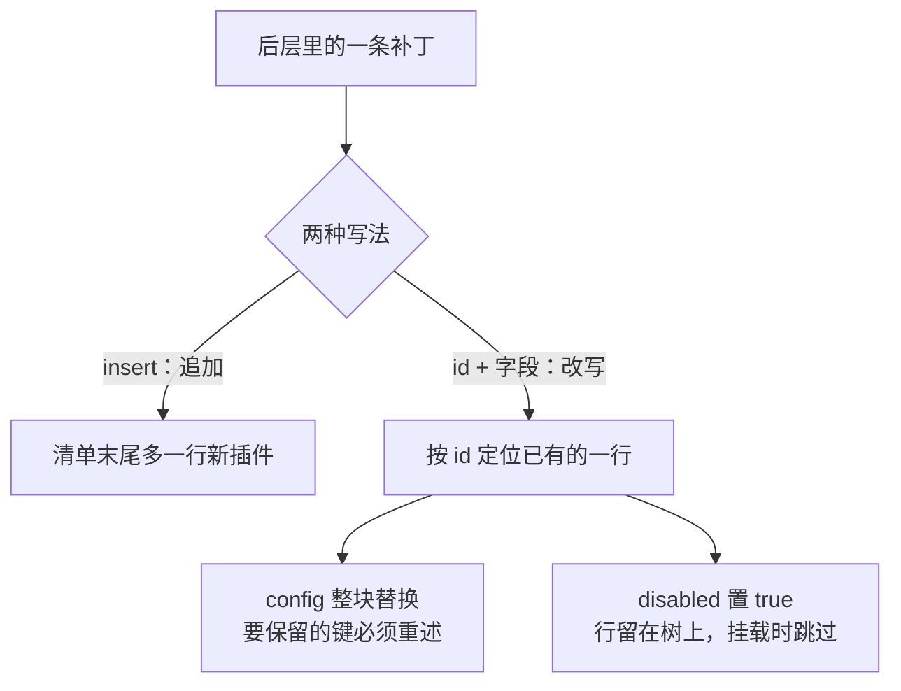
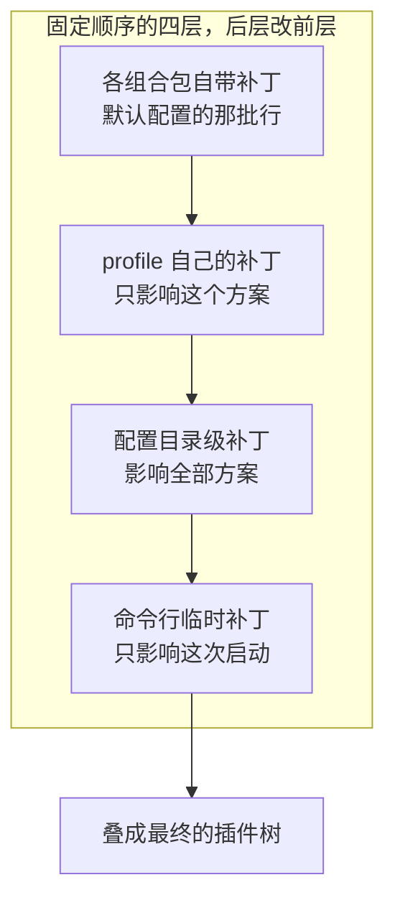
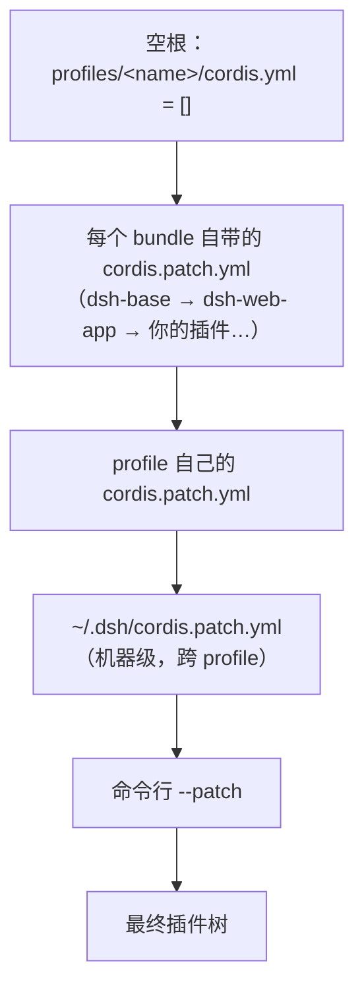

> **读完这篇你能**：用一份 patch 文件关掉不需要的内置插件、改掉内置插件的参数，不动 `node_modules` 里的一行源码。
>
> **前置**：[[02-最小插件的结构与配置]]。约 20 分钟。
>
> **示例代码**：[dsh-patch-demo](https://github.com/anthonyzhao-4926/blog/tree/main/code/dsh_plugin/dsh-patch-demo)

[[02-最小插件的结构与配置]]里写了 `patch.yaml`，这篇讲它到底是什么、能不能用同一套写法改 DSH 自己装的东西。

`test` profile 启动时，插件树有一百多行，几乎全是 DSH 自己装的：`@deepseek-ai/dsh-base` 铺底座，`@deepseek-ai/dsh-web-app` 在上面盖 Web 界面。它们躺在 `node_modules` 里，不是你仓库的一部分，所以只能从配置层下手——而配置层只写要改的那几行，前面那一百多行照旧。

## 目标

不改任何源码，让 `test` profile 的默认配置听你的话：

- **改参数**：把自动生成的会话标题截短。
- **加一行**：往树里插一个自己的插件。
- **停一行**：不需要的内置插件，让它不启动。

改完验证一遍：配置层用 `--dump-config` 看值有没有落上去，运行层真启动一次看日志。

## DSH 设计

本节依据源码快照 `local/deepseek-harness-dsh-v0.2.0-rc.2/docs/architecture.zh.md` 与 `packages/boot/app-boot/README.zh.md`。

**补丁是改 DSH 配置的唯一方式。** 补丁（patch）是一份 YAML 文件，逐行描述对插件清单的改动。组合包插进树里的每一行始终可被其上各层 patch：内置的那一百多行默认配置不是写死的内核，而是和用户覆盖文件走同一条叠加管线的第一批文件。想改变行为，只有「往上叠一层」这一条路。这里说的还是[[参考/由行组成的树.html|由行组成的树]]。

**叠加顺序固定四层。** 从空清单开始：先按 profile（一份具名配置方案）列出的顺序应用各组合包自带的补丁，再叠这个方案自己的补丁文件，再叠用户配置目录里对全部方案生效的那份，最后叠命令行临时指定的补丁。越靠后话语权越大。

**每条补丁只有两个动作。** `insert`：往清单末尾追加新行；「id 加字段」：按 id（每行的唯一标识）定位已有行，把写出的字段覆写上去。其中 `config` 是整块替换、不做深度合并——想保留的键必须原样重述（合成器不猜你想保留什么）。



**「停用」是唯一的减法。** 两个动作里没有「删除」：后层再靠后也抹不掉前层写下的行，只能改它的字段。所以「不让某一行启动」被做成普通字段 `disabled`——行还在树上，名字和参数都留着，只是每次挂载决策时跳过它。因此被停用的行在配置导出里照样看得见。

**运行期才知道的事，推迟到挂载那一刻求值。** 补丁是静态 YAML，写下文件那一刻不可能知道平台、环境变量、别的插件装没装。加载器因此支持 `!!js` 表达式：`config` 的插值推迟到插件等待的服务就绪之后，`disabled` 在每次挂载决策时现算。表达式看见的是「加载那一刻」的树，不是「文件写下那一刻」的树。

**错误待遇分两级：行级警告，文件级判死。** 补丁指向的行不存在，只打一条警告、继续启动——同一份补丁可能喂给装的行本就不一样的多个方案，对不上是常态。补丁文件本身解析失败（包括空文件、纯注释）则直接启动失败：启动器不会带着一棵「以为改了其实没改」的树跑起来。组合包一级更宽容：单个组合包解析或加载失败会被跳过并列入跳过名单，其余照原顺序继续。



把握「固定顺序、两个动作、不合并、推迟求值」这四条，其余规则都能推出来。

## patch 的工作原理

插件树从空根开始，由一层层 patch 叠出来：



后方覆盖前方，所以只需写要改的那几行。patch 文件就是这张「改动清单」：文件里一条，对应树里改一处。

| patch 文件 | 作用范围 | 适合什么 |
| --- | --- | --- |
| `profiles/<name>/cordis.patch.yml` | 这个 profile | 这台机器上的偏好 |
| `~/.dsh/cordis.patch.yml` | 所有 profile | 跨 profile 的机器级选择 |
| 命令行 `--patch <file>` | 这一次启动 | 临时试验，满意了再落进上两处 |

## 两条改动

先拿两条改动跑通 patch：把自动生成的会话标题截短，再往树里插一行自己的插件。两条都写进上面第一层 `~/.dsh/profiles/test/cordis.patch.yml`：

```yaml
# 1) 让自动生成的会话标题短到肉眼可见
- id: session-title
  config:
    fallbackMaxWords: 3
    fallbackMaxBytes: 16
    maxTitleBytes: 30

# 2) 插一行自己的插件
- insert:
    - id: dsh-note
      name: '/绝对路径/dsh-patch-demo/my-note.ts'
```

| #   | 写法              | 作用         | 这条的效果                             |
| --- | --------------- | ---------- | --------------------------------- |
| 1   | `id` + `config` | 找到那一行，替换字段 | 新开一个会话，标题明显变短                     |
| 2   | `insert:`       | 往列表尾部追加行   | 启动日志多打印一行，出现 `[dsh-note] … apply() 执行了` |

> 第 1 条故意做成「一眼能看出来生效」，所以不太能用：标题截到 30 字节只够好看。改完记得调回合适值。

## `--dump-config` 验证

patch 写完，先确认它有没有落到树上：

```bash
dsh --profile test --dump-config
```

它把合成后的整棵树打印出来，每行的来源标在上一行的注释里：

```yaml
# == @deepseek-ai/dsh-base, patched by ~/.dsh/profiles/test/cordis.patch.yml
- id: session-title
  name: '@deepseek-ai/dsh-session-title'
  config:
    fallbackMaxWords: 3
    fallbackMaxBytes: 16
    maxTitleBytes: 30
```

`fallbackMaxWords` 变成 3 了，`# ==` 那行注明了改动来自哪一层——写的是你的 profile patch，就对上了。

`--dump-config` 只做合成：不启动插件，也不求值 `!!js`（表达式原样打印）。所以它随时能跑，但只能证明「配置层写对了」，证明不了插件跑得起来。

## patch 语法

每条 patch 只有两种形状：**改一行**（`id` 加上要覆盖的字段），或者**加一行**（`insert`）。上面两条里 `session-title` 是第一种，`dsh-note` 是第二种。

### insert：追加一行

```yaml
- insert:
    - id: dsh-note
      name: '/绝对路径/dsh-patch-demo/my-note.ts'
```

`name` 可以是包名、绝对路径，或相对路径——相对路径按 patch 文件所在目录锚成 `file://` URL。被插进来的一行会真的执行：`my-note.ts` 里就一句 `console.log`，启动后日志出现 `[dsh-note] 我被 patch 插进了插件树，apply() 执行了`。

#### 与 `dsh plugin add` 的不同

`my-note.ts` 只是一个文件，给个路径就能加载。[[02-最小插件的结构与配置]]的 hello world 则是一个**包**：`package.json` 里声明 `dsh.bundle.patch`，`dsh plugin add` 把它装进 profile 的 `node_modules`，并把包名写进 profile `package.json` 的 `dsh.profile.bundles`。

差别在于 patch 里那行 `name` 交给加载器的是一段**模块说明符**：写成磁盘路径就直接 `import` 那个文件，写成包名才要去 `node_modules` 里解析。加载器拿到模块后只认导出的 `name` 和 `apply`，其余一概不问；`package.json` 解决的是另外两件事——让包名能被解析、用 `dsh.bundle.patch` 声明自带哪份补丁。

### id：覆盖字段

**改一行**要用 `id` 指名目标。`id` 是 dump 里那个 `id:`，不是包名，也不是插件自己的 `name`——别背，去 dump 里抄。

patch 条目里只有三个键有结构含义：`id`（必写，定位用）、`name`（可选，校验用——与目标行的 `name` 不一致就跳过并告警）、`insert`（往 group 里塞行；没有 `id` 时往顶层塞）。**其余键会被原样覆写到目标行上**，所以能写哪些取决于目标行有哪些字段：最常用的是 `config` 和 `disabled`，`inject`、`isolate`、`intercept`、`group` 一样能覆写。

想停用一行，就只写 `disabled`：

```yaml
# 这一行原样来自上面 dump 的输出，id 照抄
- id: <某行的 id>
  disabled: true # 这行从此不启动，它的 name、config 都还留在树上
```

覆盖是逐个字段的：只写 `disabled`，那一行的 `name`、`config` 都照旧。`config` 是唯一的例外，整块替换（见易错点 1）。`id` 找不到时也只警告、继续跑，这是故意的：同一份 patch 可能同时喂给不同的 profile，web 和 tui 装的行本就不一样。

### `!!js` 表达式

值不一定非得写死。要跟平台走、跟环境变量走、按别的插件装没装来决定时，就在值的位置写一条 `!!js` 表达式，它在加载那一刻才求值。作用域里有 `process.env`、`process.platform` 和 `ctx`：

```yaml
# id 照抄 dump 里那一行，值改成一条表达式
- id: <某行的 id>
  disabled: !!js process.platform === 'win32'
```

`dsh-base` 里就有一批这样的行，上面这条是最常见的路子：Windows 上不启动，别的平台照常。注意这条 patch 会把那一行的 `disabled` 整块顶掉，原来的条件不会合进来，得自己一次写全。

`better-sidebar` 用同一机制做「有人挂过我就不挂」：

```yaml
- id: better-sidebar
  name: dsh-better-sidebar
  disabled: !!js >-
    [...ctx.loader.entries()].some((e) => e.options.name === 'dsh-better-sidebar'
      && e.options.id !== 'better-sidebar' && !e.disabled)
```

同一个包挂两遍会让路由注册撞车、把整棵树搞崩，所以这一行发现别人已经挂了同一个包就禁用自己。表达式只能看见排在它前面的行，守卫要写在被守卫的行之前。

## 易错点

patch 写错有两种结果：改错了地方只警告，文件本身写坏了直接退出。

### 1. `config` 是整块替换

覆盖是逐个字段的，`config` 是唯一例外：整块顶掉目标行原来的 `config`。所以上面 `session-title` 那条把三个键全写了——只写一个键，另外两个就等于没写，而它们没有默认值可回落，整行直接起不来：

```yaml
# 踩法：写一个键，丢掉另外两个
- id: session-title
  config:
    fallbackMaxWords: 3
```

这个插件的 schema 里 `fallbackMaxBytes` 和 `maxTitleBytes` 是必填的，于是这一行启动时校验不过：

```text
dsh: warning: 1 entry did not activate
session-title (@deepseek-ai/dsh-session-title): ValidationError: invalid config:
  - $.fallbackMaxBytes missing required value (at fallbackMaxBytes)
```

别的插件不一定这么严格：像 `bash-sandbox`，schema 里每个键都有默认值，只写要改的那个键也能起来。

### 2. id 写错只警告

```text
dsh: [/tmp/patch.yml] patch: entry "bash-sandbax" not found
```

只警告、继续跑，插件照原样启动，现象是「配置没生效」。改完记得认 `# == ... patched by ...` 那行：它没出现，或者值还是旧的，多半就是 id 写错了。

### 3. patch 文件写错启动失败

YAML 语法错、顶层不是数组、元素不是键值对（`insert:` 那一条不是 KV），都在启动时直接抛错退出。

## patch 的位置

三个位置的作用范围见前面那张表，这里补三点使用差别。

profile 那层是默认选择：要动的内置配置都属于某个 profile。换到 `~/.dsh/cordis.patch.yml` 就跨 profile 生效——所有 profile 都不想要同一个内置能力时写这里，代价是它同时影响别的 profile。`--patch` 是叠在最后的一次性层，适合先试再落盘：

```bash
dsh --profile test --dump-config --patch ./tmp.yml
```

`--dump-config` 会把上面三处一起打出来，每层内容都标着来源。想看「还没加这三处之前」的树，用对照开关 `--dump-default-config`：

```bash
dsh --profile test --dump-default-config
```

它去掉的正是这三处（profile patch、家目录 patch、`--patch`），留下的只有 bundle 自带的层——「还没有你的时候，DSH 默认长什么样」。

## 完整代码

前面散着讲的东西收成一份可跑的：`dsh_plugin/dsh-patch-demo/` 下三个文件——`cordis.patch.yml`（本文那两条 patch）、`my-note.ts`（`insert` 插进去的插件）、`install.sh`（填绝对路径，复制进指定 profile）。

```bash
cd dsh_plugin/dsh-patch-demo && ./install.sh
```

装好后，两层验证各跑一遍：

```bash
# 配置层：值都落上去了
dsh --profile test --dump-config | grep -A6 'id: session-title'

# 运行层：insert 那行真的跑起来了
dsh --profile test --no-open --port 3099
```

第一条看 `config` 里的三个值有没有落上去；第二条才看运行——`insert` 这类改动必须真启动一次，在日志里找 `[dsh-note]`。3099 是躲开正在跑的 3080。第 1 条的效果得新开一个会话才看得见：标题被截短了。

## 注意事项

- **id 从 dump 里抄**，它不是包名，也不是插件自己的 `name`。
- **改完 patch 不用重启。** 配置热重载默认开着（base 里 `hmr` 那行负责），保存 `cordis.patch.yml` 就重新组合配置。默认关着的是源码热重载，见[[07-配置与源码的热重载]]。
- **禁用有依赖的东西，dump 里看不出来。** dump 只显示配置，不显示谁在用谁，被禁用的插件如果有消费者，会在启动时报错——记得看启动日志。
- **`--dump-default-config` 去掉的是你自己写的那几层，不是 bundle 层。** 留下的正是 `dsh-base`、`dsh-web-app` 这些 bundle 自带的层。它和 `--dump-config` 的差别：

| 层 | `--dump-config` | `--dump-default-config` |
| --- | --- | --- |
| 各 bundle 自带的 `cordis.patch.yml`（dsh-base → dsh-web-app → …） | ✓ | ✓ |
| profile 自己的 `cordis.patch.yml` | ✓ | ✗ |
| `~/.dsh/cordis.patch.yml`（机器级） | ✓ | ✗ |
| 命令行 `--patch` | ✓ | ✗（和这个开关互斥，不能一起用） |

dump 里少了东西时，先用这张表定位是哪一层没了，再看那个文件。`--dump-default-config` 只做救援：`cordis.patch.yml` 写坏了、解析都会失败时，它照样能跑出来。
