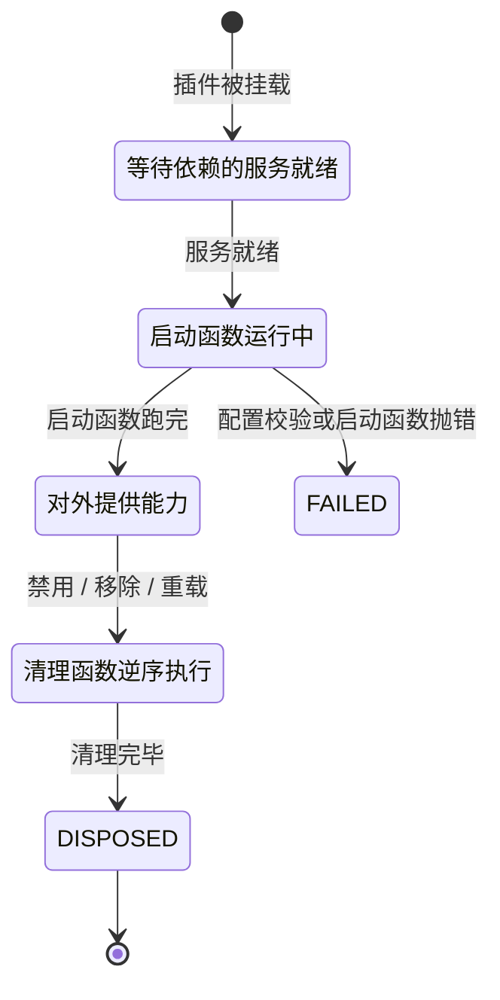
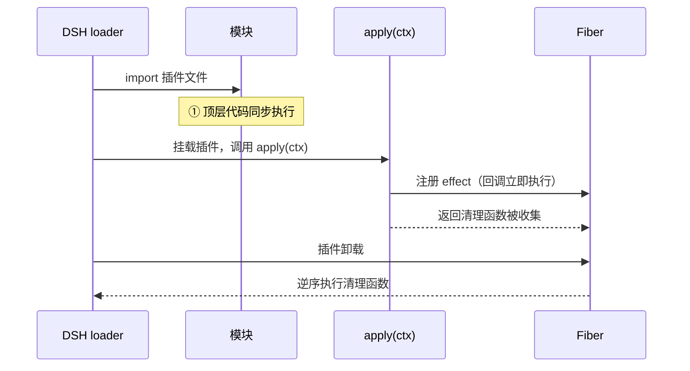

> **读完这篇你能**：说清插件从加载到卸载的四个阶段，知道什么该交给 `ctx.effect` 管理。
>
> **前置**：[04-注册 HTTP 路由与注入页面样式](04-注册 HTTP 路由与注入页面样式.md)。约 15 分钟。
>
> **示例代码**：[dsh-effect-func](https://github.com/anthonyzhao-4926/blog/tree/main/code/dsh_plugin/dsh-effect-func)

[04-注册 HTTP 路由与注入页面样式](04-注册 HTTP 路由与注入页面样式.md)里，我们用了 `ctx.effect(() => webServer.register(...))`，当时留了一句话："`ctx.effect` 的清理时机留到后面着重讲解"。这篇就把它彻底讲透。

`ctx.effect` 是 Cordis 生命周期的地基。路由、事件监听、子插件……所有"需要随插件卸载而消失"的东西，底层都是它。

## DSH 设计

**卸载是常态，所以每次注册都必须可逆。** 先对齐三个词：插件是给 DSH 增加功能的一段代码；挂载是把它装进运行中的系统；卸载是把它拿出来。DSH 自带的 web 方案默认开着配置热重载——改完配置文件不用重启进程，框架会把受影响的插件就地卸载再挂载；禁用、启用、移除插件更是日常操作。框架因此把「注册是可逆的」列为核心约定：提示词片段、工具定义、事件监听这些注册，装的时候就得配好「拆的时候做什么」。在这套框架里，装上去却卸不干净的注册就是缺陷。

**fiber 是撤销动作的归属单位。** 插件每被挂载一次，框架就创建一个 fiber（一个插件的一次运行实例），装着这次运行的生命周期状态、校验过的配置，以及它登记过的全部清理动作。同一个插件挂两次就有两个互不串扰的 fiber：各自的配置、各自等待的服务、各自收集的清理函数，各管各的。卸载一个插件，落到实现上就是销毁它那个 fiber——把它收集的清理函数逐个执行完才算了结。

**ctx.effect 是登记「可撤销注册」的入口。** 插件启动函数里拿到的 `ctx` 是插件与框架打交道的上下文对象。`ctx.effect` 接收一个函数并立即执行它；这个函数返回的第二个函数就是清理函数（「拆的时候做什么」），被 fiber 收起来。清理函数在两种情况下执行：插件主动撤销这个注册，或者 fiber 被卸载——以先到者为准，重复调用不会重复执行。框架的辅助方法（比如监听事件的 `ctx.on`）内部已经把注销动作包进了同一套机制，所以只有拿到框架不管的资源——一条路由注册、一个定时器、一个连接——才需要亲手写 `ctx.effect`。官方实践规则还有两条：每个注册都应有对应的清理函数；拆的顺序有讲究时，把相关工作放进同一个 effect，保证按预期顺序释放。

**清理按登记的相反顺序执行，异步清理也会被等待。** 销毁 fiber 时，清理函数按登记的相反顺序跑——后登记的往往建立在前面的注册之上，拆要倒着拆。清理函数可以是异步的，卸载过程会等它完成才结束。

**插件的一生是六个状态的流转。** fiber 源码里定义了六个生命周期状态：`PENDING`（等待声明依赖的服务就绪）、`LOADING`（插件的启动函数运行中）、`ACTIVE`（已加载并对外提供能力）、`FAILED`（启动函数或配置校验抛了错）、`UNLOADING`（清理函数运行中）、`DISPOSED`（已移除）；每次状态转换都会广播一次内部事件（依据 `local/deepseek-harness-dsh-v0.2.0-rc.2/vendor/cordis/src/fiber.ts`）。这解释了一个常见困惑：插件文件被加载后，它的启动函数并不立刻执行——声明了要等的服务时，fiber 停在 `PENDING`，服务就绪才进入 `LOADING`。挂载时机由服务依赖决定，不由文件加载顺序决定。



一句话点题：在这套设计里，「注册」和「注销」是同一笔账的两面——fiber 记账，`ctx.effect` 是记账的笔。

## 插件生命周期

先看演示插件的完整代码：

```ts
// dsh-effect-func.ts
import type { Context } from '@deepseek-ai/cordis'

export const name = 'dsh-effect-func'

// ① 同步阶段：模块顶层代码随插件加载同步执行（此时 apply 尚未运行）
console.log('[dsh-effect-func] ① 同步阶段：插件模块被加载')

export function apply(ctx: Context) {
    // ② 异步阶段：apply 在插件注册完成后执行（并非加载时立即执行）
    console.log('[dsh-effect-func] ② 异步阶段：apply 执行')

    // ③ effect 回调同步立即执行，返回的清理函数交给框架收集
    ctx.effect(() => {
        console.log('[dsh-effect-func] ③ effect 回调同步立即执行（返回清理函数）')
        return () => {
            // ④ 插件卸载时：框架逆序调用已收集的清理函数
            console.log('[dsh-effect-func] ④ 卸载时：effect 清理函数执行')
        }
    })
}
```

运行结果，日志严格按这个顺序出现：

```text
[dsh-effect-func] ① 同步阶段：插件模块被加载
[dsh-effect-func] ② 异步阶段：apply 执行
[dsh-effect-func] ③ effect 回调同步立即执行（返回清理函数）
[dsh-effect-func] ④ 卸载时：effect 清理函数执行
```


四个阶段其实分属两个大阶段：

- ① 发生在"加载模块"时：JS 引擎 import 这个文件，顶层代码同步执行。此刻 DSH 的插件树还没开始动，`ctx` 还不存在——所以顶层代码里拿不到 `ctx`。
- ②③④ 发生在"挂载插件"时：DSH 把插件插进插件树，loader 调用 `apply(ctx)`。`apply` 一执行，里面的 `ctx.effect` 回调同步、立即执行一次；它返回的清理函数被框架收起来，等插件卸载时再放出来执行。

配一张时序图：



## fiber 实例

前面的时序图里出现了一个词：Fiber。它是理解 effect 绕不开的主角，先花半分钟认识它。

fiber = 一个插件的一次运行实例。

- 每次插件被挂载，Cordis 就创建一个 fiber。DSH 的插件树里，每个节点其实就是一个 fiber。
- 同一个插件被挂载两次（比如在两个地方各启用一次），就有两个各自独立的 fiber，互不干扰。

## 清理的必要性

[04-注册 HTTP 路由与注入页面样式](04-注册 HTTP 路由与注入页面样式.md)那篇里我们写过这么一段：

```ts
ctx.effect(() => webServer.register({
    kind: 'exact',
    path: IMAGE_URL,
    handler: ...,
}))
```

当时说了一句"不用 `ctx.effect` 也能注册进去"。没错，能注册，但后果是：

1. 插件被禁用（卸载）时，路由还在；
2. 下次再启用插件，`webServer.register` 对同一条 `(kind, path)` 直接抛 `duplicate exact route`——因为 DSH 把路由当"组合级契约"，撞了就是配置错误。

所以规律很朴素：凡是"你装上去的东西、卸下来时必须拆掉"的，就交给 `ctx.effect`。

---
