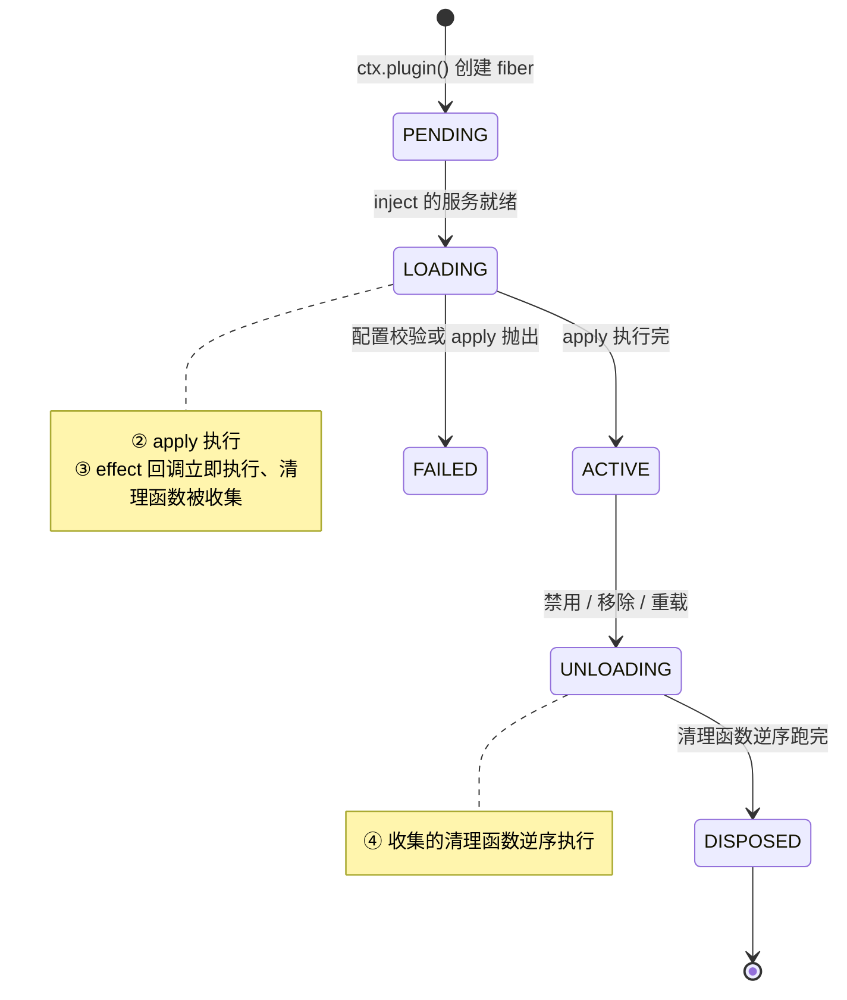
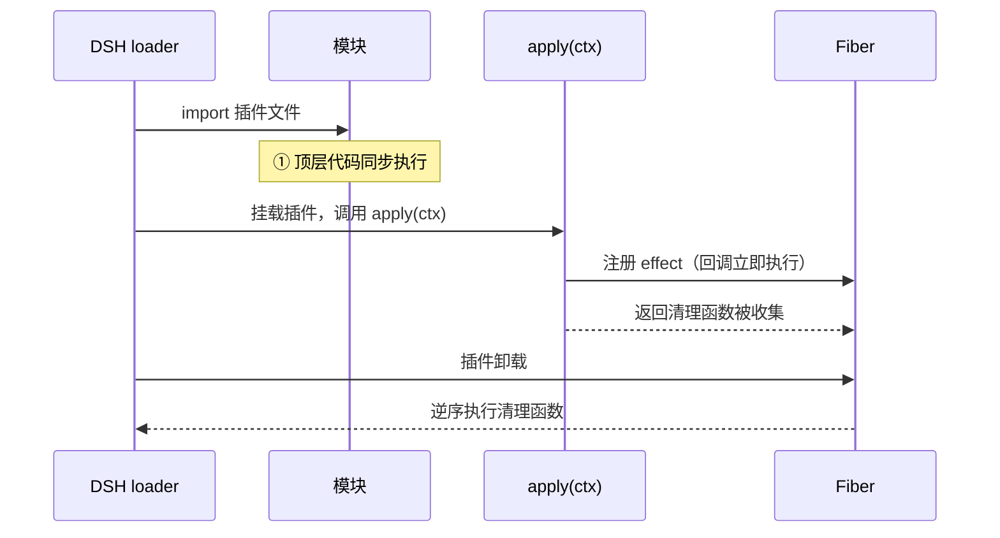

> **读完这篇你能**：说清插件从加载到卸载的四个阶段，知道什么该交给 `ctx.effect` 管理。
>
> **前置**：[注册 HTTP 路由与注入页面样式](04-注册 HTTP 路由与注入页面样式.md)。约 15 分钟。
>
> **示例代码**：[dsh-effect-func](https://github.com/anthonyzhao-4926/blog/tree/main/code/dsh_plugin/dsh-effect-func)

[上一篇](04-注册 HTTP 路由与注入页面样式.md)里，我们用了 `ctx.effect(() => webServer.register(...))`，当时留了一句话："`ctx.effect` 下一篇着重讲解"。这篇就把它彻底讲透。

`ctx.effect` 是 Cordis 生命周期的地基。路由、事件监听、子插件……所有"需要随插件卸载而消失"的东西，底层都是它。

## DSH 设计

`ctx.effect` 为什么非写不可，由 Cordis 的三条设计决定（依据 `local/deepseek-harness-dsh-v0.2.0-rc.2/docs/cordis-primer.zh.md` 与 `local/deepseek-harness-dsh-v0.2.0-rc.2/docs/cordis-api/fiber.zh.md`）。

**卸载是常态，所以注册必须可逆。** DSH 的配置热重载默认开着（见 [03 篇](03-用 patch 覆盖 DSH 的默认装配.md)），禁用、启用、重载一行随时发生；架构层面就写明「各项注册都是副作用，会在其插件卸载时撤销」。Cordis 把这条落成机制：提示词片段、工具 schema、适配器、提供方、监听器，全都通过 `ctx.effect()` 或 `ctx.on()` 安装，reload 和 teardown 时按预期撤销。所以「装上去的东西、卸下来时必须拆掉」不是经验之谈，而是框架的默认语义——插件要做的只是登记「拆的时候做什么」。

**fiber 是撤销的归属单位。** fiber 是一个已加载的插件实例，装着它的生命周期状态、校验过的配置和已注册的作用；`ctx.effect()` 就是委托给当前 fiber。每次挂载各建一个 fiber，所以同一个插件挂两次，配置、等待的服务、收集的清理函数互不串扰。卸载就是 dispose 这个 fiber：它收集的清理函数按注册的相反顺序跑完，异步清理也会等到完成。逆序是刻意的——后注册的往往建立在前面的注册之上，拆要倒着拆；实践规则因此建议「teardown 顺序有要求时，把相关工作放进同一个 effect」。而 `ctx.on` 这类辅助方法内部已经把监听器包进了 effect，所以只有拿到「框架不管的资源」（路由注册、定时器、连接）时，才需要像上一篇那样亲手写 `ctx.effect`。

**四个阶段对应 fiber 的状态机。** 源码里 fiber 有六个生命周期状态：`PENDING`（等待必需服务）、`LOADING`（插件回调运行中）、`ACTIVE`（已加载并提供）、`FAILED`（回调或配置抛出）、`UNLOADING`（清理函数运行中）、`DISPOSED`（已移除）（依据 `local/deepseek-harness-dsh-v0.2.0-rc.2/vendor/cordis/src/fiber.ts`）。本篇的①发生在 import 时，fiber 还没创建；②③发生在 `LOADING`；④就是 `UNLOADING` 干的事。apply 之所以不紧跟 import，是因为 `PENDING` 在等 `inject` 声明的服务——挂载时机由服务依赖决定，不由 import 顺序决定。



## 插件生命周期

先看演示插件的完整代码：

```ts
// dsh-effect-func.ts
import type { Context } from '@deepseek-ai/cordis'

export const name = 'dsh-effect-func'

// ① 同步阶段：模块顶层代码随插件加载同步执行（此时 apply 尚未运行）
console.log('[dsh-effect-func] ① 同步阶段：插件模块被加载')

export function apply(ctx: Context) {
    // ② 异步阶段：apply 在插件注册完成后执行（并非加载时立即执行）
    console.log('[dsh-effect-func] ② 异步阶段：apply 执行')

    // ③ effect 回调同步立即执行，返回的清理函数交给框架收集
    ctx.effect(() => {
        console.log('[dsh-effect-func] ③ effect 回调同步立即执行（返回清理函数）')
        return () => {
            // ④ 插件卸载时：框架逆序调用已收集的清理函数
            console.log('[dsh-effect-func] ④ 卸载时：effect 清理函数执行')
        }
    })
}
```

运行结果，日志严格按这个顺序出现：

```text
[dsh-effect-func] ① 同步阶段：插件模块被加载
[dsh-effect-func] ② 异步阶段：apply 执行
[dsh-effect-func] ③ effect 回调同步立即执行（返回清理函数）
[dsh-effect-func] ④ 卸载时：effect 清理函数执行
```


四个阶段其实分属两个大阶段：

- ① 发生在"加载模块"时：JS 引擎 import 这个文件，顶层代码同步执行。此刻 DSH 的插件树还没开始动，`ctx` 还不存在——所以顶层代码里拿不到 `ctx`。
- ②③④ 发生在"挂载插件"时：DSH 把插件插进插件树，loader 调用 `apply(ctx)`。`apply` 一执行，里面的 `ctx.effect` 回调同步、立即执行一次；它返回的清理函数被框架收起来，等插件卸载时再放出来执行。

配一张时序图：



## fiber 实例

前面的时序图里出现了一个词：Fiber。它是理解 effect 绕不开的主角，先花半分钟认识它。

fiber = 一个插件的一次运行实例。

- 每次插件被挂载，Cordis 就创建一个 fiber。DSH 的插件树里，每个节点其实就是一个 fiber。
- 同一个插件被挂载两次（比如在两个地方各启用一次），就有两个各自独立的 fiber，互不干扰。

## 清理的必要性

[注册 HTTP 路由与注入页面样式](04-注册 HTTP 路由与注入页面样式.md)那篇里我们写过这么一段：

```ts
ctx.effect(() => webServer.register({
    kind: 'exact',
    path: IMAGE_URL,
    handler: ...,
}))
```

当时说了一句"不用 `ctx.effect` 也能注册进去"。没错，能注册，但后果是：

1. 插件被禁用（卸载）时，路由还在；
2. 下次再启用插件，`webServer.register` 对同一条 `(kind, path)` 直接抛 `duplicate exact route`——因为 DSH 把路由当"组合级契约"，撞了就是配置错误。

所以规律很朴素：凡是"你装上去的东西、卸下来时必须拆掉"的，就交给 `ctx.effect`。

---

**下一篇**：[用 Config schema 声明插件配置](06-用 Config schema 声明插件配置.md)——把写死的图片路径和透明度挪进 `Config`，换图改配置就行。

排障和查阅去[profile 与插件包结构](参考/profile与插件包结构.md)；`ctx` 上还有 `inject`、`on`、`plugin` 等能力，见 [Cordis API 文档](../dsh/cordis_api.md)。
