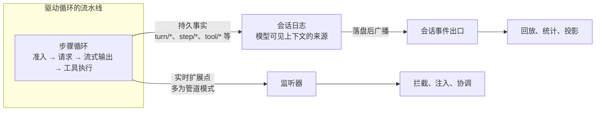
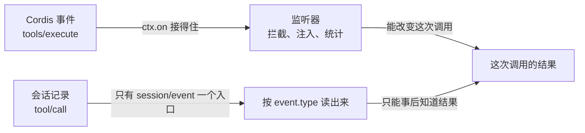
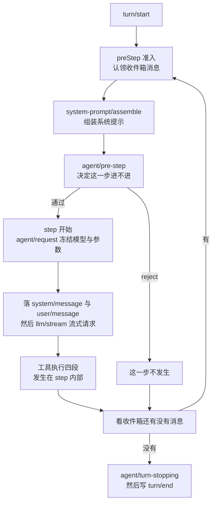

> **事件清单**：[事件生命周期](参考/事件生命周期.html)——每个事件什么时候发生、能用来做什么、如何监听。
>
> **读完这篇你能**：分清 DSH 里"事件"和"会话记录"两种东西；说清一次对话从进程启动到退出，事件是按什么结构发生的；知道为什么顺序和嵌套关系会影响你该监听哪一个。
>
> **前置**：[09-订阅 DSH 事件与五种分发模式](09-订阅 DSH 事件与五种分发模式.md)。约 20 分钟。
>
> **DSH 版本**：0.2.0-rc.2

[09-订阅 DSH 事件与五种分发模式](09-订阅 DSH 事件与五种分发模式.md)那个计数器，我用了三个事件就凑出来了：谁调了工具、调了几次、成没成。当时觉得，事件这东西挺简单啊。

后来我想干的事变复杂了——模型要调某个工具之前，我得先看一眼再放行。这一下就不够用了：光"工具调用"这一件事，前后就冒出四五个名字长得差不多的东西。我把 DSH 的事件表翻出来，一百多个，平铺在那儿，像一团乱麻。

翻久了才看明白，它们根本不是一张平铺的表，是**一条链**——有先后、有嵌套、有循环。顺序错了、地方挂错了，监听器要么永远不响，要么响的时候事情已经过去了。这篇讲的就是这条链长什么样；至于每个事件叫什么、什么时候发、怎么监听，全在 [事件生命周期](参考/事件生命周期.html) 里，正文不重复罗列。

## DSH 设计

一百多个事件名看着像乱麻，其实要先分清两种东西。一种是「事件」：组件之间「喊一声」的通信，谁关心谁挂监听器；其中管道（waterfall）模式的监听器还握有一个放行开关，能改写甚至否决这件事。另一种是「会话日志」：每次对话逐条落盘的事实记录，里面的一行叫一条「会话记录」，模型看到的上下文就是从这里投影出来的。本篇讲的结构，就是这两样东西怎么排布。

一条流水线，两种出口。生命周期文档把分工写成一句话：持久的可回放事实经 `session/event` 送出——它是会话日志每落一条记录就广播一次的出口；实时控制与状态放在 `agent/*` 里——名字以 agent 开头、携带正在运行的那个对话实体的事件。需要可回放记录的消费前者；后者是实时协调接口，管队列与状态、提示词拦截、请求构造、错误处理。「能改变这次调用」的只有实时事件，「重启后还在」的只有落盘的记录：分工是设计出来的，不是命名巧合。两边因此常有名字长得很像的一对：`tools/execute` 是「这次工具调用正在执行」的实时事件，`tool/call` 是「这次调用发生过」的落盘记录——它们描述同一件事的两个出口。

分界就画在事件名上。架构文档的轮次流程把节点分成两类：`turn/*`、`step/*`、各类消息和 `tool/*` 是持久会话事件，先写进日志、再广播出去；其余是实时扩展点。实时扩展点里，决定「要不要放行」的那几个——`agent/pre-step`、`agent/request`、`llm/stream` 和三个 `tools/*`——恰好都是管道模式。框架把「能被改变的决定」做成管道，把「已经发生的事实」写成记录，所以拦截点恰好是那几个名字。还有一个容易记错的顺序：「模型要调某个工具」这条记录写在准入管线之前——先记下事实，再决定批不批，哪怕不批，日志里也不缺这一笔。

轮次的形状则由驱动循环的结构决定。架构文档定义：一个「步骤」（step）是一次模型请求加上它调用的工具；一个「轮次」（turn）包含零个或多个步骤，在领取首条输入之前打开、不再欠下任何工作时关闭。所以一次对话里有两处会转圈：步骤的重复来自「工具还欠着一次请求，或下一步输入已到」；轮次的开阖来自「不再欠工作时才关闭」。事件的顺序不是一张时间表，是这个循环结构的展开。

监听之前，先定位自己要的东西在图的哪一条分支上：落盘那一支要的是事实，实时那一支要的是时机。挂错一支，要么永远不响，要么响的时候事情已经过去。

## 事件与会话记录

这是踩坑最多的地方，我花了一个晚上才把这两样东西摘清楚。

**一种是 Cordis 事件。** 你可以把它想成有人在车间里喊了一嗓子："我要动这个工具了！"谁想管谁接话，喊的人并不知道有几个人在听。管道模式（waterfall）的事件还要更狠一点：接话的人能把喊话内容改掉，甚至干脆让这件事不发生。拦截、注入、统计，全是靠它做的。

**另一种是会话记录。** 这些是已经落进会话文件的事实，比如"这次工具调用发生过"。它也能被看见，但只有 `session/event` 这一个入口，进去再看 `event.type` 是哪一条。它记的是"发生过什么"，改不了。

麻烦的是事件与会话记录这俩名字长得太像：`tools/execute` 是事件，`tool/call` 是记录；`approval/request` 是事件，`approval/decided` 是记录。接前一个的话，你能改变这次调用；接后一个，只能事后知道结果。

那怎么分辨？每个事件是哪种，[事件生命周期](参考/事件生命周期.html) 里已经逐个标好，直接查就行——记录类在清单里单列着，点开也会写明"会话日志记录"。真要去源码里确认，搜事件名本身：带函数签名的是事件，带类型映射的是记录。

## 一次对话的流程

我把一次对话当成一条流水线：进程是厂子开门，一轮对话是一张订单，一步是一道工序。真正定下顺序的是 `packages/core/agent-loop/src/agent.ts` 里的 `turn()` 和 `step()` 两个函数，我们顺着它走一遍。

### 进程启动

厂子开门的时候，插件树是一个 fiber 一个 fiber 配置的。每个 fiber 的建立和销毁，都会派发一次同名的 `internal/plugin`；配置解析、热重载也各有自己的事件。

这一段跟"跑哪一轮对话"没关系，进程活着它就一直有效。它属于 Cordis 框架，不属于 harness。但你要是想查"插件到底装上没有"，这是最直接的一条路。

### 会话建立

一个会话先被公告（`session/created`），接着 agent 发布到注册表，派发 `agent/created`。它按注册顺序 await 完所有监听器，这次发布才算完成，时机在第一个 turn 之前，很适合做会话级初始化。

不过我得提醒一句：它的 `source` 有四种——新建、恢复、清空、压缩——恢复就是同一个会话再来一次。所以别把"只初始化一次"的假设全押在它身上。

### 一轮对话

一轮由 `turn()` 打开：先写一条 `turn/start` 记录，然后进入 `while (true)`。每一步先过准入，通过就跑一个 step，跑完看看收件箱里还有没有待处理的消息——有就再跑一步，没有就关掉这一轮。

准入那一步（源码里叫 `preStep()`）其实叠着好几件事，这正是我一开始记错的地方：它先从收件箱认领这一步要用的消息，再组装系统提示（往提示词里加东西就是在这儿，派发 `system-prompt/assemble`），最后才派发 `agent/pre-step` 决定这一步进不进。

所以有个嵌套关系要记牢：**`system-prompt/assemble` 发生在 `agent/pre-step` 里面，不是和它并列。**

`agent/pre-step` 也是唯一能拦住某一步的地方——返回 reject，这一步就直接不发生。

### 一步里面

一道工序（`step()` 函数）内部还有一层：先冻结这次请求的配置（`agent/request`，想换 provider 或 model 就趁这里），把系统提示（`system/message`）和用户消息（`user/message`）落进日志，然后才开始流式请求（`llm/stream`）。

**这一层要用的模型和参数，在 `agent/request` 之后就定死了。** 晚一步，窗口就关了。

### 工具调用那四段

模型如果决定调工具，整段工具执行发生在 `step()` 里面、模型输出之后。它**不是独立的一步**，是这一步的一部分。

这段自己又是一条四步管线，顺序固定：

- `tools/pre-execute`：决定批不批——放行、拒绝，还是转人工审批。
- `tools/execute`：唯一包着工具本体的那一层。
- `tools/post-execute`：决定结果要不要改写或者拦掉。
- `tools/result`：冻结之后的只读广播。

想拦危险调用挂第一个，想统计耗时挂第二个，想改结果挂第三个。

还有个细节值得单独记一笔：`tool/call` 这条记录出现在 `tools/pre-execute` **之前**。DSH 先老实写下"模型要调这个工具"，再去走审批——哪怕审批被拒，日志里也不缺这一笔。

### 分叉

子代理和工作流是另开一条线去跑：派出去建一个子运行，跑完收回来，start 和 end 成对。工作流还会按脚本里的阶段派发进度事件。

它们不改变主线的顺序，只是在某个时刻分叉出去。

### 收尾

`agent/turn-stopping` 在 turn 快要关掉的时候派发，是最后的挽回机会——可以在这里让 agent 再读一次收件箱接着跑。之后写 `turn/end`，agent 回到空闲。会话和 agent 被回收时各有对应的事件，最后是进程退出。

## 有两处会转圈

顺着走一遍，容易以为这条链是一次走完的，其实中间有两段会重复：

- **每个 step 重复一次**：准入 → 请求 → 模型 →（可能要）工具执行。
- **每轮对话重复一次**：一轮结束，收件箱里还有消息，就回到 turn 起点再开一轮。

剩下的都是一次性的：进程启动、会话建立、分叉、收尾、进程退出。

## 事件还挑听众

多数跟 agent 有关的事件都带作用域标签，只派发给"跟这个 agent 有关系"的监听器。你在别的作用域里注册，就收不到。

反过来，没有作用域标签的监听器——比如直接挂在进程根上的插件——全都能收到。[09-订阅 DSH 事件与五种分发模式](09-订阅 DSH 事件与五种分发模式.md)那个统计插件能统计整个进程，就是这个原因。想按 agent 分开算，就得进到那个 agent 的作用域里去注册。

## 知道顺序有什么用

结构清楚了，三件事跟着就顺了。

**别把记录当事件监听。** `turn/end`、`tool/call` 这些名字读起来特别像事件，可它们不在 Cordis 的 `Events` 表里——`ctx.on` 的事件名就是这张表的键，所以类型检查会直接拦下来；真绕过类型去注册，也永远不会触发。要读它们，只有 `session/event` 一条路。

**拦截点选错，等于没拦。** 想拦一次工具调用就挂 `tools/pre-execute`；挂 `tools/result` 只能看到它已经跑完了。想知道"这一步到底会不会发生"，只有 `agent/pre-step` 能回答。

**嵌套关系就是 deadline。** 在一个 step 里，模型参数在请求阶段就冻结了，想换模型得在 `agent/request`——而它已经被包在准入之后。晚一步，就没机会。

## 几个提醒

- **源码、文档、运行时可能三个版本三样。** 这篇的结构是我读仓库里的 `local/deepseek-harness-dsh-v0.2.0-rc.2/` 读出来的，你机器上 `dsh --version` 很可能不一样，同名事件的声明位置、分发模式与派发点都跟着版本走。跨版本的时候，以 `node_modules/@deepseek-ai/*` 的类型声明为准。
- **顺序靠实测校，别只信声明。** 声明里只有签名和分发模式，不写谁先谁后。上面每条顺序关系，都是我从 `agent.ts` 的调用结构里读出来的，个别还拿一次 headless 运行的时间戳对过。想自己看，最省事的做法是在 [09-订阅 DSH 事件与五种分发模式](09-订阅 DSH 事件与五种分发模式.md)那个插件里多订阅几个事件，日志上带一行时间戳。
- **一个事件名只有一种分发模式。** `emit` 的用 `ctx.emit`，`waterfall` 的必须接 `next`。给自己的插件加事件时，照抄旁边声明的 `@mode`，别自创。
- **监听器要短。** 准入、请求、工具执行都在热路径上，你的监听器慢一点，模型每一步都跟着慢一点。

---
