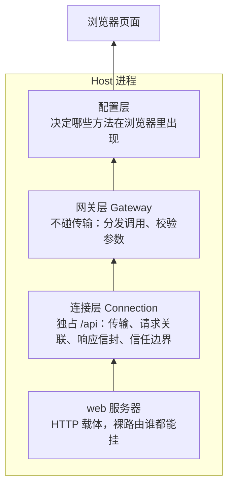
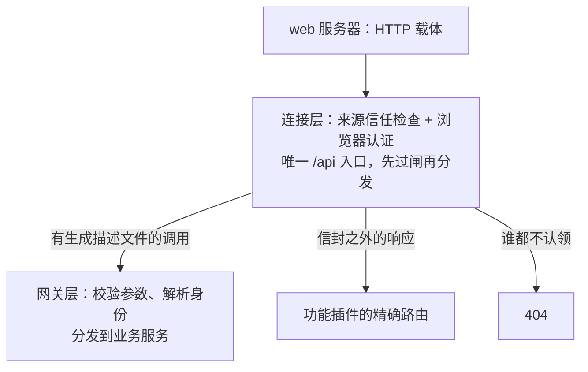
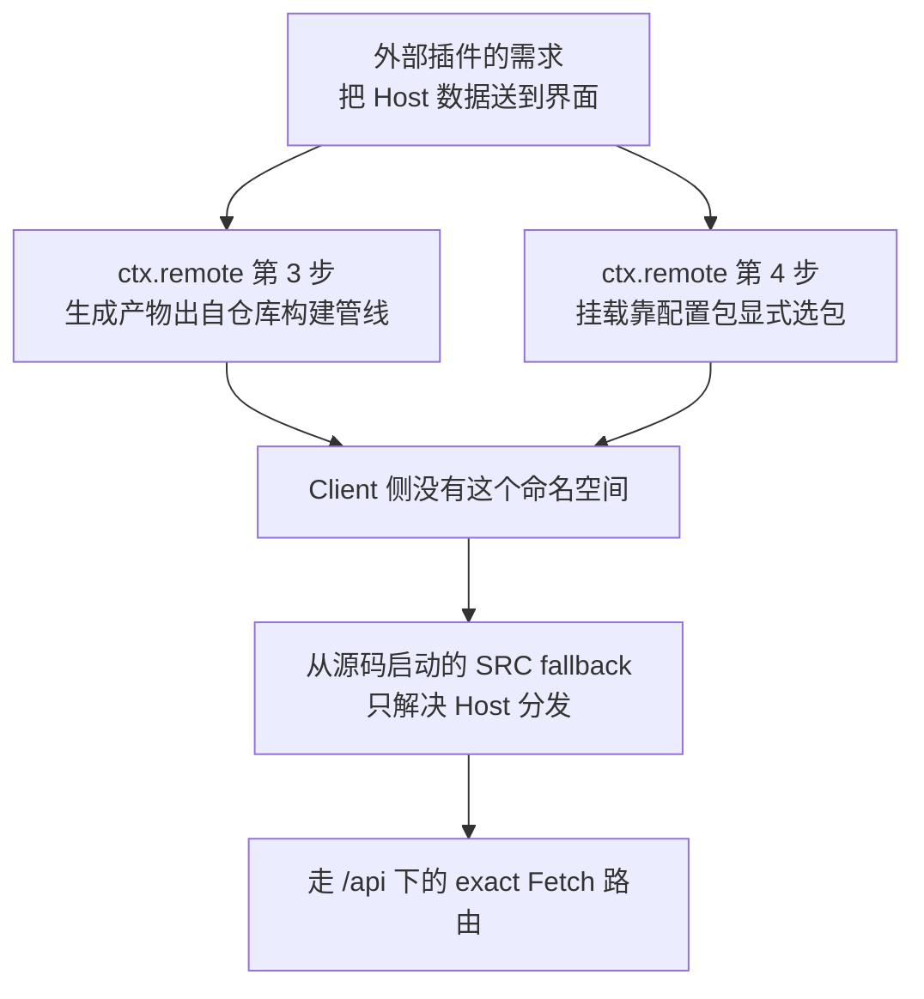
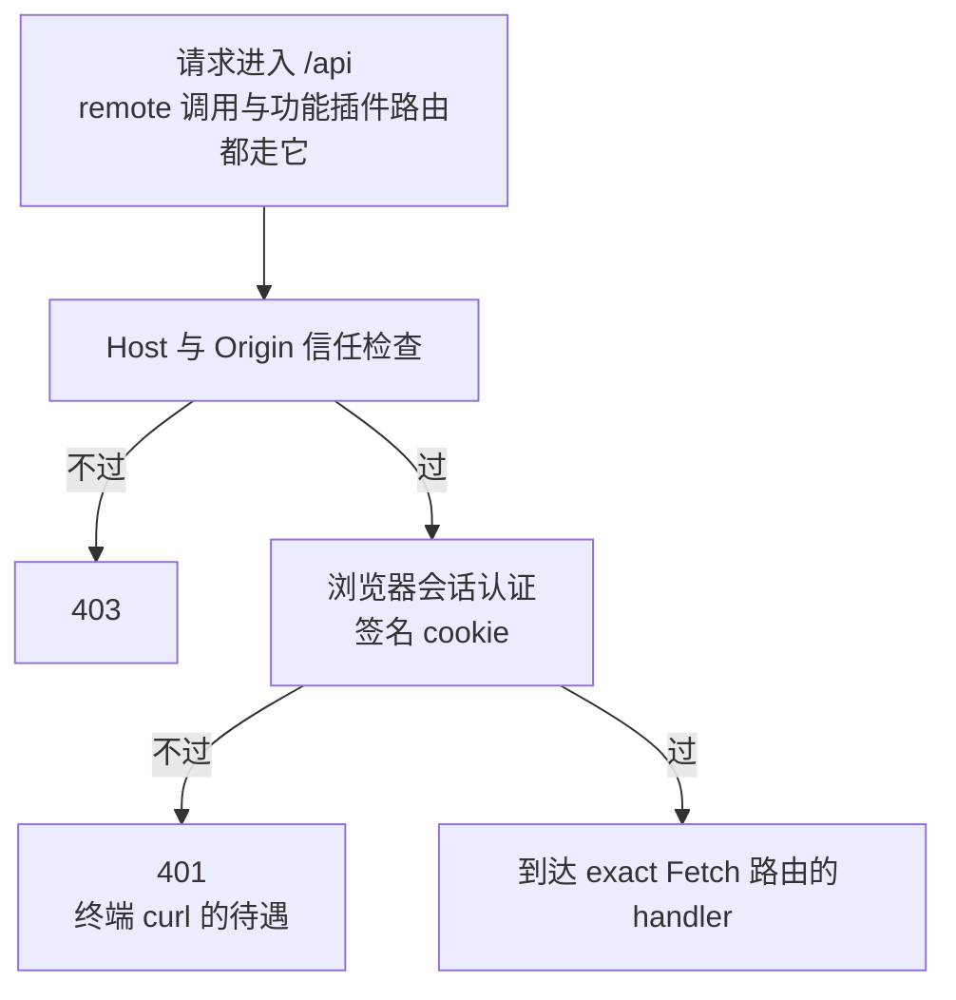
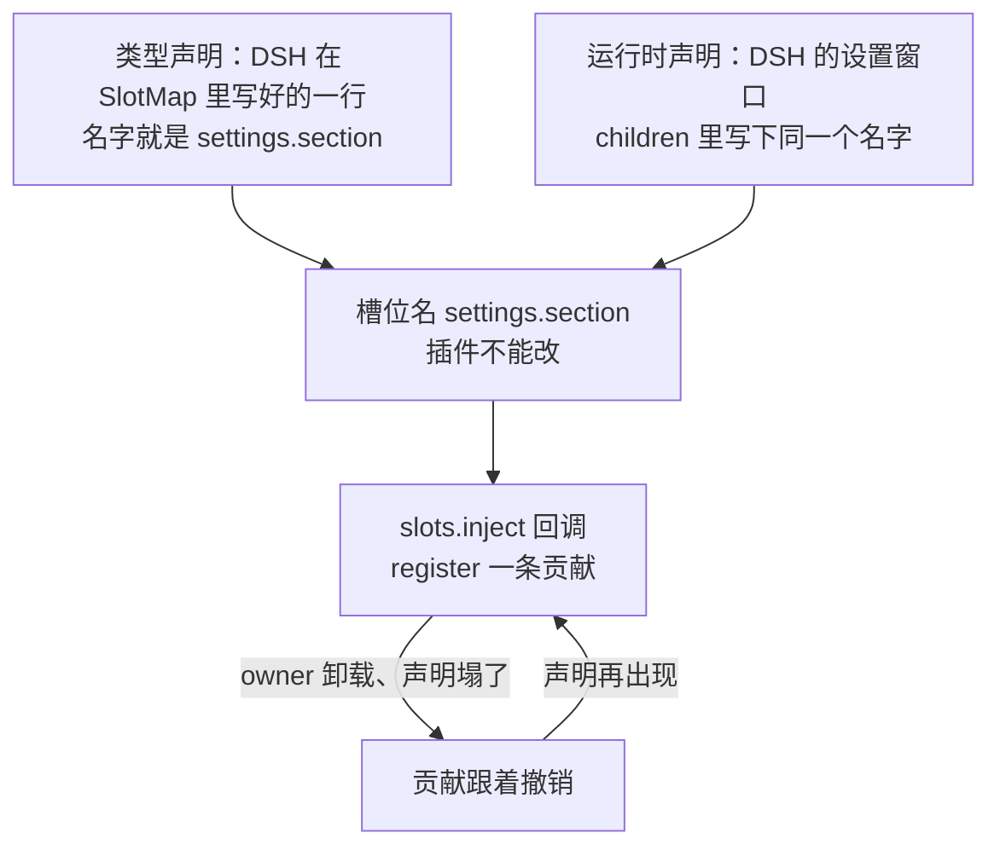

---

## title: 15-把 Host 数据展示到界面

date: 2026-09-30
tags:

- ai
- dsh
column: dsh-plugin
order: 15
viewable: true

> **读完这篇你能**：把插件在 Host 进程里攒下的数据送到浏览器——仓库内插件走 `ctx.remote` 五步，外部插件走 `/api` 下的一条 Fetch 路由；并把展示挂进设置页的 `settings.section` 槽位。
>
> **前置**：[14-把插件配置搬进设置页](14-把插件配置搬进设置页.md)。约 35 分钟。
>
> **示例代码**：[dsh-note-stats](https://github.com/anthonyzhao-4926/blog/tree/main/code/dsh_plugin/dsh-note-stats)
>
> **DSH 版本**：0.2.0-rc.2

[11-为模型注册自定义工具](11-为模型注册自定义工具.md)的 `note_search` 跑起来之后，我想知道的很朴素：工作区里现在有多少篇笔记、最近都搜过什么关键词。统计本身不难——[09-订阅 DSH 事件与五种分发模式](09-订阅 DSH 事件与五种分发模式.md)订阅 `tools/result` 的手法原样搬过来就能攒出来。难的是另一半：数据在 Host 的 Node 进程里，页面在浏览器里，中间隔着一层 HTTP。

[14-把插件配置搬进设置页](14-把插件配置搬进设置页.md)讲过「一个包两半」：Host 半跑在 Node 进程，浏览器半从 `exports['./client']` 进页面。这篇把两半之间的数据通道打通，并把展示挂到界面上。

## 目标

- 一个插件包 `dsh_plugin/dsh-note-stats/`：Host 半订阅 `note_search` 的调用事件做统计（多少次、最近查过什么），数一遍笔记目录，把结果挂在 `/api/dsh-note-stats/stats`；浏览器半在设置页注册一节「笔记统计」，把这份 JSON 渲染出来。
- 顺带把仓库内插件的正规路 `ctx.remote` 讲清楚：五步各做什么、失败怎么表达、为什么我们的外部 demo 走不了它。

## DSH 设计

浏览器里的页面和 Host 进程之间隔着一层 HTTP，源码把这段路切成四层来管。最底下的 web 服务器只是 HTTP 载体，谁都能往上挂裸路由；它之上的连接层（Connection）独占 `/api` 这一个入口，传输、请求关联、响应信封（请求与响应在线上的包装格式）和信任边界都归它；再往上是网关层（Gateway），它不碰传输，只管把「浏览器像调本地函数一样调 Host」的调用分发给正确的业务服务、校验参数；最顶上的配置层决定哪些业务包的方法会在浏览器里出现。




一个请求过了连接层的闸之后，分发顺序是固定的：先按路径逐字匹配各插件注册的精确 Fetch 路由；没人认领再交给网关，它也只认领存在严格描述文件的两段式调用，比如 `POST /api/noteStats/summary` 这种「命名空间/方法」形态；都不匹配就 404。

`/api` 这同一个分发入口里，并存两种认领方式。一种是类型化调用：浏览器写 `ctx.remote.noteStats.summary()`，像调本地异步函数，方法名、参数、返回值全有生成的类型约束，失败按错误码分支。另一种是自己挂一条 `/api` 路由：URL 是字符串，请求和响应两边各自约定，失败就是普通 HTTP 状态码。两者不是正规路与旁门的关系，设计文档给后一种留了正式的一格：「需要 RPC 信封之外响应的功能，注册精确的 Connection Fetch 路由」。内置的会话记录下载、原始文件上传走的就是这种精确 Fetch 路由，本篇的统计数据也一样。

打个比方。假设 Host 上有个能查天气的服务，浏览器想知道「深圳现在多少度」。走类型化调用，浏览器写的是：

```ts
const result = await ctx.remote.weather.current({ city: '深圳' })
// result 的类型是生成好的：{ ok: true, value: { temp: number } } | { ok: false, error: { code: string, message: string } }
```

方法叫 `current`、参数必须是 `{ city: string }`、返回的 `value` 里有个数值 `temp`，这些 IDE 全知道，写错当场红线。线上则由网关把这次调用包进信封，POST 到 `/api/weather/current`。走 `/api` 路由，浏览器写的是：

```js
const response = await fetch('/api/weather/current?city=深圳')
const data = await response.json()  // data 是 any，里面有没有 temp 全凭两边口头约定
```

URL 是手拼的字符串，失败就看 `response.status`；Host 那边是一个普通的 Fetch handler，收 `Request`、回 `Response`。两个请求在 `/api` 入口的待遇完全一样：过同样的两道闸，只是一条被网关认领（它找得到 `weather/current` 的描述文件），另一条被插件注册的精确路由认领。

自己写的插件不能使用类型化调用。类型和校验规则是构建时从 DeepSeek Harness 源码仓库生成的，浏览器侧再由仓库里一份写死的清单挂到 `ctx.remote` 上（下文的「仓库内」「仓库外」都指这个源码仓库）。仓库外的插件两样都没有，浏览器里不会出现自己的命名空间，数据只能走 `/api` 路由。

最后是 `/api` 的鉴权。它是连接层的信任边界，不是每条路由自己的事。每个打到 `/api` 的请求先过两道闸。第一道是来源信任检查：请求报头里的 `Host` 必须是本机回环地址，或匹配信任清单；附了 `Origin` 就必须和 `Host` 一致；标记为跨站的浏览器请求一律拒绝。不过返 403。这道闸防的是 DNS 重绑定和跨站浏览器请求，源码特意注明这些检查「绝不建立身份」。第二道才是浏览器会话认证：进程启动时铸一个随机令牌，打印出来的页面 URL 带上它，浏览器首次访问时拿它换一枚签名 cookie，之后每次请求自动携带；cookie 缺失、过期或对不上，返 401。

过了闸才轮到前面说的分发。所以在终端里 curl 一条 `/api` 路由拿到 401，不是这条路由设了防，是 `/api` 之下的任何流量（remote 调用、精确路由、WebSocket 升级）都先过这两道闸；web 服务器上的裸路由不在这道边界里，静态资源保持公开，才有谁都能访问的待遇。




数据到了浏览器，还要决定摆在页面的哪个位置。DSH 的页面由一个个有名字的槽位（slot）拼出来，插件往一个已经声明好的槽位注册组件。本篇用的是设置页的 `settings.section`：注册进去，导航里就多一节「笔记统计」。槽位怎么声明、组件拿到什么参数，后面单独讲。

到这里，数据出 Host 的路就清楚了：类型化调用只对源码仓库里的插件开放，`/api` 路由任何插件都能挂，界面上的位置则注册进已声明的槽位。

## 数据出 Host 的三条路


| 路                                                              | 注册方式                            | 鉴权                       | 谁能用   |
| -------------------------------------------------------------- | ------------------------------- | ------------------------ | ----- |
| webServer 裸路由（[04-注册 HTTP 路由与注入页面样式](04-注册 HTTP 路由与注入页面样式.md)） | `ctx.webServer.register`        | 无——谁都能 curl              | 任何插件  |
| `/api` 下的 Fetch 路由                                             | `ctx.connection.fetch.register` | Host/Origin 检查 + 浏览器会话认证 | 任何插件  |
| `ctx.remote` 类型化调用                                             | `@Remote` + 生成管线                | 同上，外加参数校验与失败码表           | 仓库内插件 |


[04-注册 HTTP 路由与注入页面样式](04-注册 HTTP 路由与注入页面样式.md)走的是第一条：图片是公开资源，不需要鉴权。这篇的统计数据只想给「打开这个页面的浏览器」看，走第二条。第三条是 DSH 自己所有界面数据的通道，外部插件用不上，但读 DSH 源码、看内置插件怎么干活时处处是它，所以先讲它。

## `ctx.remote` 五步

仓库的 `docs/cookbook/adding-a-remote-api.md` 把加一个 remote 端点拆成五步：声明方法、声明失败、注册到包、Client 消费、测试。逐步看。

### 声明方法

主人是 Host 侧的一个 Cordis 服务：继承 `TypertRemoteService`，把服务 key 和线上命名空间绑在一起，要暴露的方法标 `@Remote`：

```ts
import type { Context } from '@deepseek-ai/cordis'
import { Remote, TypertRemoteService } from '@deepseek-ai/dsh-typert-protocol'

/** 浏览器读到的一份统计。 */
export interface NoteStatsSummary {
    readonly notes: number
    readonly calls: number
}

declare module '@deepseek-ai/cordis' {
    interface Context {
        noteStatsController: NoteStatsController
    }
}

export class NoteStatsController extends TypertRemoteService {
    constructor(ctx: Context) {
        // 服务 key 是 noteStatsController，线上命名空间是 noteStats
        super(ctx, 'noteStatsController', { namespace: 'noteStats' })
    }

    /** @returns 当前的笔记数与调用数。 */
    @Remote('summary')
    async summary(): Promise<NoteStatsSummary> {
        return { notes: 0, calls: 0 }
    }
}
```

没标 `@Remote` 的方法不进生成的 Client 类型，也调不到。方法签名有几条硬约束：不能是泛型；参数必须是必填的简单标识符（不能有默认值、解构、剩余参数）；要支持协作取消就把 `signal: AbortSignal` 放在最后一个参数；`Agent`、`Session` 这类 Host 对象不能直接过线，只能占顶层参数位置，由网关在调用前从线上的 id 解析回对象。

### 声明失败

Remote 失败只有一个类 `RemoteError`，加一张用声明合并扩的 code 表 `RemoteErrorDetailsMap`。code 形如 `<域>/<原因>`，在失败点 `throw new RemoteError(code, message, details)`：

```ts
import { RemoteError } from '@deepseek-ai/dsh-typert-protocol'

declare module '@deepseek-ai/dsh-typert-protocol' {
    interface RemoteErrorDetailsMap {
        /** 笔记目录不存在或不可读。 */
        'note-stats/root-missing': { readonly root: string }
    }
}

// 失败点：
throw new RemoteError('note-stats/root-missing', `cannot read ${root}`, { root })
```

不要造一族自己的错误类，也不要写「异常翻译成 code」的出口函数：和端点无关的异常不做预分类，网关会把它折进 `gateway/internal`。`catch` 只在一种情况下写——把一个第三方异常归类成自己的某个域 code，并把原异常挂到 `cause` 上。

### 注册到包

`@Remote` 必须落在 Loader 条目插件包里。包的 `package.json` 多出两个导出和一个 peer 依赖：

```json
{
  "exports": {
    "./typert": { "types": "./lib/typert.host.d.ts", "default": "./lib/typert.host.js" },
    "./remote": { "types": "./lib/typert.remote-client.d.ts", "default": "./lib/typert.remote-client.js" }
  },
  "peerDependencies": { "@deepseek-ai/dsh-typert-protocol": "workspace:*" }
}
```

这两个导出指向的是**生成产物**：`./typert` 给 Host 的 Loader（运行期描述与 schema 注册值），`./remote` 给 Client（描述、编解码器、类型合并）。改了签名、code 表、命名空间或导出名，要重跑 `pnpm run build:lib` 重新生成；只改方法体不用。

### Client 消费

调用方插件在 `inject` 里同时声明 `remote` 和 `remote.<命名空间>`，调用点直接写 `ctx.remote.<命名空间>.<方法>()`：

```ts
import { isRemoteFailure } from '@deepseek-ai/dsh-api-gateway/client'
import type {} from '@deepseek-ai/dsh-api-remotes/client'

export const inject = ['remote', 'remote.noteStats']

/** 失败码有意义的地方就地分支。 */
export async function noteCount(ctx: Context): Promise<number> {
    const result = await ctx.remote.noteStats.summary()
    if (!result.ok) {
        if (result.error.code === 'note-stats/root-missing') return 0
        throw result.error
    }
    return result.value.notes
}
```

返回值是 `RemoteResult<T>`——`{ ok: true, value }` 或 `{ ok: false, error }`。Remote 调用**不 reject**，所以用 `if (!result.ok)` 就地分支，按 `code` 判别而不是 `instanceof`（code 分支会自动收窄 `details` 的类型）。想要异常流就 `throw result.error`——它是真 Error；接住的人用 `isRemoteFailure` 区分 remote 失败和本地缺陷，缺陷继续抛。不要写防御性 catch：调用不 reject，配置错误就该崩。

### 测试

Host 侧断言抛出去的 code：用 `remoteErrorOf` 从捕获的异常里取回失败，再 `toMatchObject` 比对 `code` 和关心的 details 字段——不用 `toEqual` 深比整个错误对象，也不断言 `instanceof`。Client 侧用 `@deepseek-ai/dsh-client-test-runtime` 的 `TestRemote` 造一个返回真实 `RemoteError` 实例的替身。

## 失败词汇表

上一节的 code 表就是「失败词汇表」：一个类、一张表、一套放置规则。规则四条：

- **只有一个生产者**：声明在生产它的包里，挨着 throw 的地方。
- **几个包都产生它**：声明在它们共同依赖的最低域包（比如 `session/not-found` 在 `core/session`）。
- **载体三码直接用，别抄**：`gateway/bad-request`（参数没过校验）、`gateway/cancelled`（调用被取消）、`gateway/internal`（载体、分发或未归类的 Host 失败）声明在 protocol 包里。
- **不过线的失败不进表**：一个永远不会跨进程的本地失败，用调用方自己的类型表达。

调用方主动取消一次调用时，错误分支上看到的是 `gateway/cancelled`，而不是异常。

## 为什么 demo 走 `/api`

五步里有两步卡在外部插件进不去的地方：

- **第 3 步的生成产物来自仓库的构建管线。** `typert-generator` 在 `pnpm run build:lib` 里以整个 Host 聚合为 `ts.Program` 跑，把 `lib/typert.remote-client.`* 写进每个贡献包自己的 `lib/`。外部插件不在这场构建里。
- **第 4 步的挂载由 `dsh-api-remotes` 配置显式选包。** 浏览器里的 `ctx.remote.<命名空间>` 不是自动发现的：这个配置包把选中的 `/remote` 贡献逐个 `ctx.remote.$mount()` 上去。外部插件的命名空间不在它的选择清单里，现成的 web 客户端上就不会出现。

Host 侧倒是有个退路：从源码启动时（`node --import tsx/esm`），装饰器仍会在服务原型上留下标记，网关能为它构造一个较弱的临时描述符（SRC fallback）。但这个退路只解决 Host 分发——Client 不认识装饰器，拒绝挂载没有严格编解码器的 SRC 描述符。

所以结论很实际：**外部插件要往界面送数据，走 `/api` 下的 exact Fetch 路由。** 这正是它的设计用途——cookbook 里那句「需要 RPC 信封之外响应的功能，注册一条 exact Fetch 路由」。




## `/api` 路由

`/api` 这个路径属于 Connection（`@deepseek-ai/dsh-client-connection` 的 Host 半，服务名 `connection`）。Remote 调用也走它：`ctx.remote.noteStats.summary()` 在线上就是 `POST /api/noteStats/summary`。Connection 在分发之前先做两道检查：Host/Origin 信任检查（不过返 403），浏览器会话认证（不过返 401）——进程启动时铸一个随机 token，打开页面的 URL 带上它，换成一个签名 cookie 之后每次请求自动携带。




功能插件往 `/api` 下挂自己的路由，用 `ctx.connection.fetch.register`：

```ts
ctx.inject(['connection'], (connCtx) => {
    connCtx.connection.fetch.register({
        path: '/api/dsh-note-stats/stats',   // 必须以 /api/ 开头，逐字匹配
        methods: ['GET'],                    // GET / HEAD / POST
        requestBody: 'buffered',             // buffered 有请求体上限；streaming 走背压
        fetch: async (request) => new Response(JSON.stringify(await snapshot()), {
            headers: { 'content-type': 'application/json; charset=utf-8' },
        }),
    })
})
```

和 [04-注册 HTTP 路由与注入页面样式](04-注册 HTTP 路由与注入页面样式.md)的 `webServer.register` 三处不同：

- **handler 是 Fetch 形态**：收 `Request`、返回 `Response`，不是 `node:http` 的 `(req, res)`。
- **鉴权在到达 handler 之前**。终端里 `curl` 这条路由只会拿到 401——它没有 cookie。浏览器页面里同源 `fetch('/api/...')` 自动带 cookie，什么都不用管。
- **注册内部已经是一次 effect**（`register` 把注销绑进调用方的 fiber）：插件卸载，路由跟着消失，不用再像 [04-注册 HTTP 路由与注入页面样式](04-注册 HTTP 路由与注入页面样式.md)那样自己包一层 `ctx.effect`。重复注册同一个 path 照样抛错——路由是组合级契约。

`ctx.inject(['connection'], ...)` 的写法和 [09-订阅 DSH 事件与五种分发模式](09-订阅 DSH 事件与五种分发模式.md)等 `webServer` 一样：统计本身不依赖 HTTP，headless profile 里没有 connection 服务，回调不执行，统计照样攒。

## slot 的声明归属

数据到了浏览器，往哪儿摆？DSH 的页面不是一整个 React 树由一个人写，而是**槽位（slot）体系**：每个可扩展的位置有一个名字，谁想往那儿放东西就注册一条贡献。

本篇要挂的位置叫 `settings.section`，`settings.section 是DSH 内置的槽位名，不可自定义。`

- **类型声明。** `@deepseek-ai/dsh-client-ui-settings` 的 `SlotMap` 里有一行 `'settings.section'`。有这行，写成这个名字才不报类型错。它不往页面上画任何东西。
- **运行时声明。** 设置窗口在 `ui-settings-general`，打开设置看到的左边按钮和右边内容就是它画的。它在 `children` 里再写一遍 `'settings.section'`，右边才有这个位置，然后用 `renderSlot('settings.section', ...)` 把点中的那一节画进去。示意图见[设置页槽位](参考/设置页槽位.html)。

插件自己定的是 `id` 和 `label`。`id` 区分点中的是哪一节，`label` 是左边按钮上的字。`name` 必须是 `'settings.section'`。写一个 DSH 没声明过的名字，加载时直接失败。




插件不用关心设置窗口什么时候跑。`ctx.slots.inject` 会等它把 `settings.section` 声明出来再注册；声明没了（设置窗口卸载），这次注册跟着撤；声明再出现就再跑一遍：

```ts
ctx.slots.inject('settings.section', () => ctx.slots.register({
    name: 'settings.section', // DSH 定好的槽位名，必须照抄
    id: 'note-stats',         // 这一节自己的 id
    order: 90,
    label: '笔记统计',         // 左边按钮上的字
}, NoteStatsSection))
```

`label` 可以是普通字符串，也可以是一个 thunk（每次读取时重算，locale 切换时不用重新注册）。

## props 的推导

注册进去的组件**拿不到 `ctx`**。它的 props 是几份拼出来的，每份有各自的声明者：


| 份额               | 谁声明                  | 组件侧怎么来                             |
| ---------------- | -------------------- | ---------------------------------- |
| owner 值 + 作用域标准位 | `SlotMap` 行 + 作用域适配器 | `PropsRuntime<'settings.section'>` |
| 子槽渲染器            | 注册时的 `children`      | `renderSlot` prop                  |
| 共享视图状态           | 注册时的 `store`         | `useStore` / `actions`             |
| 私有数据与回调          | 注册时的 `inject` 工厂     | 原样穿过                               |
| 文案               | 注册时的 `locale` 命名空间   | `t` prop                           |


`settings.section` 的 owner 只给一个值：`close: () => void`（关掉设置面板——壳拥有打开状态）。我们的统计数据壳不知道、也不该知道，走自己的 `inject` 工厂。

`inject` 工厂在插件的 `apply` 世界里运行，可以闭包住注入的 Cordis 服务，但只能返回纯数据和回调。唯一的例外是保留字段 `hooks`：它收**裸 observable**（`getSnapshot` + `subscribe` 两个函数的对象），渲染器把每个源绑成一个 `use<Name>` 选择器钩子放到组件 props 上——`hooks: { noteStats }` 变成 `props.useNoteStats(selector)`。组件自己不写 `useSyncExternalStore`，也永远见不到那个源对象。

```ts
inject: () => ({ hooks: { noteStats: stats }, refresh })
```

三份数据通道怎么选：父组件渲染时就已经知道的值走 owner props；一个条目自己的回调和私有 observable 走 `inject`；跨条目共享、或者要扛住重挂载的视图状态走 `store`。

## 客户端模块的注入

浏览器那半怎么进页面，是 `dsh-client-modules` 这个服务的事（[14-把插件配置搬进设置页](14-把插件配置搬进设置页.md)讲了「一个包两半」的前提，这里讲机制）：

1. **声明**：`package.json` 里写 `dsh.client: { platform: 'web' }`，并且 `exports['./client']` 指向打好的 bundle。
2. **扫描**：client-modules 盯着 Host Loader 的条目，从条目文件的位置**向上找最近的 `package.json`**——所以我们的 patch.yaml 挂的是 `src/index.ts` 源码文件，也算这个包的条目，它旁边的 `package.json` 就是身份。
3. **注入**：每次渲染页面 HTML 时，client-modules 把组合好的启动图答进 `webserver/index-inject`（[04-注册 HTTP 路由与注入页面样式](04-注册 HTTP 路由与注入页面样式.md)见过这个事件），页面里的 `window.__DSH_BOOT__` 就是这张图；bundle 本体由 `/plugins/??<包名>/client.js&rev=<修订号>` 这类组合路由供出。

失败待遇分两档，都值得知道：启动期，已加载条目里有一个声明了 `dsh.client` 但 bundle 缺失或声明畸形，整个服务聚合成一个 `AggregateError` 直接 FAILED——页面起不来，错误里列全所有坏包；运行期（热重载途中）单个包坏了只记一条警告，不拖别人。

bundle 的形态是「懒 CJS 工厂」：脚本执行只做一件事——把 `{ id, factory }` 登记进 `window.__ModuleLoader__`；`factory(require)` 在第一次被 import 时才运行，返回的对象就是浏览器侧 Loader 看到的插件导出（`apply`、`inject`）。`require` 能答的是平台模块表：`react`、`react-dom`、`@deepseek-ai/cordis`、`@deepseek-ai/dsh-client-store`、`@deepseek-ai/dsh-client-ui-slots`、`@deepseek-ai/dsh-client-ui-primitives`、`@deepseek-ai/dsh-client-ui-dockkit`；其余依赖必须打包进这份文件，否则运行即抛。

真实插件的这份文件由打包器生成（DSH 仓库里是 tsdown 的 `clientBundle` 预设，顺带处理 CSS Modules 和 sourcemap）。demo 手写它的最小形态——不引入构建链，也让「bundle 长什么样」看得见。

## 完整代码

```text
dsh-note-stats/                       ← 插件包（bundle）
├── src/
│   └── index.ts                      ← Host 半：事件统计 + /api 路由
├── client.js                         ← 浏览器半：手写的工厂形态 bundle
├── package.json                      ← dsh.bundle + dsh.client 声明
├── patch.yaml                        ← 挂载指令（占位符由 install.sh 填）
├── tsconfig.json
└── install.sh
```

`src/index.ts` 全文：

```ts
/**
 * dsh-note-stats 的 Host 半：订阅 note_search 的工具调用事件做统计，
 * 数一遍笔记目录，把结果挂在 /api 下的一条 Fetch 路由上。
 *
 * 统计手法与 09-订阅 DSH 事件与五种分发模式相同（广播事件 tools/result，结果定型后只观察）；
 * 路由不是 04-注册 HTTP 路由与注入页面样式的 webServer.register，而是 Connection 的 exact Fetch 路由——
 * 它在 /api 下面，到达 handler 之前已经过了 Host/Origin 检查和浏览器会话认证。
 */
import { readdir } from 'node:fs/promises'
import { homedir } from 'node:os'
import { join } from 'node:path'
import type { Context } from '@deepseek-ai/cordis'
import Schema from '@deepseek-ai/schemastery'
// 只引入类型声明（模块增强）：ctx.connection 服务与 tools/result 事件的类型
import type {} from '@deepseek-ai/dsh-client-connection'
import type {} from '@deepseek-ai/dsh-tools'

export const name = 'dsh-note-stats'

export interface Config {
    /** 笔记目录的绝对路径（与 11-为模型注册自定义工具 dsh-note-search 的 root 看同一个地方）。 */
    root: string
}

export const Config: Schema<Config> = Schema.object({
    root: Schema.string().default(join(homedir(), 'notes')),
})

/** 一次 note_search 调用留下的记录。 */
interface SearchRecord {
    readonly query: string
    readonly at: number
    readonly ok: boolean
}

/** 最近记录保留的条数上限。 */
const RECENT_LIMIT = 10

export function apply(ctx: Context, config: Config): void {
    let calls = 0
    let failures = 0
    const recent: SearchRecord[] = []

    // 广播：结果已定型的时机，只记账（手法见 09-订阅 DSH 事件与五种分发模式）。exec.arguments 是这次调用的参数。
    ctx.on('tools/result', (exec, result) => {
        if (exec.name !== 'note_search') return
        const args = (exec.arguments ?? {}) as { query?: unknown }
        calls += 1
        if (result.isError) failures += 1
        if (typeof args.query === 'string') {
            recent.unshift({ query: args.query, at: Date.now(), ok: !result.isError })
            if (recent.length > RECENT_LIMIT) recent.pop()
        }
    })

    /** 路由每次请求时现取的完整快照。 */
    const snapshot = async () => ({
        root: config.root,
        notes: await countMarkdown(config.root),
        searches: { calls, failures, recent },
    })

    // 统计本身不依赖 HTTP：只有挂路由这段等 connection 服务（09-订阅 DSH 事件与五种分发模式等 webServer 的同款写法）。
    ctx.inject(['connection'], (connCtx) => {
        // register 内部已把注销绑进调用方的 effect——插件卸载，路由跟着消失，
        // 不用再像 04-注册 HTTP 路由与注入页面样式的 webServer.register 那样自己包一层 ctx.effect。
        connCtx.connection.fetch.register({
            path: '/api/dsh-note-stats/stats',
            methods: ['GET'],
            requestBody: 'buffered',
            fetch: async () => new Response(JSON.stringify(await snapshot()), {
                headers: { 'content-type': 'application/json; charset=utf-8' },
            }),
        })
    })

    console.log(`[${name}] 统计已就位，路由 /api/dsh-note-stats/stats`)
}

/** 递归数 root 下的 .md 文件；目录不存在就当 0。 */
async function countMarkdown(root: string): Promise<number> {
    const entries = await readdir(root, { withFileTypes: true }).catch(() => [])
    let total = 0
    for (const entry of entries) {
        if (entry.isDirectory()) total += await countMarkdown(join(root, entry.name))
        else if (entry.name.endsWith('.md')) total += 1
    }
    return total
}
```

`client.js` 全文（浏览器半，手写的最小 bundle）：

```js
/**
 * dsh-note-stats 的浏览器半。真实插件的这份文件由打包器生成（DSH 仓库里是
 * tsdown 的 clientBundle 预设，顺带处理 CSS Modules 与 sourcemap）；这里手写
 * 它的最小形态，好让「bundle 长什么样」看得见：
 *
 *   - 脚本执行只做一件事：把 { id, factory } 登记进 window.__ModuleLoader__；
 *   - id 必须等于 package.json 的 name（启动图里这一行的名字）；
 *   - factory 收到模块表的 require，第一次被 import 时才运行，返回插件导出；
 *   - require 能答平台模块（react、@deepseek-ai/cordis、@deepseek-ai/dsh-client-ui-slots 等），
 *     其余依赖必须打包进这份文件——本插件没有别的依赖。
 */
window.__ModuleLoader__.load({
  id: 'dsh-note-stats',
  factory: (require) => {
    const React = require('react')
    const h = React.createElement

    /**
     * 裸 observable：getSnapshot + subscribe。注册时把它放进 inject 返回值的
     * hooks 隔间，渲染器就把它绑成组件的选择器钩子——noteStats 变成
     * props.useNoteStats。snapshot 身份要稳：值没变就返回同一个引用。
     */
    const createSource = (initial) => {
      let snapshot = initial
      const listeners = new Set()
      return {
        getSnapshot: () => snapshot,
        subscribe: (listener) => {
          listeners.add(listener)
          return () => { listeners.delete(listener) }
        },
        set: (next) => {
          snapshot = next
          for (const listener of [...listeners]) listener()
        },
      }
    }

    const stats = createSource({ status: 'loading' })

    /**
     * 页面与 /api 同源，浏览器会话 cookie 自动带上，不用管 token。
     * 401/403 说明路由其实在、只是请求没过认证或信任检查。
     */
    const refresh = async () => {
      try {
        const response = await fetch('/api/dsh-note-stats/stats')
        if (!response.ok) throw new Error(`HTTP ${response.status}`)
        stats.set({ status: 'ok', data: await response.json() })
      } catch (error) {
        stats.set({
          status: 'failed',
          message: error instanceof Error ? error.message : String(error),
        })
      }
    }

    /**
     * 设置页里的一节。props 里没有 ctx：close 来自槽位 owner，
     * useNoteStats 与 refresh 来自注册时的 inject 工厂。
     */
    const NoteStatsSection = (props) => {
      const view = props.useNoteStats((snapshot) => snapshot)
      React.useEffect(() => { void props.refresh() }, [])
      if (view.status === 'loading') return h('p', null, '读取中…')
      if (view.status === 'failed') {
        return h('div', null,
          h('p', null, `读取失败：${view.message}`),
          h('button', { onClick: () => void props.refresh() }, '重试'),
        )
      }
      const { data } = view
      return h('div', null,
        h('p', null, `笔记目录 ${data.root} 下共 ${data.notes} 篇笔记`),
        h('p', null, `note_search 被调了 ${data.searches.calls} 次，失败 ${data.searches.failures} 次`),
        data.searches.recent.length === 0
          ? h('p', null, '还没有搜过')
          : h('ul', null, data.searches.recent.map((record) =>
              h('li', { key: `${record.at}-${record.query}` },
                `${record.query}${record.ok ? '' : '（失败）'}`))),
        h('button', { onClick: () => void props.refresh() }, '刷新'),
      )
    }

    const apply = (ctx) => {
      // 等 settings.section 的声明出现再注册；声明塌了，这条贡献跟着撤。
      ctx.slots.inject('settings.section', () => ctx.slots.register({
        name: 'settings.section',
        id: 'note-stats',
        order: 90,
        label: '笔记统计',
        inject: () => ({ hooks: { noteStats: stats }, refresh }),
      }, NoteStatsSection))
    }

    return { inject: ['slots'], apply }
  },
})
```

`package.json` 全文：

```json
{
  "name": "dsh-note-stats",
  "version": "0.1.0",
  "private": true,
  "type": "module",
  "exports": {
    "./client": "./client.js"
  },
  "dependencies": {
    "@deepseek-ai/cordis": "^4.0.1",
    "@deepseek-ai/schemastery": "^3.18.2",
    "@deepseek-ai/dsh-client-connection": "^0.2.0-rc.2",
    "@deepseek-ai/dsh-tools": "^0.2.0-rc.2"
  },
  "dsh": {
    "bundle": {
      "patch": "./patch.yaml"
    },
    "client": {
      "platform": "web"
    }
  }
}
```

比 [09-订阅 DSH 事件与五种分发模式](09-订阅 DSH 事件与五种分发模式.md)的包多出两块：`exports['./client']` 指向浏览器半的 bundle；`dsh.client` 声明「这个包有浏览器端代码」。四个依赖里后两个都是 `import type` 用的类型来源，运行时会被剥掉。

`patch.yaml` 与 `install.sh` 沿用旧惯例——patch 里留占位符，install.sh 填绝对路径、`pnpm install`、`dsh plugin add`：

```yaml
- insert:
    - id: dsh-note-stats
      name: '__PLUGIN_DIR__/src/index.ts'
```

```bash
#!/usr/bin/env bash
set -euo pipefail
cd "$(dirname "$0")"
# 把插件目录的绝对路径填进 patch.yaml 的占位符
sed -i '' "s|__PLUGIN_DIR__|$(pwd)|g" patch.yaml
pnpm install
dsh plugin --profile test add link:.
```

## 配置与验证

```bash
cd dsh_plugin/dsh-note-stats && ./install.sh
dsh --profile test --dump-config | tail -5
```

```yaml
# == dsh-note-stats
- id: dsh-note-stats
  name: >-
    file:///绝对路径/dsh-note-stats/src/index.ts
```

启动 web（端口沿用 3099）：

```bash
dsh --profile test --no-open --port 3099
```

先验证「这条路有鉴权」——从终端 curl，没有 cookie，拿到的是 401：

```bash
curl -i -s 'http://127.0.0.1:3099/api/dsh-note-stats/stats' | head -3
```

```text
HTTP/1.1 401 Unauthorized
```

对比 [04-注册 HTTP 路由与注入页面样式](04-注册 HTTP 路由与注入页面样式.md)那条 `webServer` 路由：`curl -sI http://127.0.0.1:3099/dsh-chat-background/image.jpg` 是能拿到 200 的。同一个端口，两种待遇——`/api` 以下的路由过 Connection 的信任检查与会话认证，裸路由不过。

再用带 token 的 URL 打开页面（启动日志里那行，或 `dsh --profile test` 不带 `--no-open` 让它自己开）。打开设置，导航里多了一节「笔记统计」，点进去：

```text
笔记目录 /Users/你/notes 下共 42 篇笔记
note_search 被调了 0 次，失败 0 次
还没有搜过
[刷新]
```

回到对话让模型用 `note_search` 搜两个关键词，再点「刷新」，次数和最近的关键词列表就上来了。界面上看到的这份 JSON 和 Host 半的 `snapshot()` 是同一份——也可以在浏览器 DevTools 的 Console 里 `fetch('/api/dsh-note-stats/stats').then(r => r.json()).then(console.log)` 核对，这次能通，因为页面里的 fetch 带着 cookie。

## 注意事项

- `**/api` 的 Fetch 路由不在失败词汇表里。** 词汇表（`RemoteError` + code 表）管的是 `ctx.remote` 调用——那种调用的错误装在 `RemoteResult` 的信封里过线。Fetch 路由是「RPC 信封之外的响应」，失败就是普通 HTTP 状态码，客户端 `response.ok` 自己判断。选哪条路，失败的表达方式跟着走。
- **三条路的鉴权差异要当成选择题。** `webServer` 裸路由（[04-注册 HTTP 路由与注入页面样式](04-注册 HTTP 路由与注入页面样式.md)）没有认证，适合公开静态资源；`/api` 路由有信任检查与会话认证，适合「只给这个页面看」的数据；`ctx.remote` 在此之上还有参数校验和 code 表，是仓库内插件的正规路。
- **统计是整进程的**（[09-订阅 DSH 事件与五种分发模式](09-订阅 DSH 事件与五种分发模式.md)说过）：没有作用域标签的插件收到所有会话的 `note_search` 调用。handler 每次请求都重数一遍目录——演示可以，目录大了该缓存或监听文件变化。
- **observable 的 snapshot 身份要稳。** 值没变就返回同一个引用；每次 `getSnapshot` 都新建对象，渲染器会以为它一直在变。demo 里 `set` 才换引用，是对的。
- **手写的 `client.js` 是生成物的最小形态**：没有 sourcemap，没有 CSS 管道（要样式用内联 `style`），改完重启 profile 最稳。仓库内插件的文案必须走 locale 字典（注册时的 `locale` + `t` prop），那是仓库自己的规矩；外部插件用普通字符串的 `label` 即可。
- **声明了 `dsh.client` 就要保证 bundle 在。** 启动期缺 bundle 不是警告，是整个客户端模块服务 FAILED、页面起不来。把 `client.js` 删了再启动就能看到那个 `AggregateError`。

---

