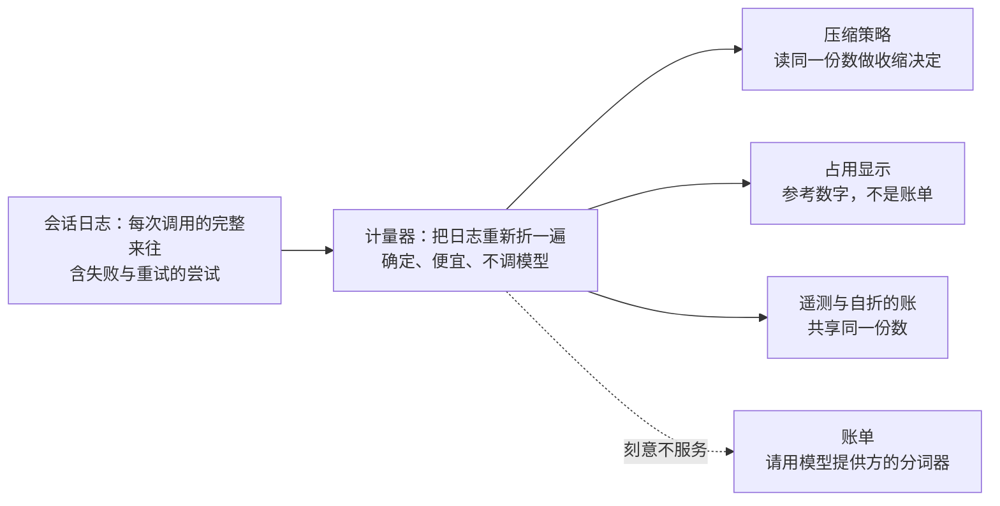
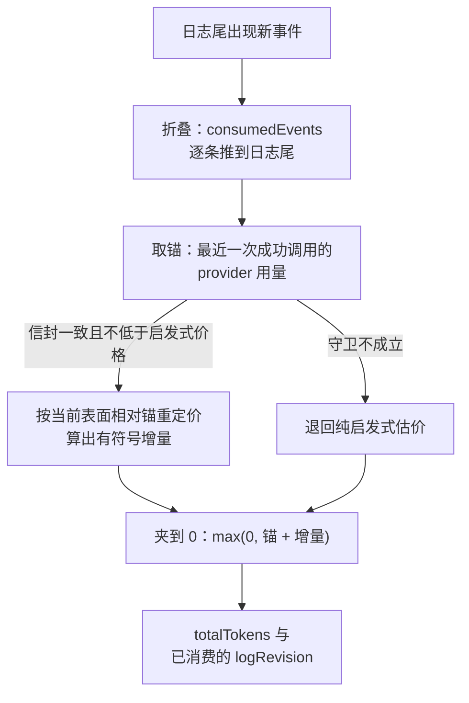
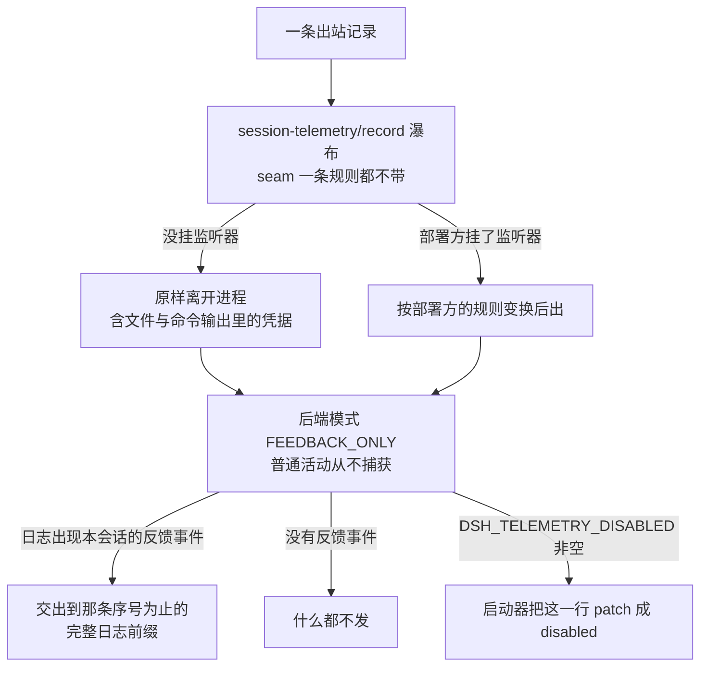

> **读完这篇你能**：分清「花了多少」其实是三个问题，知道用量为什么是**可重放**的而不是计数器、它的精度边界在哪；知道想外发数据时脱敏该由谁做；以及内置缺的那块（失败次数）怎么自己折出来。
>
> **前置**：[23-会话上下文的压缩、裁剪与排水](23-会话上下文的压缩、裁剪与排水.md)。约 30 分钟。
>
> **示例代码**：[dsh-turn-cost](https://github.com/anthonyzhao-4926/blog/tree/main/code/dsh_plugin/dsh-turn-cost)
>
> **DSH 版本**：0.2.0-rc.2

「这一趟花了多少」听起来是一个问题，拆开是三个，而且落在三个互不依赖的机制上：

| 问题 | 机制 |
| --- | --- |
| 这个会话压着多少 token？ | `ctx.tokenMeter`：重放日志折出「压力」与「表面价格」 |
| 花了多少时间、多少步？ | `sessionStats` 投影单元：纯函数折出墙钟时长 |
| 这些数据会不会被发出去？ | `ctx.sessionTelemetry`：默认连发都不发 |

再外加一件小事：`time-context` 给模型塞一个时钟，让「三天前」这种说法有个锚。它跟前三者无关，放在这篇只因为它也在回答「这一趟到底过了多久」。

## 目标

- 理解「可重放计量」是什么意思，以及为什么它不能用计数器实现。
- 知道用量的精度边界：它服务于压缩策略，不是账单。
- 弄清外发数据的责任划分：seam 脱不脱敏、出厂发不发、怎么彻底关掉。
- 给会话折出一条内置没有的账：失败次数。

## DSH 设计

要回答「这一趟花了多少」，先问数据从哪来。DSH 的会话日志（每个会话一份只追加的事件流水，写下不改）把每次模型调用的完整来往都记了下来：成功的消息内嵌产生它的精确流式记录，失败、重试、被取消的尝试也各有留存。也就是说，「每一次调用花了多少」在日志里已经是完整事实，计量不需要一个跟着进程跑的旁路计数器，只需要把日志重新折一遍。

为什么不信任计数器？打个比方：在柜台上放一个计数器，来一笔按一下。进程重启，计数器清零，账就没了；一段旧内容被压缩换下，它不该再算进下一次请求，多按的也不会自己退回去。而把日志重新折一遍是可重放的：任何时候从头算，得到的都是同一个数。计数器会丢、会错，折叠不会。

一份折叠要同时喂好几个消费者，所以取舍是确定性优先于精确性。计量器是 DSH 自带的用量估算器（token-meter），它的 README 写明：保持单一、确定的启发式，大约四个字符算一个 token。token 是模型计量文本量的单位。这种固定的启发式正是让每个消费者读到同一个数、回放稳定的原因。压缩策略、占用显示、遥测，读的都是同一份折叠。README 同时写明「占用是参考数字，不是计费记录」：消费者要的是一致、确定、便宜，不是精确到分，要对账的需求被明确指路到模型提供方自己的分词器。

计量器自己的定位也收得很窄：它是被调用的工具，不是循环里的角色。同一份 README 写明，它不添加模型可见内容，也不在主循环里做任何决定，估算器干脆一个配置项都不留。量多少、拿这个数做什么决定，全是消费方的事；想换计量行为，只能整个换掉实现。

这样一个小工具，走的却是公开扩展点。它通过会话投影（projection：把日志逐条折成一份状态的纯函数扩展点，插件可以注册自己的单元）注册三个状态单元，插件一卸载，这三个键就消失。也就是说，「内置没算的账，自己折一个」是设计好的用法，不是绕路：能折出什么账，不由框架限制，只由注册了哪些单元决定。

另一半问题是：这些数据会不会被发出去？遥测（telemetry：把会话记录发往系统之外）文档写明，外发前的变换通道「自己一条规则都不带」。没挂监听器时，记录原样离开进程；导出数据能干净到什么程度，恰恰取决于部署方挂了什么。规则是部署方的财产，框架提供的是挂点和保险丝：监听器抛错就扣下那一条，宁扣不放。文档还给了默认方向：出厂后端按需捕获，只在用户显式反馈之后才释放截至该反馈的日志前缀，普通活动从不捕获。默认收紧，放开要显式（依据 `local/deepseek-harness-dsh-v0.2.0-rc.2/docs/subsystems/session-telemetry.zh.md`）。

外发管道还有一条硬约束：从设计上不能反过来影响会话。后端的接收口被要求必须是非阻塞入队，因为它是在会话事件的热路径上被同步调用的，任何慢于一次入队的动作都会拖累主循环。投递是尽力而为的：记录可以丢、可以重，但绝不能反过来影响会话。「上报数据不会进入模型请求」写在文档开头。



被排除的消费者在图上有自己的位置：右下角。一份要同时喂给策略与显示的数，一致性比精确性值钱——这就是「别拿它当账单」在设计层的来源。

## 可重放计量

先破一个直觉：**它不是计数器累加。**

`total += usage` 这种写法在三种情况下都会算错：

- 会话被 resume 到新进程——内存里的累加值没了；
- 发生压缩，表面被替换——被遮蔽的内容不该再算进「下一次请求有多大」；
- 同一步里发生过失败重试，权威的那次调用被换掉了。

DSH 的答案是：**把计量做成会话日志上的一个可续跑折叠**。日志是唯一真相，任何时刻都能从零重算出同一个数。

每个会话只存一份极小的游标状态，五个字段：`consumedEvents`（已消费到第几个持久事件）、`header`（最近的规范请求信封）、`surface`（已计价的表面节点）、`stepStart`（当前开着的 step）、`anchor`（最近一次成功调用的锚）。每次测量先把游标推到日志尾：

```ts
    while (state.consumedEvents < session.seq) {
      const event = session.eventAt(SessionSeq(state.consumedEvents))!
      this._foldEvent(state, event)
      state.consumedEvents = SessionLogOffset(state.consumedEvents + 1)
    }
```

「可重放」在这里有三个具体含义：

**一、游标式。** `consumedEvents` 是持久序号，进程重来就从日志重新折一遍，不依赖任何内存累加值。返回的 `logRevision` 就是"这次测量消费了多少个持久事件"。

**二、锚加有符号增量。** 不是"把所有 usage 加起来"，而是"拿最近一次成功调用的 provider 用量当锚，再按当前表面相对锚的重定价算一个**有符号**的增量"。所以模型换了、上下文缩了，这个数字会**减**。最后还要夹到 0：

```ts
totalTokens = Math.max(0, baseline.tokens + surfaceDeltaTokens)
```

**三、锚只在信封完全一致时才用。** 只有 provider/model/参数都一样、而且 provider 报的总量不低于同一次调用的完整启发式价格时，锚才成立；否则退回纯启发式。这个守卫是为了防止拿"另一次调用的用量"当基准。

顺带一个设计上的对照：计量的追平是**事件驱动**的——服务在 `session/event` 上挂了一个监听器，只为已经在跟踪的会话推游标。这正是 [09-订阅 DSH 事件与五种分发模式](09-订阅 DSH 事件与五种分发模式.md)教的那件事，内置实现也在这么做。

整条折叠链是这样的：



## 没有精确 tokenizer

这是本篇最该带走的限制：

**token-meter 里没有精确 tokenizer。** 它用固定启发式——4 个字符算一个 token，每块结构加 4，每条消息的角色开销加 4。README 自己写着：需要精确到能对账的计数时，请改用 provider 的 tokenizer；而"不引入每家 provider 的精确 tokenizer"是一条**明确的已知取舍**。

原因在消费者身上：这份数字是给**压缩策略和占用率显示**用的——它们要的是"离阈值还有多远"，不是"这次调用多少钱"。所以：

- 中文（CJK）会被**系统性低估**，因为一个汉字算一个字符、四个字符才算一个 token；
- 大段 JSON schema 也一样，结构开销的估算比真实情况乐观。

**别拿它当账单。** 要账单调 provider 的 usage 字段，那是权威来源；token-meter 的产出是"够用的近似"。

## 外发与脱敏

正确答案是：**seam 自己一条规则都不带。** 这不是我的判断，是两份原文的一致说法——没有挂监听器时，记录**原样**离开进程，包括文件内容或命令输出里夹带的任何凭据；导出到共享收集器的部署方自己拥有规则集。

所以脱敏的做法是：在 `session-telemetry/record` 这个瀑布上挂自己的监听器，对每条出站记录做变换。仓库里唯一的现成范例是测试夹具里那条正则规则。

但还有一层比脱敏更强的保护：**出厂后端默认不发。** 它的模式是 `FEEDBACK_ONLY`——普通活动根本不会被捕获。只有会话日志里出现本会话自己的反馈事件时，才会把"到那条序号为止的完整前缀"交出去。base 层的注释写得很直接：

> OTel releases a Session-log prefix only after explicit user feedback, regardless of model
> provider. **Ordinary activity never triggers capture.**

要彻底关掉，设环境变量 `DSH_TELEMETRY_DISABLED`（**任意非空值**都算，包括 `'0'` 和 `'false'`）。这里有个反直觉的地方：它不是靠配置关的，而是**启动器把那一行 patch 成 `disabled`**——注释原话是"config cannot disable a row"。所以别指望在 `cordis.yml` 里把它设成 `false` 就能关。

记录从产生到彻底关掉外发：



## 给模型的时钟

`time-context` 做的事很小：在 `agent/pre-step` 上追加一条 `user/message`，三行文本：

```text
Time sampled while preparing turn 3, step 1: 2026-09-12T18:04:31+08:00[Asia/Shanghai]
Browser time zone for this request: Asia/Shanghai. Interpret otherwise-unqualified dates and times in this zone.
Elapsed since the preceding model-visible message: 2h 14m 7s.
```

三行分别是时间戳、浏览器时区策略、距上一条的时间。第三行的**基线是分段的**：第 1 步从"最近一条模型可见消息"算起，第 2 步及以后从本轮上一次注入算起。没有基线时字面量就是 `unavailable`。

两个实现细节值得记：

- 它注册时用了 `prepend: true`，并且**先 `await next()` 拿到下游决定**，只有决定不是拒绝、也没被中止时才追加。所以它读得到本轮已进入或已提议的全部用户消息。
- 时区按"本轮所有相关消息里那个**唯一**的浏览器时区 → 配置的时区 → 进程时区"依次取。如果本轮出现了多个不同时区，它会渲染成 `mixed [...]` 并让模型去问用户——这是刻意不做猜测。

还有一个现状：**它默认根本不在配置里**。插件是 opt-in 的，出厂组合把它留着不挂，唯一的配置点是那个定时任务的 overlay。想让模型有个时钟，得自己加这一行。

## 自己折的失败计数

规划里写的是"想知道花了多少 token、多久、**失败几次**"。前两个内置都有，第三个**没有**。

内置的 `sessionStats` 有八个字段，没有一个是失败计数。但失败信号确实存在，只是散在三处、都要自己折：

| 信号 | 位置 | 含义 |
| --- | --- | --- |
| 工具结果带 `isError` | `tool/result` 事件 | 这次工具调用失败了 |
| 轮次结束原因是错误 | `turn/end` 的 `reason.kind` | 整轮失败了 |
| provider 层重试 | `llm/retry` 事件 | 上游调用被重试过 |

所以"失败几次"是一个**自定义投影单元的练习**，而不是查一个现成字段——这正好是 demo 做的事。

## 这一趟的账

demo 干脆把两件事一起做：读内置的三个单元，再自己折一个失败计数。

```ts
const failureCounts = {
    key: 'failureCounts' as const,
    stateVersion: 1,
    stateSchema: failuresSchema,
    init: (): FailuresState => zero,
    // 纯函数：不关心的事件必须返回同一个引用。
    apply: (state: FailuresState, event: SessionEvent): FailuresState => {
        if (event.type === 'tool/result' && event.data.message.content[0]?.isError === true) {
            return { ...state, toolErrors: state.toolErrors + 1 }
        }
        if (event.type === 'turn/end' && event.data.reason.kind === 'error') {
            return { ...state, turnErrors: state.turnErrors + 1 }
        }
        if (event.type === 'llm/retry') {
            return { ...state, providerRetries: state.providerRetries + 1 }
        }
        return state
    },
}
```

三个分支正好对应上表的三处信号。读取的时候把四块拼在一起：

```ts
        execute: (_args, exec) => {
            const session = exec.agent?.session
            if (session === undefined) return 'no agent-bound caller'
            const read = (key: 'tokenUsage' | 'sessionStats' | 'contextPressure' | 'failureCounts') =>
                ctx.sessionProjections.stateOf(session, key)
            return JSON.stringify({
                usage: read('tokenUsage'),
                time: read('sessionStats'),
                pressure: read('contextPressure'),
                failures: read('failureCounts') ?? zero,
            }, null, 2)
        },
```

这里有几行 **type-only import 不是废行**，它们是把对应包对 `SessionProjectionStateMap` 的声明合并进本程序的开关——去掉就编译不过，因为 `stateOf` 认不出 `tokenUsage` 这几个 key。内置的 token-meter 自己也是这么写的。

一个数据形状上的细节：`tokenUsage` 的四个桶是**互斥**的。推理用量已经算在输出里，不会重复累加——所以别把四个数加起来当成"总量"，它们本来就是分类不是分项。另外 `sessionStats` 的步数数的是 `step/end`，**失败和被取消的步也各算一步**；要区分就得像 demo 这样自己折。

## 验证

```bash
cd code/dsh_plugin/dsh-turn-cost && ./install.sh
```

三步：

```bash
# 1. 配置对不对
dsh --profile test --dump-config | grep -A3 'id: dsh-turn-cost'

# 2. 跑一轮有失败的活：让模型读一个不存在的文件，再正常跑一个工具
dsh --profile test "读一下这个仓库里根本不存在的文件，然后告诉我当前目录有几个文件"

# 3. 让模型读账本
dsh --profile test "调 turn_cost，把结果原样贴给我"
```

第三步会返回四块：`usage`（四个互斥桶）、`time`（轮数/步数/模型时长/工具时长/首 token/解码）、`pressure`（压力、投影、上下文窗口——模型没报用量时可能缺字段）、`failures`（至少 `toolErrors ≥ 1`）。

最后做一个**对照实验**，它是"可重放"最直接的可观测证据：

```text
在同一个会话里连续读两次 turn_cost，中间什么都不做。
两次的数字必须完全相同——包括 usage 和 time。
```

如果是计数器累加，重读只会越加越多；而折叠是可重放的，没发生新事件就不会有新数字。

## 注意事项

- **别把这份用量当账单。** 固定 4 字符/token 的启发式会系统性低估中文和大段 schema。要精确数字，读 provider 的 usage 字段。
- **脱敏是你自己的事。** telemetry seam 一条规则都不带，挂上监听器之前，记录原样出门。要导出到共享收集器，先挂规则，再决定导什么。
- **关掉外发要靠环境变量，不是配置。** `DSH_TELEMETRY_DISABLED` 是启动器把那一行 patch 成 `disabled` 的开关；在配置里写 `false` 关不掉。
- **`FEEDBACK_ONLY` 是默认，不是保证。** 换了后端或者改了模式，普通活动就可能被捕获。部署到公司环境前，确认这一行到底是什么。
- **计量单元没有配置项，写了键会抛。** 它是固定启发式，干脆一个旋钮都不给。想换行为就换实现（[08-替换内置能力的提供方与消费者](08-替换内置能力的提供方与消费者.md)的换供应商套路）。
- **`time-context` 默认不挂。** 觉得模型对时间没概念，先确认这一行有没有在配置里；不是模型不会看时钟，是没人给它时钟。
- **失败计数要自己折，而且要接住三处信号。** 只数 `tool/result` 会漏掉整轮失败和 provider 重试——三者的含义完全不同，别混成一个数。

---
