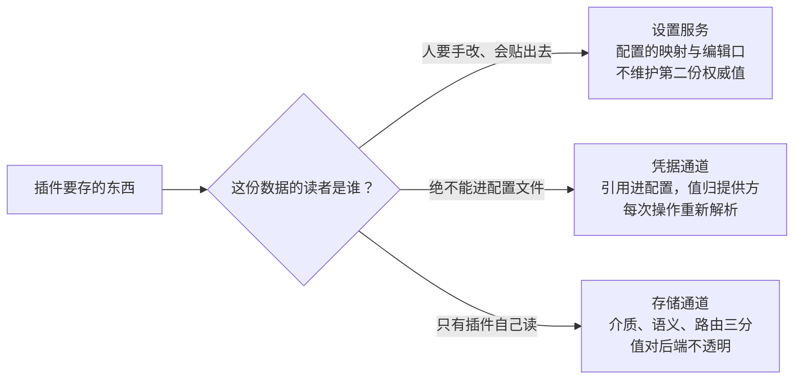
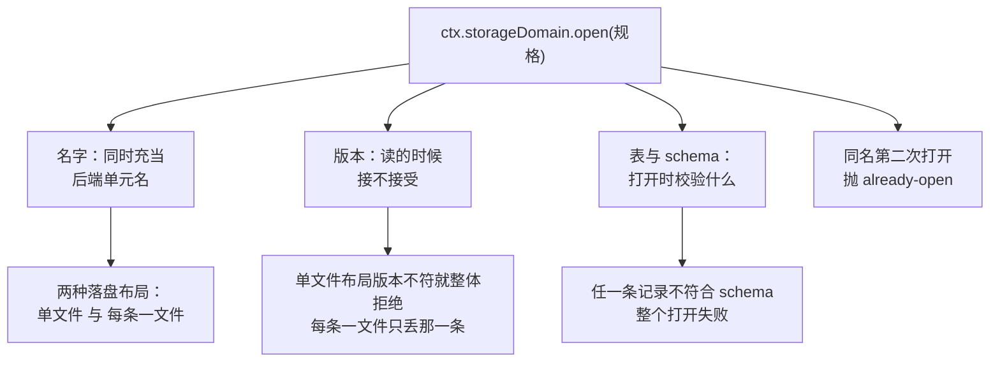
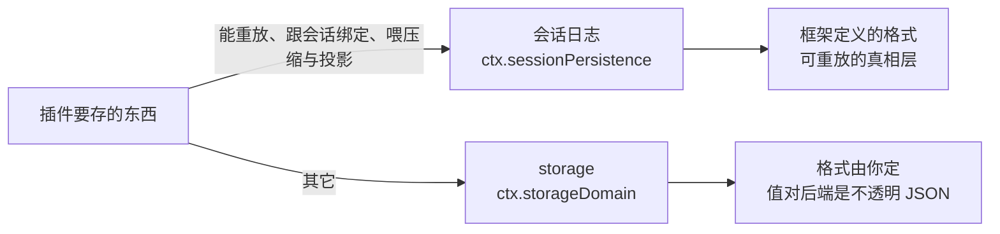

> **读完这篇你能**：给自己的插件找对存放东西的地方——状态、密钥、用户配置各走哪条缝；会声明一个自己的 domain 把数据落盘，会用「引用」的方式拿密钥而从不把明文写进配置。
>
> **前置**：[24-会话用量与成本的计量](24-会话用量与成本的计量.md)。约 30 分钟。
>
> **示例代码**：[dsh-note-hits](https://github.com/anthonyzhao-4926/blog/tree/main/code/dsh_plugin/dsh-note-hits)

插件写到一定程度就会遇到这个问题：有些东西得存下来。可能是运行状态（上次同步到哪、启动过几次），可能是密钥（要调一个外部服务），可能是用户配置（路径、偏好）。

DSH 把这件事拆成了**三条互不重叠的缝**。选错缝的代价不是"不能用"，而是"用着用着发现放错了地方"——比如把密钥写进了一个会被贴进 issue 的配置文件。

## 目标

- 分清三条缝各存什么，以及它们为什么不能合并成一条。
- 会声明一个自己的 storage domain，把状态落盘，并知道名字/版本/schema 各决定什么。
- 理解「存引用不存明文」的准确含义，以及凭据的解析层序。
- 知道会话日志为什么是第四条、跟这三条是什么关系。

## DSH 设计

这一节不依赖本文后面的任何内容，单独讲清 DSH 给「插件要存的东西」划出的存放通道是怎么设计的（依据源码快照 `local/deepseek-harness-dsh-v0.2.0-rc.2/docs/subsystems/credentials.zh.md` 与 `local/deepseek-harness-dsh-v0.2.0-rc.2/docs/subsystems/storage.zh.md`）。

**三类数据的读者互相冲突，所以不能共用一条通道。** 插件（挂进 DSH 的一段带名字的功能代码）要存的东西大致三类：给人改的配置、给外部服务的密钥、给自己记的状态。配置会被用户手改、随手贴进 issue；密钥绝不能出现在那种文件里；状态只是插件自己的派生数据，丢了能重建。凭据通道的存在理由就写在文档第一句：把机密挡在配置之外——配置里携带的是引用（一个环境变量名），值归专门的提供方。存储通道则把自己的管辖划为「一切不属于会话事件日志的数据」。每条通道的契约都按它的读者量身定：配置要过校验、要能画成表单；密钥要按来源分层解析；状态对落盘介质没有任何语义，谁读谁解释。

**密钥的来源层序是「谁的意图该赢」的声明。** 本地凭据提供方把层序的理由写得很直白：启动环境优先，因为按次覆盖（`KEY=… dsh` 这样的命令行前缀、CI 注入的机密）代表「本次运行」的明确意图——它无法从产品内部修改，所以被报为只读，写入直接拒绝；其他一切来源都输给那个只有属主可读的凭据文件，这正是界面上存的密钥立即生效、不会被某个目录里残留的 `.env`（项目自带的环境变量文件）顶掉的原因（依据 `local/deepseek-harness-dsh-v0.2.0-rc.2/packages/credentials/credentials-local/README.zh.md`）。

**热更新不是一套机制，是「每次重新读」的副产品。** 凭据通道的契约要求使用方每个操作重新解析、绝不跨操作缓存——模型适配器就是每个模型请求解析一次。没有缓存就没有缓存失效问题：换完密钥，下一个请求自然用新的。

**引用能分层，授权记录不能。** 引用能分层，是因为环境变量天然有「本次进程／凭据文件／.env」多个来源可选；而第三方登录（OAuth）换来的授权记录没有环境来源，所以它走另一个键空间：按「所有者/编号」寻址，存的是记录本身而不是引用，唯一的写路径是带锁的读-改-写。同一条通道下的两种键空间，来自两种数据根本不同的来源结构。

**存储通道把介质、语义、路由拆成三份。** 存储枢纽自己不做任何读写——后端拥有介质（json 文件还是 sqlite 数据库），数据域（domain：插件声明的一块带名字、带版本、带校验规则的键值分区）拥有语义，用哪个后端归插件自己的配置。所以后端能从 json 换成 sqlite 而插件一行不改。打开时的严格校验也来自同一立场：存着的记录过不了校验，默认整个打开失败——对权威数据，宁可不开也不拿错数据接着跑；「备份后跳过」只留给可重建的派生数据。

**能静态判的错误不留到运行期。** 数据域的声明在模块加载时、任何介质被触碰之前就报错：名字不合语法、版本不是非负整数，都在加载期抛出。数据域是插件对外的公共承诺——把承诺里的错别字留到「打开那一刻」才爆，等于把一个本可静态发现的错误推迟成运行期事故。

**设置服务不是存储，是配置的映射与编辑口。** 设置（settings）服务只管插件标了「可现场改」（volatile）的那些配置字段：它把当前 profile（一套具名的配置方案）里条目的配置映射成一张表单，落盘交给配置编辑器写回那个 profile；包 README 写明它「投影加载器配置，不维护独立的权威值」（依据 `local/deepseek-harness-dsh-v0.2.0-rc.2/packages/settings/settings/README.zh.md`）。权威值自始至终只有一份——profile 里的那行配置——设置服务只是给它开了一扇带校验的窗，窗后面没有第二份数据要同步。



分叉的标准不是「数据类型」而是「读者」：读者决定这份数据要过什么契约——过校验进表单、按来源分层解析，还是不透明落盘。

## 三条缝

storage 与 credentials 是「抽象服务 + 供应商 + 消费者」的三件套（[08-替换内置能力的提供方与消费者](08-替换内置能力的提供方与消费者.md)的骨架）；settings 只有服务侧，落盘交给配置编辑器。三者都从 `ctx` 上取用：

| 缝 | 服务键 | 背后是谁 | 存的是 |
| --- | --- | --- | --- |
| storage | `ctx.storage` / `ctx.storageDomain` | `json` / `sqlite` 后端 | 插件的**普通状态** |
| credentials | `ctx.credentials` | 本地凭据库 | 插件的**密钥值** |
| settings | `ctx.settings` | 配置编辑器（写当前 profile 的 patch） | 用户的**可改配置** |

分工可以一句话记住：

- **settings 存配置，不存状态。** 它只投影插件愿意让人现场改的那部分字段（在 `Config` 里标了 `.volatile()` 的那些），有一条严格的"只收 JSON"写入校验，而且每次写入都会按完整 `Config` 跑一遍 schema。
- **storage 存状态，不收配置。** 它除了 schema 冲突检查之外没有任何语义，值对后端是不透明的 JSON——谁读谁负责解释。
- **credentials 只存密钥**，而且配置里出现的是**环境变量名**，不是值。

## 三条缝的分工

三个理由，都能在源码里找到痕迹。

**一、密钥不能进配置文件。** 设置落在当前 profile 的 patch 里，那是一份用户随时手改、随手贴给别人看的 YAML。所以配置里只放引用，值放进另一个文件，并且那个文件被强制成 `0600`。

**二、状态是可丢的派生数据，配置不是。** storage 的规格里有一个 `backup-and-skip` 选项，专门给"投影缓存"这类可重建数据用：存坏了就把那份文档挪走、记一条日志、当它不存在。settings 没有这个选项——存坏了直接拒绝启动。

**三、运行期改配置不改插件形态。** settings 的解析是三层合成，每次写入先按完整 `Config` 算出候选值、跑 schema，全通过了才落盘。标成 volatile 的字段还能再走一条更快的通道：Loader 只把新值提交进运行中的引用，不重挂插件。

三者之间只有一条真实的依赖，不是三层塔：

```text
ctx.settings       投影 volatile 字段；落盘交给配置编辑器（当前 profile 的 patch）
ctx.credentials    $DSH_HOME/.credentials.yaml
ctx.storage        只做「名字 → 后端」的登记，自己不做 IO
  └─ ctx.storageDomain   数据面：schema 校验 + 变更事件 + 写链
       └─ 后端 json / sqlite   真正落盘
```

settings 和 credentials 之间唯一的结构性耦合是**引用**这个概念：settings 的 schema 里可以把一个字段标成"这是凭据引用"。但 DSH 自己**不做**"把引用解析成值"这件事——消费者自己在每次操作时调一次解析。

## domain 的定义

一句话：**domain 是一份被命名、被版本、被 schema 约束的 KV 分区**，由拥有它的包在模块加载时声明一次。它不是隔离，不是权限，不是多租户。

三件事都由规格决定：

- **名字决定落盘位置**，因为它"同时充当后端单元名"。两种布局：`single` 是 `<root>/<name>.json`，`per-record` 是 `<root>/<name>/<table>/<key>.json`。
- **版本决定读的时候接不接受**。`single` 布局版本不对就整体拒绝；`per-record` 布局只丢那一条记录。
- **表和 schema 决定打开时校验什么**。任何一条存着的记录不符合当前 schema，整个打开就失败——除非你声明了"备份后跳过"。

还有一条硬约束：**同一个 domain 名在一个进程里只能开一次**，第二次会抛 `already-open`。

这几条合起来的意思是：**domain 名是一次性的命名资源，写错了就是和别人撞车**。所以名字带上插件前缀（demo 用的是 `note_hits`），并且把它当成公共 API 一样对待——因为改了名字等于数据搬家。

把这几条规格落到打开动作上：



## 引用与值

这是本篇最容易搞错的一点，值得慢慢说。

**配置文件里存的是名字。** 它形如 `DEEPSEEK_API_KEY`，语法就是 POSIX 环境变量名——构造引用时会校验这一段 shell 标识符。在 schema 里用 `.role('credential-ref')` 把这个字段标成"一条凭据引用"；它和 `role('secret')` 不是一回事：`secret` 的字段值会被从表单响应里剔掉，只留一个"有没有设"的标记，而引用存的就是名字，本来就可以照常读写。

**值存在供应商管的可写源里。** 自带供应商的可写源是那个 `0600` 的凭据文件，里面是**明文**。

所以"存引用不存明文"这句话说的是**配置文件那一侧**。它不是"加密保存"——自带实现靠文件权限保护，而且它的已知限制里明确写着：同 UID 的进程能读到那份文档，而文件沙箱模式并不拒绝读，系统钥匙串供应商是**待办**。这一点必须如实说：它是"不把密钥散落在会被分享的文件里"，不是"密钥被安全地锁起来了"。

还有一半是**不能分层**的：OAuth 授权记录那种东西没有环境变量可读，它用一个完全不同的键空间，存的是**记录**而不是引用，只能通过记录写接口修改。

## 分层解析

凭据的解析有明确的层序，从高到低：

```text
1. 继承的进程环境                只读，最高优先级，赢
2. $DSH_HOME/.credentials.yaml   供应商管的可写源
3. <启动时 cwd>/.env             只读兜底
4. $DSH_HOME/.env                只读兜底
```

三条规则值得单独记：

- **第一层赢，而且写不进去。** 它代表"本次运行你明确想要的那个值"（命令行前缀、CI secret、容器注入）。进程内改不了它，所以想写第一层会被**直接拒绝**，而不是静默失败。
- **第二层赢过第三、四层。** 界面上存的 key 不会被某个 checkout 里带的 `.env` 顶掉。这个顺序是有意的。
- **空字符串等于没配。** 整条缝上都按"没有"处理。

最后一件事是这套设计里最漂亮的地方：**每次操作重新解析，不缓存**。这就是热更新的全部机制——LLM 适配器每个模型请求解析一次凭据，所以在界面上换了 key，下一个请求就用新的，不需要重启任何东西。

## settings 的三层

settings 的解析同样是三层：

```text
1. schema 默认值（Schemastery 的 .default(...)）
2. 组合 base（这一行在 cordis.yml 里的 config）
3. 用户层（当前 profile 的 patch 里这个 entry id 下的 config 块）
```

合并规则是：**纯对象递归合并，其它值（包括数组）整块替换下层**。所以往一个数组里"加一项"是做不到的——你得给出完整数组。写入有三个粒度：往用户层合并、整节替换、以及按路径改单个键。

这里和 [14-把插件配置搬进设置页](14-把插件配置搬进设置页.md)是同一套机制的两个面：**表单的 namespace 就是这一行在 profile 里的 entry id**，不是插件自起的字符串，所以也没有"命名规则"要遵守，唯一要求是这个 id 能在 profile 里被唯一定位。区别只在入口——[14-把插件配置搬进设置页](14-把插件配置搬进设置页.md)额外有一个浏览器半，把这份表单画成设置页上的卡片；本篇只用 Host 侧那一半：字段标上 `.volatile()`，`apply` 里拿到的就是一个稳定引用，读值走 `.get()`。两者面对的是同一行、同一份表单。

## 会话日志是另一条缝

有一处必须澄清，否则会把两条缝混起来：**会话日志不是 storage**。

它走的是完全不同的服务（`ctx.sessionPersistence`），落盘位置和格式也都是独立的。storage 是"你的插件想记什么就记什么"，会话日志是"这个会话发生过什么"——前者的格式由你定，后者是框架定义的、可重放的真相层（[23-会话上下文的压缩、裁剪与排水](23-会话上下文的压缩、裁剪与排水.md)）。

判断标准很简单：**要能重放、要跟会话绑定、要给压缩和投影当输入的东西走会话日志；其它都走 storage。**

这条判断标准落在两条缝上：



## 一张账

demo 把两件事放进了一个插件：把启动次数落盘，以及按引用取一次密钥，但只报告来源层和长度。

状态这一半，先声明规格：

```ts
const bootDomainSpec = defineDomain({
    name: 'note_hits',
    version: 1,
    global: {
        schema: bootState,
        initial: { boots: 0, lastAt: '' },
    },
    tables: {},
})
```

只用全局单例、不要表是合法的声明（表字段必填但可以是空对象）。打开之后，句柄的归属要自己交代清楚：

```ts
    const domain = await ctx.storageDomain.open(bootDomainSpec)
    // 句柄归自己：插件卸载时先关 domain，别把单元漏在外面。
    ctx.effect(() => () => domain.close(), 'note-hits.domainClose')

    const state = domain.global.get()
    await domain.global.set({ boots: state.boots + 1, lastAt: new Date().toISOString() })
```

这就是 [05-插件生命周期与 ctx.effect](05-插件生命周期与 ctx.effect.md)那句"注册了东西要交给 `ctx.effect`"在这里的形态：**开出来的句柄也是资源**，卸载时得还回去。

密钥这一半，配置里只有一个引用，而且要现场改，所以声明成 volatile：

```ts
export interface Config {
    /** 取密钥用的凭据引用（环境变量名）。 */
    apiKeyEnv: Volatile<string>
}

// 不写 `: Schema<Config>` 标注：volatile 字段的序列化形态与接口里的
// Volatile<T> 引用不同，标注会与 schemastery 的 default 签名冲突。
export const Config = Schema.object({
    // role('credential-ref') 标明这个字段是凭据引用（环境变量名），不是密文本身。
    apiKeyEnv: Schema.string().role('credential-ref').default('DEEPSEEK_API_KEY').volatile(),
})
```

读值走 `.get()`：

```ts
        const ref = credentialRef(config.apiKeyEnv.get())
```

用的时候先问"配没配"，再问"从哪来"：

```ts
        const info = await credentials.describe(ref)
        if (!info.configured) {
            console.warn(`note-hits: ${ref} 还没配（可在设置页填，或导出环境变量）`)
            return
        }
        const resolved = await credentials.resolve(ref)
        console.log(
            `note-hits: ${ref} 来自 ${resolved?.source ?? 'unknown'} 层，`
            + `值长 ${resolved?.value.length ?? 0} 个字符（值本身不打）`,
        )
```

**只打来源层和长度，永远不打值。** 这不是演示代码的洁癖——真实插件往日志里写凭据是最常见的泄漏路径之一。

最后一块是可选依赖的用法。凭据服务在某些配置下可能不存在，所以不能写进 `inject`：

```ts
        const credentials = ctx.get('credentials')
        if (credentials === undefined) { … }
```

而设置页改完引用之后要重报一次。这件事不需要 settings 服务：Loader 在 volatile 提交成功时向本插件派发一个事件，听它就行（事件类型由 `@deepseek-ai/cordis-plugin-loader` 合并进来，只引类型）：

```ts
    ctx.on('loader/volatile-update', () => void reportCredential())
```

`ctx.inject` 和 `inject` 的区别值得记住：**硬依赖写在模块的 `inject` 上**（没有它这个插件没意义，宁可不起）；**可选依赖用 `ctx.inject` 或 `ctx.get`**（它在就增强，不在就降级）。volatile 字段是第三种情形：读值不需要任何服务在场，Loader 已经把引用交到手上了。

## 验证

```bash
cd code/dsh_plugin/dsh-note-hits && ./install.sh
```

先看配置，再启动两次看计数：

```bash
dsh --profile test --dump-config | grep -A3 'id: dsh-note-hits'

dsh --profile headless        # 终端打「第 1 次启动」
cat ~/.dsh/storages/note_hits.json
dsh --profile headless        # 「第 2 次启动」，文件里 boots 变成 2
```

那个文件长这样，一眼能对上前面讲的规格：

```json
{"unit":{"name":"note_hits","version":1},"global":{"boots":1,"lastAt":"…"},"tables":{}}
```

单元头带名字和版本，正是"版本决定读的时候接不接受"的落点；`tables` 即使一张表都没有也会写出来。第一次跑之前文件不存在是正常的——`single` 布局的落盘推迟到第一次写。

密钥那一半，只动 shell、一个字不改配置：

```bash
DEEPSEEK_API_KEY=sk-demo dsh --profile headless
# note-hits: DEEPSEEK_API_KEY 来自 env 层，值长 7 个字符（值本身不打）
```

没导出时那句会变成"还没配"。**注意配置文件全程没动过**——这正是"引用"要表达的意思：换来源只需要改名字，改名字不需要碰插件的任何代码。

## 注意事项

- **`$DSH_HOME/.credentials.yaml` 是明文。** "存引用不存明文"说的是配置文件那一侧。自带实现靠 `0600` 权限保护，系统钥匙串供应商还没做。别把它当成保险箱。
- **domain 名不是隔离机制。** 没有所有者检查，名字撞了就读到别人的数据——版本或 schema 对不上时整个打开失败。所以名字要带前缀，并且当成兼容性承诺来对待。
- **命名语法只有 domain 这一侧有硬规则。** domain 名必须匹配 `UNIT_NAME_RE`：小写字母开头，后面只能是小写字母、数字和下划线。settings 这一侧没有命名规则——namespace 就是 entry id，唯一要求是它能被 profile 唯一定位。domain 名写错会在加载期直接失败。
- **domain 一个进程只能开一次。** 第二次打开抛 `already-open`。要共享，就把句柄传出去，别各自去开。
- **句柄是资源。** 打开 domain 之后要用 `ctx.effect` 登记关闭，否则热重载几次就会撞上"已经被占用"。
- **settings 只收 JSON，数组整块替换。** 想往数组里追加一项做不到，必须给出完整数组；写入还会跑一遍 schema，不合法的值根本落不下去。
- **可选服务不要写进 `inject`。** 凭据服务在某些配置下不存在，写死会让插件一直挂起等一个不会出现的服务（[18-把插件打包成配置包](18-把插件打包成配置包.md)讲的 `PENDING`）。settings 是另一回事：读 volatile 字段根本不需要它。
- **别把会话日志当 storage 用。** 两条缝的服务、位置、格式都不同；会话日志要能重放，塞私有状态进去会破坏这个前提。

---

从 [01-profile、bundle 与插件的关系](01-profile、bundle 与插件的关系.md)的"插件与 profile 是什么"，到这里的"插件怎么记住自己的东西"，前面这一整段走完了一个插件从写出来到长期用下去要经过的每一节：配置、配置、生命周期、事件、工具、界面、分发、运行期组合、边界、持久化。
