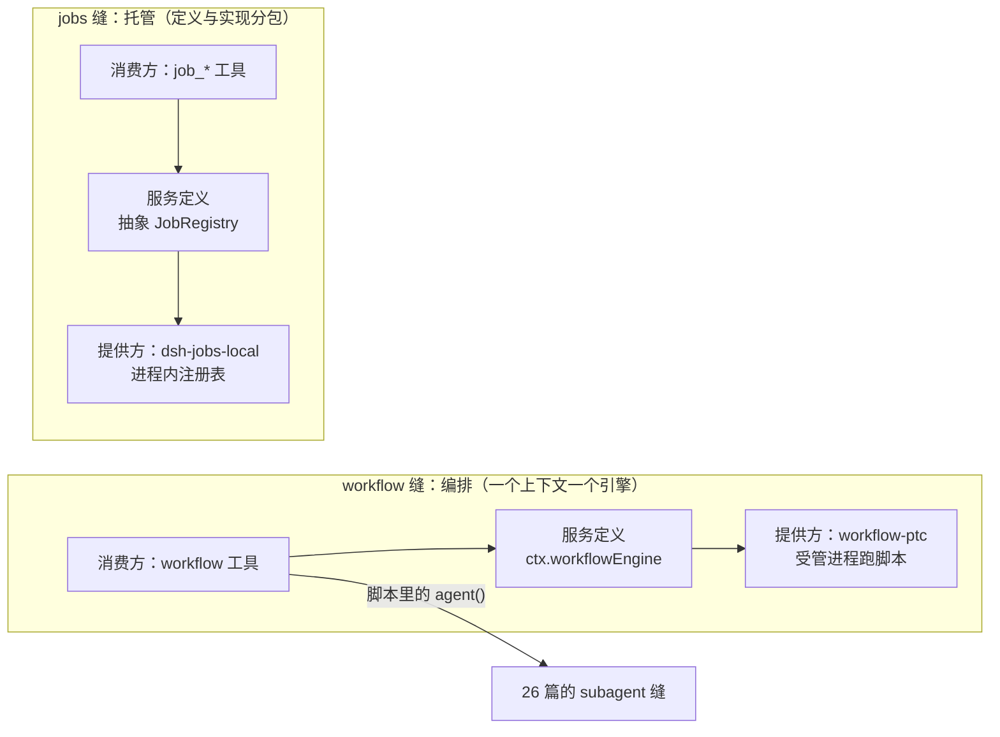
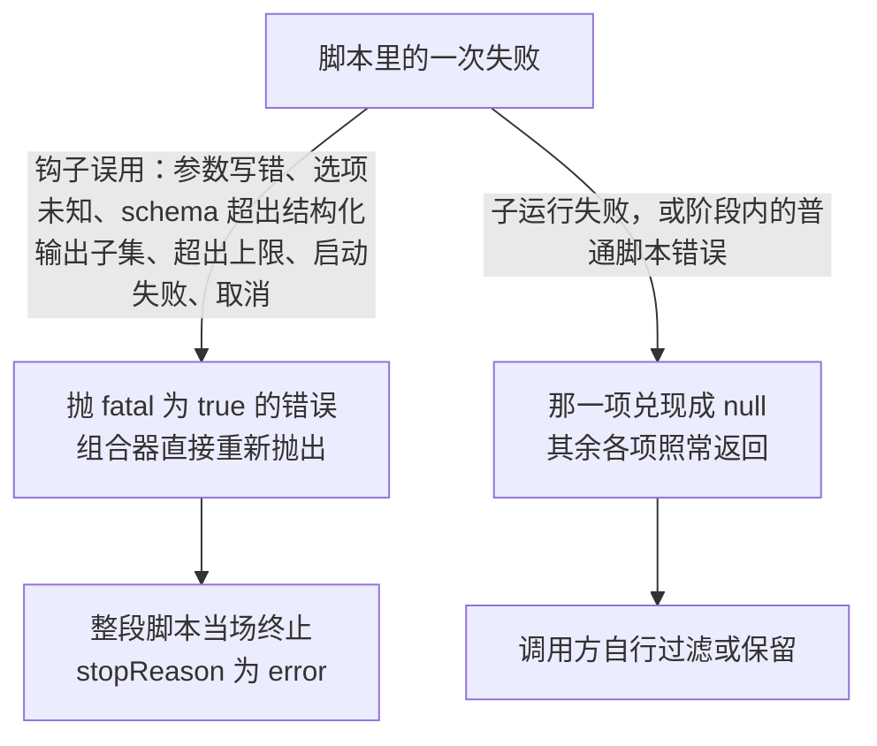
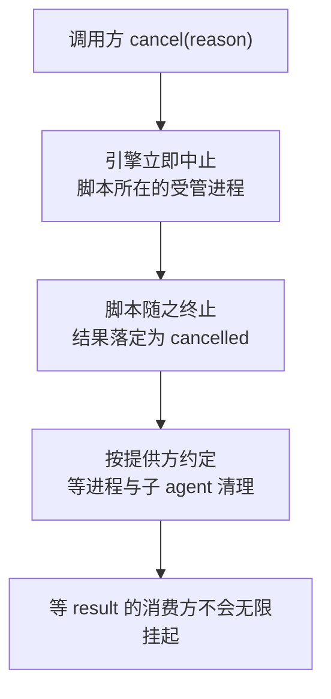
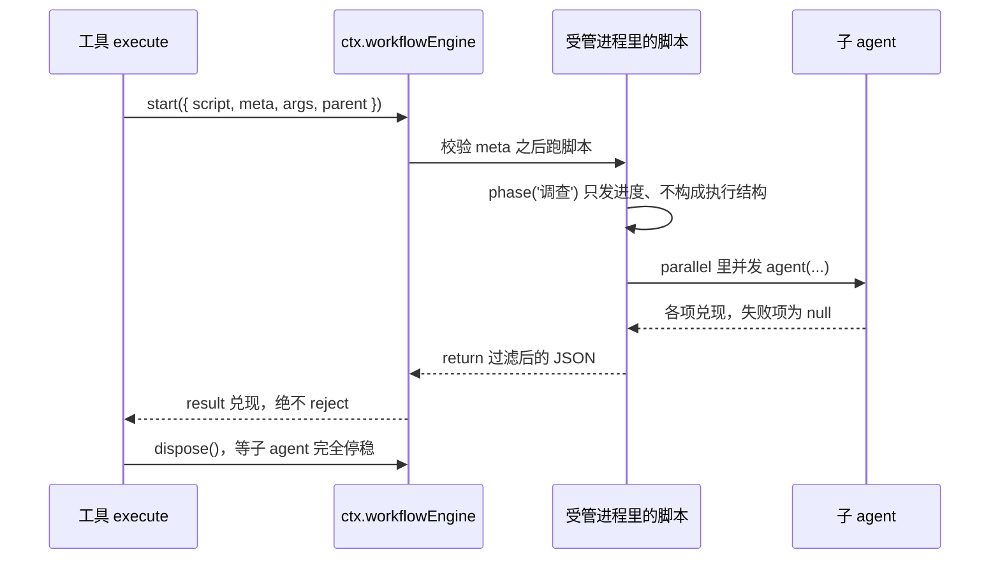

> **读完这篇你能**：分清「编排一批活」和「扔一个后台任务」两种模型；知道一次编排的请求里哪些东西由调用方定、哪些由引擎定；理解为什么「某项失败」和「脚本写错了」必须报成两回事。
>
> **前置**：[多 agent 的任务拆解](26-多 agent 的任务拆解.md)。约 30 分钟。
>
> **示例代码**：[dsh-workflow-lite](https://github.com/anthonyzhao-4926/blog/tree/main/code/dsh_plugin/dsh-workflow-lite)

上一篇讲的是「把一件事交给一个子 agent」。这一篇讲的是它放大之后的样子：一次要跑好几件、彼此不依赖的活。

放大的时候会多出两个问题——**怎么编排**，和**怎么看待其中某一项失败**。DSH 把前者交给 workflow，后者交给一条明确的失败纪律。

## 目标

- 分清编排（workflow）与后台任务（jobs）各自解决什么。
- 知道一次编排的请求里，`script`、`meta`、`args` 三者的边界在哪。
- 理解「逐项失败」与「钩子误用」为什么要分开报。
- 会给结果做正确的收口：该取消时能取消，该等一下的时候等得住。

## DSH 设计

编排为什么长成「脚本加引擎」、后台任务为什么长成「注册表加生产方」，由两条缝各自的形状决定（依据 `local/deepseek-harness-dsh-v0.2.0-rc.2/docs/subsystems/workflow.zh.md` 与 `local/deepseek-harness-dsh-v0.2.0-rc.2/docs/subsystems/jobs.zh.md`）。

**workflow 与 jobs 是两条独立的能力缝，分工在定义层就划好了。** workflow 缝解决「怎么安排」：和 bash 一样，一个上下文只允许一个引擎提供 `ctx.workflowEngine`，没有命名注册表——编排策略是单选，换引擎就是换掉组合里加载的那个插件。jobs 缝解决「甩出去之后还找得到」：抽象的 `JobRegistry` 是服务定义，`dsh-jobs-local` 是进程内提供方，`dsh-tool-jobs` 是模型侧消费方，正是 08 篇那套服务定义、提供方、消费者三件套。本篇开头那张对照表因此不是用法建议，而是两条缝各自的边界。

**workflow 不是另起炉灶的多 agent 机制，它是 26 篇那条委派缝的批量调用方。** 引擎自己不养子 agent——脚本里的每个 `agent()` 都经 subagent 缝发出，所以启动请求里 `parent` 必填，归属、谱系、深度都沿那条链走。`result` 永不拒绝、失败以 `stopReason` 兑现的纪律也与 `SubagentRun` 同款：引擎没有发明新的结算语义，它把委派缝的那一套原样延伸到了编排句柄上。

**「没跑成」与「写错了」分开报，是失败要响这条规则在脚本里的形态。** 子运行失败是正常业务结果，逐项 `null` 留给脚本自己处理；钩子误用是契约违规，必须以 `fatal: true` 终止整段脚本。组合器对 fatal 直接重新抛出，守的就是这条分界——两种失败在类型上分得开，脚本作者才不会拿兜业务失败的逻辑去掩盖自己的笔误。

**jobs 的所有权模型是「注册表拥有身份与生命周期，生产方拥有执行资源」。** 这条分界解释了本篇的一串做法：`run()` 在预检之后只被调用一次、抛错等于什么都没注册（身份与准入先由注册表收好，执行才交出去）；访问控制靠 owner 授权而不是 id 保密（`<kind>-N` 可预测，保密从来不在设计里）；`done` 在生产方释放完资源之后才 resolve——「活干完」是生产方的事，「东西都收拾干净了」才是注册表要的结算。



「一次编排」与「一个后台作业」看着都像「跑个活」，底下却是两种所有权：前者由持有者拥有、每条路径都要 `dispose()`；后者由注册表拥有身份，生产方只拥有执行。

## 编排与后台任务

两条路，别看错：

| | workflow | jobs |
| --- | --- | --- |
| 解决什么 | 一批活的**编排**：并发、阶段、汇总 | 一个活的**托管**：后台跑、可查、可停 |
| 谁执行 | 引擎在受管的沙箱进程里跑你给的脚本 | 生产方自己跑，运行时只管身份与生命周期 |
| 你交出去什么 | 一段脚本文本 + 身份块 + 入参 | 一个 `run()` 起始器 |
| 结果怎么来 | 脚本的返回值 | 生产方通过钩子报告 |

一句话：**workflow 管"怎么安排"，jobs 管"甩出去之后还找得到"**。

## 脚本编排

调用方交出去的是七个字段里的一部分：

```ts
interface WorkflowStartRequest {
  script: string
  meta: WorkflowMeta
  args?: unknown
  subagentProvider?: string
  maxTotalAgents?: number
  parent: Agent
  signal?: AbortSignal
}
```

`parent` 是必填的，理由很直接：**脚本里启动的每个子 agent 都要归属到它**，cwd、谱系、深度都靠这条链传下去。

`script` 是一段顶层可以用 `await`、结尾 `return <json-value>` 的 JavaScript 文本。`meta` 和 `args` 是**普通 JSON 数据**——这一条在契约里被专门强调过：**引擎绝不会通过对脚本文本求值来取得它们**。`meta` 会先过 schema 校验，不合法的数据在**任何工作开始之前**就被明确拒绝。

`meta` 是脚本的身份块：

```ts
interface WorkflowMeta {
  name: string
  description: string
  whenToUse?: string
  phases?: WorkflowPhase[]
}
```

`name` 用短横线命名，既是显示名也是持久化键。`phases` 值得单独说一句：**它只用于进度展示**——`phase()` 调用按标题跟它匹配，给观察者看——**不暗示任何执行结构**。写了一堆 phase 不代表脚本会按那个顺序走。

另外两个字段是给调用方的策略旋钮：`subagentProvider` 换掉这次运行的子 agent 提供方，`maxTotalAgents` 压低本次的子 agent 总数上限。**脚本观察不到也换不掉这两项**——它们是调用方的决定，不是脚本的。

## 结果与失败纪律

`WorkflowRun.result` 会兑现成：

```ts
interface WorkflowResult {
  value: unknown
  stopReason: WorkflowStopReason
  error?: string
  agentsStarted: number
}
```

`value` 是脚本物化后的返回值，**只有 `completed` 的时候才有意义**。`stopReason` 是封闭联合：`completed` / `cancelled` / `error`。非 `completed` 时 `error` 里带着失败信息，消费方应该把它映射成一个**出错的工具结果**，而不是把部分输出当成功上报。

`agentsStarted` 有个容易被忽略的细节：**优雅结算时它是脚本侧的计数**（包括还排在并发槽位后面的调用），**走到终止路径时**（取消、进程失败）它会退化成宿主观察到的计数——因为那时脚本里还在排队的调用已经无从得知了。

然后是这一篇最该记住的那条纪律。

**脚本内部的钩子误用会抛 `fatal: true` 的错误**：参数写错、`agent()` 的选项未知或延迟给出、schema 超出结构化输出子集、超出上限、引擎启动失败、取消——全算。

而 **`parallel()` / `pipeline()` 这类组合器对 fatal 错误是直接重新抛出**，而不是把那一项映射成 `null`。原文的理由说得很好：

> 一个拼写错误的选项必须明确报错并终止脚本，**绝不能消融为看似普通子 agent 失败的结果**。

而逐项的 `null` 是留给另一类事的：**子运行失败**（非 `completed` 的停止原因）和**阶段内的普通脚本错误**。

这条区分直接决定了你写脚本时的心态：`null` 是"这项没干成"，`fatal` 是"我写错了"。前者正常收，后者必须炸。



## 运行、取消与事件

调用方拿到的句柄是：

```ts
interface WorkflowRun {
  readonly id: WorkflowRunId
  readonly meta: WorkflowMeta
  readonly result: Promise<WorkflowResult>
  cancel(reason?: string): void
  dispose(): Promise<void>
}
```

两条硬约束：

- **`result` 不会被拒绝。** 脚本失败以 `stopReason: 'error'` 兑现，不是异常。这样"脚本没跑好"和"这条通道坏了"在类型上就分得开。
- **每个持有者都必须在每条路径上 `dispose()`。** 它会按需取消，再等进程与子 agent 完全清理——而且**不会因为脚本卡死而挂住**。

取消这件事有个细节值得知道：**引擎没有整体经过时间截止，取消时直接中止脚本所在的受管进程**，所以即使脚本自己永不结算，`result` 也会落定为 `cancelled`——等待它的消费方**不会在取消后无限期挂着**。没有这一步，"取消"就只是"请求取消"。释放则按各提供方约定等待进程与子 agent 清理，不另设工作流清理截止。



`workflow/*` 那六个事件（`start` / `phase` / `log` / `agent-start` / `agent-end` / `end`）都是**仅供观察**的。它们有两个刻意的设计：

- 每个 payload 以 `WorkflowRunInfo`（id + meta）开头，**而不是活跃的 `WorkflowRun`**——订阅者因此拿不到 `cancel` 和 `dispose`。观察者不该有控制权。
- `workflow/end` **刻意省略了结果值**——观察结局的监听器不该拿到调用方 result 的可变别名。

事件之间的隔离也做得彻底：某个订阅者抛异常会被记进日志、不向外传播，也不影响后面注册的监听器；每个监听器收到的是**自己的 payload 克隆**，改它既不会损坏引擎也不会影响别人。

## 后台任务的另一条路

如果某个活不需要编排、只需要"甩出去还能找回来"，那是 jobs。它的模型要简单得多，但有一条反直觉的设定：

**`JobId` 是按 `<kind>-N` 生成的，而访问控制依赖拥有者授权，不是 id 的保密性。** 也就是说别把 job id 当密码用——真正决定谁能碰它的是那个 owner。

状态是 `'running' | 'stopping' | 'completed' | 'killed' | 'failed'`；生产方特有的事实归进快照——运行期是 `progress` 一行，结算后是 `detail`——不往状态机里塞。

生产方的声明里，有几条边界划得很清楚：

```ts
interface JobSpec {
  kind: JobKind
  label: string
  owner?: SessionId
  outputLimitBytes?: number
  output?: readonly JobOutputSource[]
  run(job: JobHandle): JobHooks
}
```

- **运行时在调用 `run()` 之前完成预检**，随后提交注册，**之后不再执行可能失败的步骤**。所以 `run()` 只被调用一次，而且**抛错就等于什么都没注册**——生产方得自己把已经启动的那部分资源清掉。
- **省略 `owner` 会创建一个无主 job**，在服务销毁之前对任何调用方开放。这在某些场景下有正当用途，但它是"开放"，不是"默认安全"。
- **`JobHooks.done` 在生产方释放完资源之后才 resolve**，而不只是"活干完了"。这个区别决定了调用方等到的到底是"结果好了"还是"东西都收拾干净了"。
- 可选的 `output` 声明拉取源，把"会持续产出、边跑边能读的流式任务"和"只有一份最终结果的任务"在声明时就分开：前者的字节由注册表按自己的节奏泵进输出环，后者把结果放进 `JobOutcome.result`，结算后的第一次读取交给模型。

职责的分界一句话概括：**生产方拥有执行资源，运行时拥有身份、访问权限与生命周期状态**。

## 并发派活

demo `dsh-workflow-lite` 把一批活并发发出去：

```ts
const SCRIPT = `
const tasks = args.tasks
phase('调查')
const settled = await parallel(tasks.map((task, index) => async () => {
    const finding = await agent('调查第 ' + (index + 1) + ' 件事：' + task)
    return { task: task, finding: finding }
}))
// 逐项 null 表示那一项的子运行失败了；这里保留下来交给调用方判断。
return settled.filter((item) => item !== null)
`
```

注意 `args` 是**脚本里的全局量**：调用方通过请求的 `args` 传进去，引擎校验后原样暴露——不是字符串拼接进去的。

调用侧就三步：

```ts
const run = ctx.workflowEngine.start({
    script: SCRIPT,
    meta: { name: 'fan-out', description: '并发派活并汇总各自的结论', phases: [{ title: '调查' }] },
    args: { tasks },
    parent,
})

// result 永不 reject：脚本失败会以 stopReason 兑现，不是异常。
const result = await run.result
// 每个持有者都必须在每条路径上 dispose，它同时负责等子 agent 停稳。
await run.dispose()
```

`parent` 从工具的执行上下文里拿（`exec.agent`），这就是"子 agent 归属到谁"的那条链。

script 里那个 `settled.filter(...)` 是刻意的：**逐项失败变成 `null`，然后被过滤掉**——剩下的照常返回。这就是"失败不互相拖累"在脚本层面的样子。



## 验证

```bash
cd code/dsh_plugin/dsh-workflow-lite && ./install.sh
```

三步，第三步是关键：

```bash
# 1. 装配对不对（应当看到一行：我们的工具；引擎由 base 层已挂的 workflow-ptc 提供）
dsh --profile test --dump-config | grep -A3 'id: workflow-lite'

# 2. 并发跑几条
dsh --profile test "调 fan_out，任务分别是：三篇文档的字数、仓库里最大的文件、当前目录的 md 文件数"

# 3. 把其中一条改成必然失败的活
dsh --profile test "调 fan_out，第二条写「读一下 /不存在的路径/x.txt」，另外两条照常"
```

第三步你应当看到：**失败的那一项从结果里消失，另外两项照常返回**。这正是"逐项隔离"的可观测证据。

再做一个对照实验，体会那条失败纪律：**把脚本里 `agent(...)` 的调用改成传一个不存在的选项**（比如 `agent('x', { nope: true })`）。这时不是某一项变成 `null`——整段脚本会**当场终止**，`stopReason` 变成 `error`。一个拼错的选项就该这样，而不是伪装成"这项没跑成"。

## 注意事项

- **`meta` 和 `args` 是数据，不是代码。** 引擎不会对脚本求值来取它们；`meta` 会先过 schema，非法数据在任何工作开始前就被拒。
- **`phases` 只影响展示。** 它跟 `phase()` 调用按标题配对，供观察者用，不构成执行顺序上的任何保证。
- **`value` 只在 `completed` 时有意义。** 别拿非 `completed` 的部分输出当成功上报——消费方该把它映射成出错的工具结果。
- **`fatal` 与 `null` 是两件事。** 钩子误用会终止整段脚本；逐项 `null` 只留给子运行失败和阶段内的普通脚本错误。别把前者当成后者来兜。
- **`result` 不会拒绝，但 `dispose` 必须调。** 它在每条路径上都需要，而且它负责等子 agent 停稳。忘了它，资源就留在那儿。
- **取消是立即中止受管进程的。** 即使脚本永不结算，结果也会落定为 `cancelled`——所以等 `result` 不会无限挂起。引擎没有整体经过时间截止，也没有额外的工作流清理截止。
- **观察者拿不到控制权。** `workflow/*` 事件的 payload 是 `WorkflowRunInfo` 而不是活跃 run，`workflow/end` 也不带结果值。想要控制权就得是持有者。
- **job id 不是凭证。** 访问控制靠 owner 授权。另外 `done` 在生产方释放资源后才 resolve，别把它当成"结果可用"的信号——那是两件事。
- **`run()` 只调一次，抛错等于什么都没注册。** 生产方要负责把已经启动的部分清干净。

---

**下一篇**：[定时任务与目标推进](28-定时任务与目标推进.md)——前两篇都要有人按一下才跑，这一篇讲怎么让事情自己发生，以及怎么给一个会话挂上"目标"让它往前拱。
