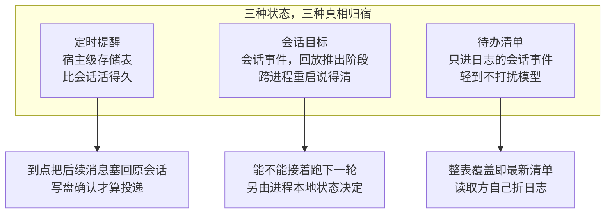
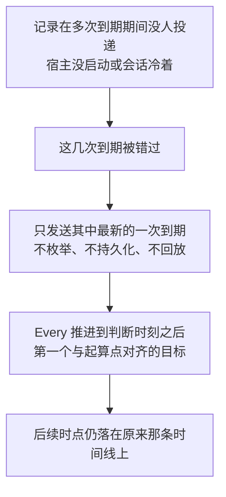
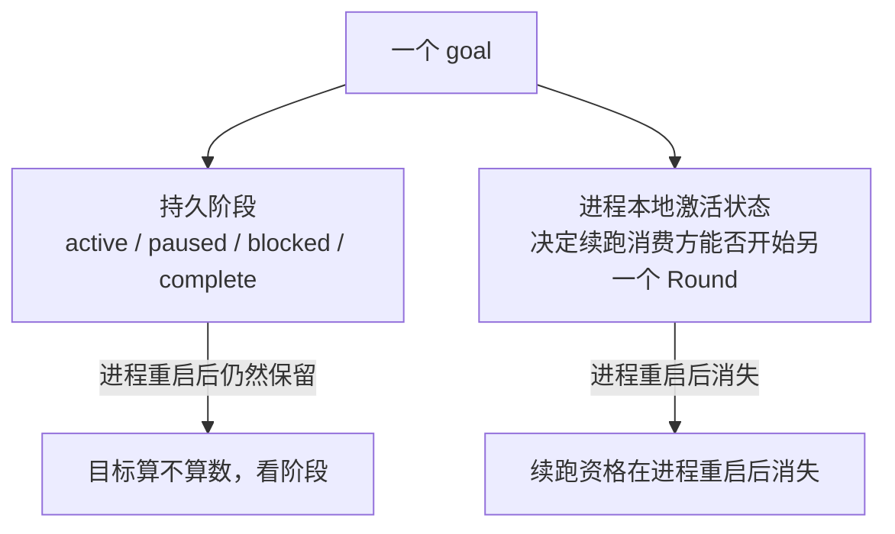
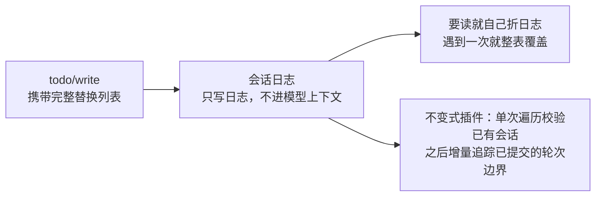

> **读完这篇你能**：知道「让事情自己发生」在 DSH 里由三件不同的东西分管——提醒、目标、待办；理解提醒的固定速率与本地钟表规则各自怎么算，以及错过的间隔为什么不补。
>
> **前置**：[27-一批任务的并行编排](27-一批任务的并行编排.md)。约 30 分钟。
>
> **示例代码**：[dsh-todo-digest](https://github.com/anthonyzhao-4926/blog/tree/main/code/dsh_plugin/dsh-todo-digest)
>
> **DSH 版本**：0.2.0-rc.2

前两篇都要有人先按一下：[26-多 agent 的任务拆解](26-多 agent 的任务拆解.md)是委派，[27-一批任务的并行编排](27-一批任务的并行编排.md)是编排。这一篇讲没人按的时候——**怎么让事情自己发生**，以及怎么让一个会话知道自己在往哪儿走。

题目里的三件事各管一段，别混：

| | 回答的问题 | 形式 |
| --- | --- | --- |
| 提醒（schedule） | 什么时候再叫我一次 | 持久记录，到点变成一轮普通对话 |
| 目标（goal） | 这个会话在追什么 | 持久阶段 + 进程本地的续跑状态 |
| 待办（todo） | 眼下要做哪几件 | 整表替换的清单 |

## 目标

- 知道提醒的几种规则各自保留了什么、不保留什么。
- 理解「错过的间隔不补」这条语义，以及它为什么是刻意的。
- 分清目标的持久阶段与进程本地激活状态这两件事。
- 知道待办清单为什么故意不带 id。

## DSH 设计

没人按的时候，事情要「自己发生」，前提是它的状态有个能自己站住的存放处。提醒、目标、待办这三件事的分管方式，正是由三种「真相存在哪」的答案决定的。先交代一个背景：DSH 里一个会话（session，一段由模型持续推进、有持久记录的对话）发生过的所有事，都会追加进一份只增的会话日志，它是大多数状态的默认归宿——但不是全部状态的。

先看提醒。它的真相存在宿主级存储里，因为它要比会话活得久。宿主（host）是跑 DSH 的那个进程本体。一条定时提醒要在进程重启后仍然有效，也要在原会话没人打开的时候到点，记录就不能跟着某个会话的日志走，所以提醒的权威是一张独立的存储表。会话日志里的旧式提醒事件只剩历史身份：不再填充这张表，也不再触发投递。到点之后的归宿很朴素：把提醒文本作为一条普通的后续消息塞回原会话，宿主需要时把冷会话恢复起来接着聊。而且一次投递只有在会话确认写盘之后才算提交。这条依赖链决定了提醒功能离不开带会话持久化后端的 Web 宿主组合，无界面或纯 SDK 的组合挂不上它。

再看目标。它的真相是事件溯源的：状态靠回放推出，不单独记账。给一个会话挂一个目标（比如「修完这个问题再收工」），每次变更都是一条携带完整快照的会话事件；目标当前处于哪个阶段，只靠从头回放这些事件推出。一个小例子：

```ts
// 某个目标的变更事件依次是：
// 创建(active) → 暂停(paused) → 恢复(active) → 受阻(blocked)
// 从头回放完，当前阶段就是最后一条快照里的 blocked，没有别处可查。
```

这里有个刻意的拆分。持久保存的「阶段」（进行中、已暂停、受阻、已完成）回答「目标发生了什么」；而「现在能不能接着跑下一轮」是进程本地状态，重启即失。两件事寿命不同，所以分两处存放，重启之后才说得清「这目标还算不算数」。并发修改靠版本号做「比较并设置」：带着读到的版本号去改，每次获准的变更把版本号加一，而不是靠锁。

最后是待办。它的真相只在日志里，而且故意不进模型上下文。待办清单的每次写入都是一条只进日志的会话事件，携带整份新清单——模型平时看不见它，想读就得自己把日志折一遍。写整份而不是增量，条目于是不需要 id：没有任何东西靠身份去指某一条。日志既然是它唯一的真相，写进去的就必须始终合法。一个配套的「不变量校验插件」（专门检查会话事件是否合法的伴生插件）会对已有会话做一次完整遍历，之后跟着已提交的轮次边界增量校验，让每条实时写入在追加之前就过检，而不必为重扫整个日志付出成本。



三种归宿没有高下之分，它们是三种寿命的直接表达：提醒比会话活得久，目标要跨重启说得清，待办轻到不该占用模型的注意力。

## 提醒

提醒是**持久**的，而它的归宿很朴素：**到点之后，作为一轮普通的后续对话回到原来那个 Session**（宿主需要时会把它恢复起来）。不是另开一个会话，也不是一条特殊通知——就是接着聊。

六种记录形态，各自保留的东西不一样：

| 形态 | 输入 | 记录里保留什么 |
| --- | --- | --- |
| `after` | 一个正的延时秒数 | 提交的那个**延时**本身 |
| `at` | 一个绝对时点 | 只存**结果时点** |
| `every` | 至少 60 秒的间隔 | 固定**间隔** + 下一个目标 |
| `daily` | 本地 `HH:mm:ss` + 显式 IANA 时区 | 规范化的本地 `time`、`timeZone` + 下一个目标 |
| `weekly` | 本地时间 + ISO 星期集合 + 时区 | `time`、星期集合、`timeZone` + 下一个目标 |
| `cron` | 五字段 Vixie 表达式 + 显式 IANA 时区 | 规范化后的 `expression`、`timeZone` + 下一个目标 |

创建的时候，每个初始目标都会被规范化成**四位年份的 RFC 3339 UTC** 时点。`at` 只留结果是有意的：你既然给的是绝对时点，延时是多少就不再是事实的一部分了。另外每次创建都必须给一个 `title`（去除首尾空白后非空、最多 120 个字符）——它是任务界面上的短名称，宿主绝不从指令里替你派生。

还有一个约束值得记：**`ScheduleId` 全局唯一，而且绝不复用**。删掉再建，拿到的是新 id。

## 固定速率与补偿

六种规则里只有 `every` 是"固定速率"：它衡量的是**经过的时间**，和创建（或最近一次改间隔）的时刻对齐。`daily` / `weekly` / `cron` 是**本地钟表时间**语义，两者不能互换——`every_seconds: 86400` 顶替不了 `daily`。协议里没有共享冷却时间，也没有跨记录的准入门禁：

> 协议不提供共享冷却时间或跨记录准入规则；cron 选择器是钟表时间语义，不是固定速率间隔。

然后是**补偿语义**，这是这篇最该带走的一点：

> 宿主启动时若 Every、Daily、Weekly 或 Cron 记录已逾期，只发送最新一次到期发生时点。Every 推进到投递判断时刻之后第一个与当前间隔起算点对齐的目标……**错过的发生时点不会累积。**

换句话说：**错过的间隔不补**。会话睡着的时候到点了五次，醒来只会提醒你一次，然后从"现在之后第一个锚点对齐的时点"接着走。



这个选择值得琢磨。补发看起来更"忠实"，但会带来一串麻烦：醒来时一口气灌五轮对话，用户真正想要的是"哦，该做那件事了"；而且越积越多的补发会让"提醒"变成"骚扰"。**锚点对齐**则保住了节奏——不管中间错过几次，后续的时点仍然落在原来那条时间线上。

同一会话里多条重复记录同时到期时：它们**合并成一条 follow-up 发出一轮**，每条各带自己最新的一次触发。批处理限制的是模型轮次数，`every` 的一分钟下限限制的是这条记录的定时器频率，两者不是一回事。

## 提醒的持久权威

`schedule/change` 会话事件曾经是提醒的**唯一持久权威**，0.2.0 里这个位置换成了**一张 storage domain 表**：版本 1 的 `schedule` domain、`tasks` 表，每条记录连同原始 `sessionId`、`status: 'active' | 'inactive'` 和可选的 `lastDelivery` 一起存。缺状态的记录按 `active` 规范化。列表、删除这些操作直接读存储，**不会顺手把原会话激活起来**。

老的 `schedule/change` 事件还在，但只剩**历史**身份：它仍能被解码、被 fold，用来读旧会话日志，却**不再填充任务表、也不再触发投递**；旧日志里带的活动提醒要靠 `schedule_create` 显式重建。它保留下来的四种转换，边界当年就划得很清楚：

- **create** 保存完整记录。
- **delete** 是**终结性**的、**仅含 id** 的转换。
- **一次性提醒的 dispatch** 同样是终结性、仅含 id——发过就结束了。
- **`every` 的 dispatch** 携带一个**墙钟判断时刻**，通常只推进活动记录而不终结它。

最后还有一个容易被读错的措辞：投递完成时写下的那条回执表示"后续对话已经同步入队、会话已经 flush"，**并不表示"模型答复成功"或"用户已经读到"**。它是投递事实，不是送达确认。

## 目标

目标（goal）这条线里有一处设计特别值得先讲，因为它最容易被读成一件东西——**这里其实是两个状态**：

> 持久阶段回答**目标发生了什么**。进程本地激活状态则另行回答**续跑消费方能否开始另一个 Round**。

持久阶段是四态：

```ts
type GoalPhase = 'active' | 'paused' | 'blocked' | 'complete'
```

而"能不能再跑一轮"是**进程本地**的。为什么分开？因为"目标被暂停了"和"这次进程里的续跑引擎还在不在"是两件可能不同步的事——进程重启之后激活状态没了，但目标的持久阶段还是原来那个。把两者混成一个字段，重启之后就说不清"这目标到底还算不算数"。



修改目标用 compare-and-set：调用方拿着一个确切的修订版本号去改，**每次获准的持久变更都会把修订号加一**。这正是前几篇见过的模式——并发写靠版本号挡住，而不是靠锁。

```ts
interface GoalRef {
  readonly id: GoalId
  readonly revision: number
}
```

## 目标的阻塞

四个阶段里，**`blocked` 是唯一表示「因问题而停止」的持久状态**。它带一个原因对象：

```ts
interface GoalBlockReason {
  readonly code: string
  readonly message: string
}
```

两个字段各有用处：`code` 是**稳定的、lower-kebab-case 的分类**，用来做路由——下游可以按它决定怎么办；`message` 是非空的人话说明，给人看也给模型看。

这个分工值得抄：**机器要的那个标识和人类要的那段解释，别塞进同一个字符串**。塞在一起的下场通常是两边都不好用——代码要解析自然语言，人看到一坨密文。

## 待办

待办这条线的设计目标是"极简"，而且理由写在定义里：

```ts
interface TodoItem {
  content: string
  status: 'pending' | 'in_progress' | 'completed'
}
```

**只有一句可读内容和三态，没有 id、没有优先级、没有 `activeForm`。** 为什么能这么少？因为**列表每次写入都整表替换**（last-write-wins），条目因此**不需要稳定身份**——没有东西靠 id 去指向某一条。

三态描述的是"模型与 UI 消费方需要的完整可携带生命周期"，而不是一个可以随便扩的状态机。`in_progress` 表示"正在做"，而且**并行工作时可以有好几条同时标着它**——这不是异常。

事件是 `todo/write: { todos: TodoItem[] }`，通过声明合并进会话事件表。它**只写日志**，携带完整替换列表，所以它不会占用模型上下文——这也意味着想读它得自己折日志。配套的不变式插件会**单次遍历**校验已有会话与新发布的会话，之后**增量追踪已提交的轮次边界**，让每个实时的 `todo/write` 都在追加之前得到校验，而不用重扫整个日志。



## 读待办

demo `dsh-todo-digest` 就是上面那句话的实践：`todo/write` 不进模型上下文，所以自己折。

```ts
function latestTodos(session: { seq: number, eventAt(seq: number): unknown }): TodoItem[] {
    let todos: TodoItem[] = []
    for (let index = 0; index < session.seq; index += 1) {
        const event = session.eventAt(index) as { type?: string, data?: { todos?: TodoItem[] } } | undefined
        // 整表替换：不需要合并，直接覆盖。
        if (event?.type === 'todo/write' && event.data?.todos !== undefined) {
            todos = event.data.todos
        }
    }
    return todos
}
```

那个 `todos = event.data.todos` 就是整表替换的全部实现——**没有合并逻辑，因为不需要**。换成增量语义的清单，这里就得写一堆"哪条是新增、哪条被删了"的匹配代码，而匹配又要靠 id。

读出来之后按三态分组：

```ts
const group = (status: TodoItem['status']): string[] =>
    todos.filter((item) => item.status === status).map((item) => `  - ${item.content}`)
```

三个分组各自只在非空时输出，所以空清单和"某一态为空"看起来不一样。

## 验证

```bash
cd code/dsh_plugin/dsh-todo-digest && ./install.sh
```

三步，第三步是重点：

```bash
# 1. 配置对不对
dsh --profile test --dump-config | grep -A3 'id: dsh-todo-digest'

# 2. 让模型列三件事
dsh --profile test "用 todo 工具列三件要做的事，然后调 todo_digest 汇总"

# 3. 只改其中一条的状态，整表重写一次
dsh --profile test "把第二件事标成进行中，其余保持，再跑一次 todo_digest"
```

第三步你应当看到：清单反映的是**最新那一份完整列表**，而不是任何增量叠加的结果。这就是"整表替换"的可观测证据。

再补一个对照：**把模型连续写两次，第二次少写一件事**。第二次之后，少掉的那件就真的不在清单里了——因为整表替换就是"这份新列表就是全部"，不存在"忘了删"这回事。

## 注意事项

- **提醒的规则分两类语义。** `every` 是固定速率（经过的时间），`daily` / `weekly` / `cron` 是本地钟表时间，两者不能互相顶替。`cron` 是五字段 Vixie 方言，最小粒度一分钟，`L`、`W`、`#`、月份与星期名称、`@daily` 风格宏都不接受。
- **错过的间隔不补。** 会话睡着时到点多次，醒来只提醒最近一次，然后从锚点对齐的下一个时点继续。这是刻意的，不是丢事件。
- **`ScheduleId` 永不复用。** 删掉再建拿到的是新 id，别拿旧 id 去指新提醒。
- **投递回执不是送达确认。** 它只表示后续对话已经同步入队——模型答复是否成功、用户是否读到，都不在这条回执里。
- **目标的"阶段"和"能不能续跑"是两件事。** 前者持久，后者进程本地。进程重启后激活状态没了，目标的持久阶段还在。
- **改目标要带版本号。** compare-and-set，每次获准的变更递增修订号；不带就是拿旧版本去覆盖别人的改动。
- **`blocked` 的原因要分成两半。** `code` 稳定可路由，`message` 给人看。别把两者塞进一个字符串。
- **待办是整表替换，条目没有 id。** 想按条目做增量跟踪（比如"这条上次是什么状态"），得自己在外面维护映射——别指望从这个清单本身读出来。
- **`todo/write` 不进模型上下文。** 它只写日志。要在别的插件里读，就自己折日志；这不会干扰模型看到的对话。

---
