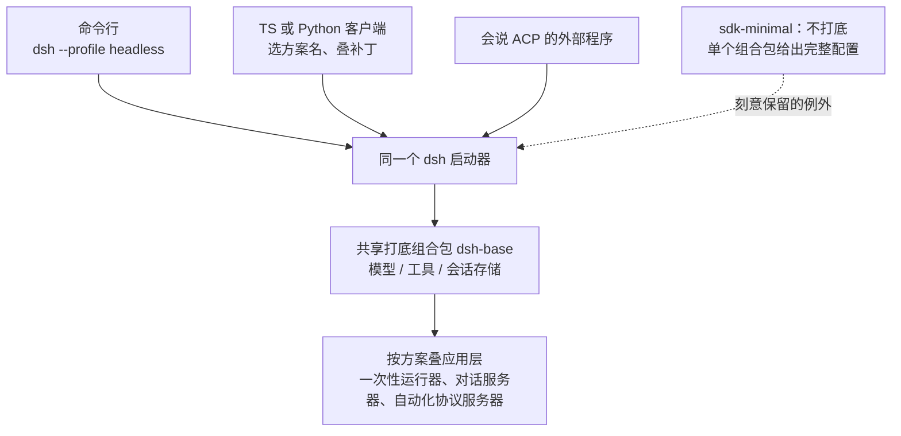
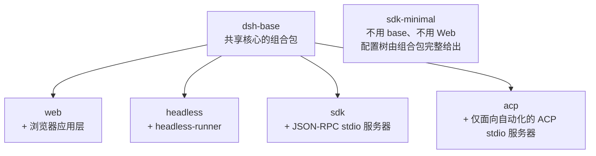
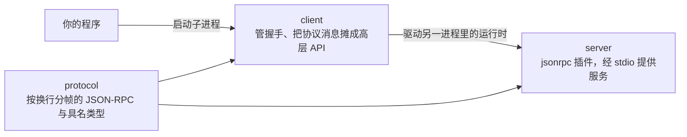
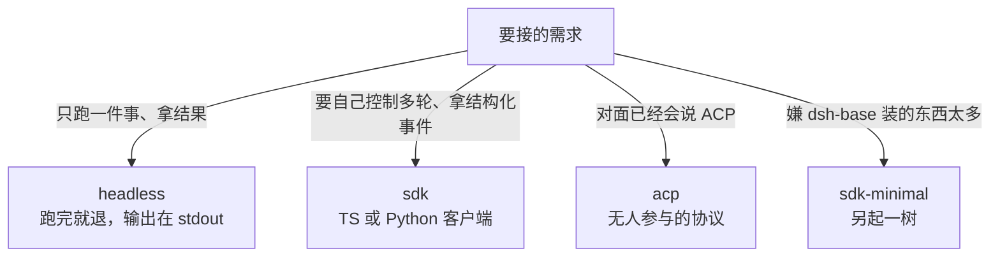

> **读完这篇你能**：知道五个 profile 各自适合什么、`sdk-minimal` 和另外四个差在哪；会在「跑一件事」「自己控制多轮」「对面已经会说 ACP」这三种需求之间选对路。
>
> **前置**：[30-外部事件触发会话](30-外部事件触发会话.md)。约 25 分钟。
>
> **示例代码**：[dsh-embed-lab](https://github.com/anthonyzhao-4926/blog/tree/main/code/dsh_plugin/dsh-embed-lab)
>
> **DSH 版本**：0.2.0-rc.2

前三十篇都在往 DSH 里面加东西。这一篇把方向反过来：**DSH 当一个组件，塞进你的流水线或应用里**。

这件事的入口是 `dsh --profile <名字>`。所以第一个问题是：有哪几个 profile，它们差在哪。

## 目标

- 分清五个 profile 的组成与适用场景。
- 知道什么时候一条命令行就够、什么时候要自己拿协议。
- 理解 SDK 提供的到底是什么（以及它**不**提供什么）。

## DSH 设计

把 DSH 嵌进自己的应用，入口只有一个：启动时选一套具名的配置方案。DSH 把「一个应用」定义成一套方案，叫它 profile——一份清单，写明这套方案要叠放哪些功能包、覆盖哪些配置。发行版自带五套现成的：`web`（浏览器界面，给人用）、`headless`（在命令行跑一个一次性任务）、`sdk`（挂一个供别的进程驱动的服务器）、`sdk-minimal`（最小依赖）、`acp`（挂一个自动化协议服务器）。架构把这条路定为唯一入口：受支持的应用一律用 `dsh --profile <名字>` 启动；想自定义功能组合，也只能用「选一套方案、再叠几份补丁」来表达，而不是另写一个可执行文件。补丁（patch）是逐条声明「插入、替换、停用哪个功能条目」的配置文件。仓库还有专门的校验脚本，把任何绕过这个启动器的应用形态归入拒绝之列。所以「嵌入」从来不是 import 一个库再自己组装，而是选一套方案、起它的进程、按它暴露的方式对话。

入口定下来之后，第二个问题是这几套方案差在哪。答案是：五套方案跑的是同一套运行时，差别只在叠了哪一层功能包。DSH 的功能按「组合包」（bundle，把一批插件——即挂载进系统的功能代码——连同挂载说明打包在一起的分发单位）分发，启动时一层层叠上去，上层可以改下层插入的任何内容。五套现成方案里，四套以同一个叫 `dsh-base` 的组合包打底——模型对接、工具、会话存储、沙箱策略（限制程序能碰哪些文件）都在这一层——再各叠一个应用层包。唯一的例外是 `sdk-minimal`：不打底，由单个组合包给出完整配置。这个例外是被刻意保留的，它说明打底那层也只是一层可选的配置，不是内核的一部分。

方案之外，还要看对外的两条协议路，它们各自把边界收得很窄。一条是 SDK 家族：让另一个进程通过「按换行分帧的 JSON-RPC」驱动完整的运行时——开会话、发提示词、收事件，仅此而已。「按换行分帧」的全部意思就是一行一条 JSON 消息：

```text
→ {"jsonrpc":"2.0","id":1,"method":"initialize","params":{…}}
← {"jsonrpc":"2.0","id":1,"result":{…}}                  带 id 的是响应
← {"jsonrpc":"2.0","method":"session.event","params":{…}}  不带 id 的是通知
```

包组文档明说这些包不创建开发者项目、也不定义应用形态；TypeScript 与 Python 两份客户端说同一种协议、驱动同一个 `sdk` 方案。另一条是 ACP（Agent Client Protocol），一条公开的「程序驱动智能体」协议，定位是仅面向自动化：权限确认必须能由程序直接给答案，取消必须能经协议发起，设计上直接排除「有个人坐在屏幕前」的情形。

最后一条保证关于透明度：配置结果永远摊在眼前，也永远改得动。启动器提供 `--dump-config`，能把某套方案最终叠出的完整配置树打印出来；树上打印出来的任何条目，都可以用一份自己的补丁替换。这条保证让「选一套方案」不是接受一个黑盒：先看清它装了什么，再决定要不要改、改哪一行。



嵌入 DSH 要做的决定因此永远只有两个：选哪套配置方案，以及跟它说哪种话。

## 五个 profile

它们的关系可以用一句话概括：**`web` / `headless` / `acp` / `sdk` 都以 `dsh-base` 为基础，只有 `sdk-minimal` 不是。**



| profile | 适合什么 | 组成 |
| --- | --- | --- |
| `web` | 给人用 | `dsh-base` + 浏览器应用层 |
| `headless` | 一次性任务 | `dsh-base` + 命令行任务应用（`headless-runner`） |
| `sdk` | 你自己的程序要驱动它 | `dsh-base` + SDK 的 JSON-RPC stdio 服务器 |
| `sdk-minimal` | 要最小依赖 | **不用 `base`、不用 Web**，由一个组合包给完整配置树 |
| `acp` | 已有支持 ACP 的客户端 | `dsh-base` + 仅面向自动化的 ACP stdio 服务器 |

`dsh-base` 本身只是一个**共享核心的组合包**，没有自己的 `ctx` key——它存在的意义是让上面那几个 profile 不必各自重复一份基础配置。这条和[01-profile、bundle 与插件的关系](01-profile、bundle 与插件的关系.md)讲的「profile 是层叠出来的」是同一件事，只是这次你是在**选**一层现成的。

内置组合包从 dsh 安装目录解析；**树外的组合包通过 `dsh plugin --profile <name> add <package>` 装进 profile**——这就是[18-把插件打包成配置包](18-把插件打包成配置包.md)那套，只不过那次你给别人装，这次你给自己装一个自定义 profile。

## 最省事的一条路

如果需求是"跑一件事，把结果给我"，`headless` 就够了：

```bash
dsh --profile headless "看一遍当前仓库，列出三个最可能出问题的地方"
```

它跑完就退，输出在标准输出上。**没有会话要管、没有连接要维护、没有协议要懂。**

很多"把 AI 接进 CI"的需求到这一步就结束了。在往下走之前，先确认自己不是这种情况——多写一层协议客户端是要付维护成本的。

## 需要多轮就上 SDK

`headless` 的局限是它只有一问一答的形态。当你要的是"开着会话、看着它一步步做、中途还能插一句话"，就得自己拿协议：`--profile sdk`。

SDK 家族让**另一进程**通过**按换行分帧的 JSON-RPC** 驱动完整的 DSH 运行时。三个包分工明确：



| 包 | 职责 |
| --- | --- |
| `protocol` | 协议格式：按换行分帧的 JSON-RPC 传输，以及具名的请求、结果与通知类型 |
| `client` | TypeScript 客户端：启动运行时子进程，通过高层与协议层 API 驱动 agent 轮次 |
| `server` | `jsonrpc` 插件：通过 stdio 为进程外 SDK 客户端提供服务 |

有一点要点名：**这些包不创建开发者项目，也不定义其他应用**。SDK 是一套"驱动运行时"的方式，不是一个脚手架——它不会替你 `init` 一个工程出来。

## 协议很朴素

demo `dsh-embed-lab` 里的客户端是**手写协议帧**的，因为协议本身够简单：

```js
/** 按换行分帧的 JSON-RPC：一行一条消息。 */
function send(message) {
    child.stdin.write(`${JSON.stringify(message)}\n`)
}
```

整个对话里的消息只有两种：

```js
lines.on('line', (line) => {
    // 有 id 且我们发过它 → 这是一条响应。
    if (message.id !== undefined && pending.has(message.id)) { … }

    // 没有 id → 这是服务器推来的通知。会话事件、agent 状态变化都走这条路。
    if (message.method !== undefined) { … }
})
```

**带 `id` 的是响应，不带 `id` 的是通知。** 这一条分清了，后面就都好办：你要等的答案是响应，你想观察的过程是通知。

这条协议只有三个请求：`initialize`、`session/prompt`、`shutdown`。`initialize` 是运行时就绪边界——握手成功之前 `session/prompt` 会被拒绝；排队一条提示词只返回一个已入队的消息 id，真正的进展全部走通知，所以别等它的响应来代表"做完了"。

服务器主动推的东西里，比较有用的有会话事件、agent 状态变化、以及**子 agent 完成事件**——最后这个正好接上[26-多 agent 的任务拆解](26-多 agent 的任务拆解.md)：从外面也能看见委派出去的活干完没有。

生产里当然不必手写。`@deepseek-ai/dsh-sdk-client` 会帮你起子进程（用**具名 profile 加有序 patch**）、管握手、把协议层消息摊成高层 API。而 **Python SDK 用的是同一种协议**，并附带打包运行时——所以你的流水线是 Python 的话，用那一份就行，两边可以互换。

但手写一遍的价值在于：**你会知道那一层封装底下到底是什么**。出问题时，"为什么这个事件没收到"和"为什么这个响应对不上 id"，是两个完全不同方向的排查。

## ACP：对面已经有客户端

`acp` 这条路的定位很特别：**它是仅面向自动化的协议**。

如果你的对面已经是一个会说 Agent Client Protocol 的东西（比如某个编辑器或其他 harness），那不用自己写驱动——起 `--profile acp`，让它来说。

ACP 服务器让程序可以：**创建、列出、恢复、关闭会话；挂载标准 MCP 服务器；选择模型选项；发送文本与图片提示词；接收语义更新；响应权限提示；取消工作**——全程**无需人类参与**。

注意列表里那两项：**响应权限提示**和**取消工作**。它们说明这条协议在设计上就把"会有人类在场"这件事排除掉了——权限提示得有程序化的答案，取消得能通过协议发起。所以别拿它当"给人用的界面的无头版"。

反过来，DSH 自己内部要驱动一个 ACP 服务器时，用的是配套客户端 `dsh-subagent-acp`——也就是[26-多 agent 的任务拆解](26-多 agent 的任务拆解.md)里那种「进程外的子 agent 提供方」。**同一条协议，两个方向都在用。**

## 怎么选

一句话版：



- **只想跑一件事** → `headless`。别过早上协议。
- **要自己控制多轮、要拿结构化事件** → `sdk`（TS 或 Python 客户端）。
- **对面已经会说 ACP** → `acp`。
- **嫌 `base` 装的东西太多** → `sdk-minimal`。

`headless` 和 `sdk` 之间那条线值得再强调一次：**它们跑的是同一套运行时，差的是你有没有把控制权拿在自己手里**。所以从 `headless` 迁到 `sdk` 不是"换一个产品"，而是"同一件事，换成你自己发起"。

## 验证

```bash
cd code/dsh_plugin/dsh-embed-lab && ./run.sh
```

它做三件事：列出五个 profile、用 `headless` 跑一个真实任务、再用手写的 JSON-RPC 客户端跟 `sdk` 对话一次。

第三步你应当看到两类输出交替出现：**`[通知]` 开头的行**（服务器推来的）和你自己打的 `[已开会话]` 这类行（你发起的请求回来了）。这个交替就是"外面驱动里面"最直观的样子。

如果想再确认一下 profile 的层级关系：

```bash
# 看某个 profile 最终配置成了什么
dsh --profile sdk --dump-config | head -40

# 换成 sdk-minimal 对比：它不用 base，所以树的样子不一样
dsh --profile sdk-minimal --dump-config | head -40
```

## 注意事项

- **先确认 `headless` 不够用，再上协议。** 一个进程、一段标准输出就能解决的事，别为它写一个长连接客户端。
- **`sdk-minimal` 与另外四个的关系是"另起一树"。** 它不用 `dsh-base`、也不用 Web，配置树由那个组合包完整给出。别拿它当"删减版 `sdk`"来理解。
- **SDK 不创建项目。** 它不 `init`、不搭脚手架、不定义应用。你的工程结构是你的事。
- **带 `id` 的是响应，不带的是通知。** 这条分不清，写出来的客户端就会在"等一个永远不会来的响应"上卡住。
- **TS 客户端与 Python SDK 同协议。** 两边可以互换，别为了"跟另一个服务语言一致"而重写驱动层。
- **ACP 是无人的协议。** 权限提示要程序化应答，取消要能通过协议发起。它不是"给人用的界面的无头版"。
- **树外组合包要装进 profile。** 你自己的 profile 不是放个文件就生效，得走 `dsh plugin --profile <name> add`——和[18-把插件打包成配置包](18-把插件打包成配置包.md)给同事分发是同一套机制。
- **子 agent 完成事件在 SDK 里也能看到。** 从外面驱动时，委派出去的活一样可观察，不必自己另建一套上报。

---
