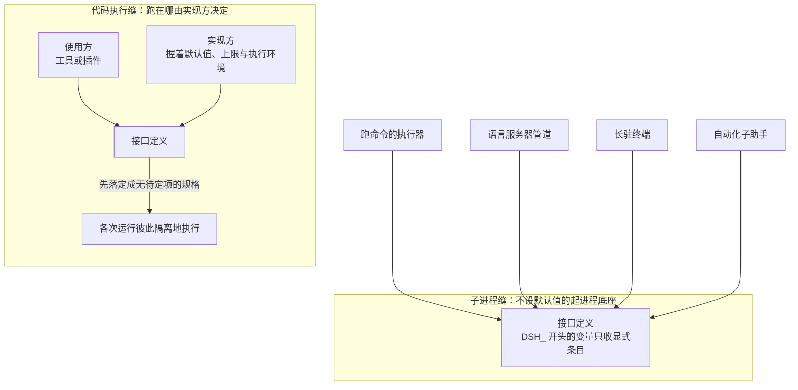
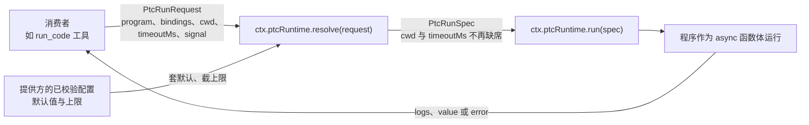
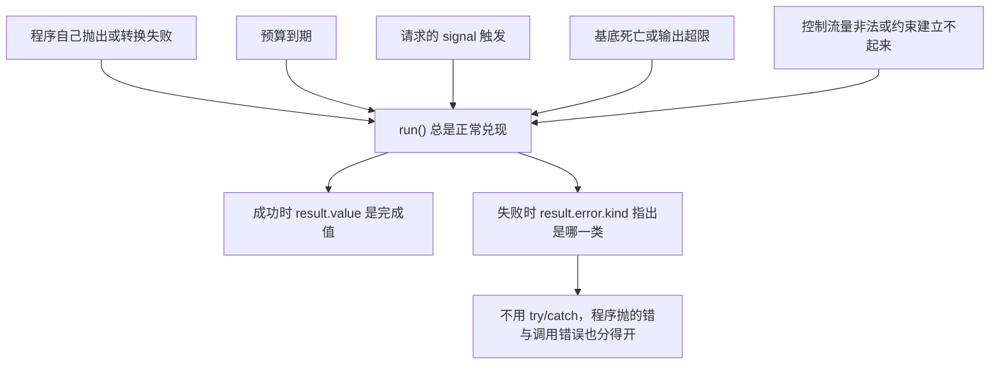
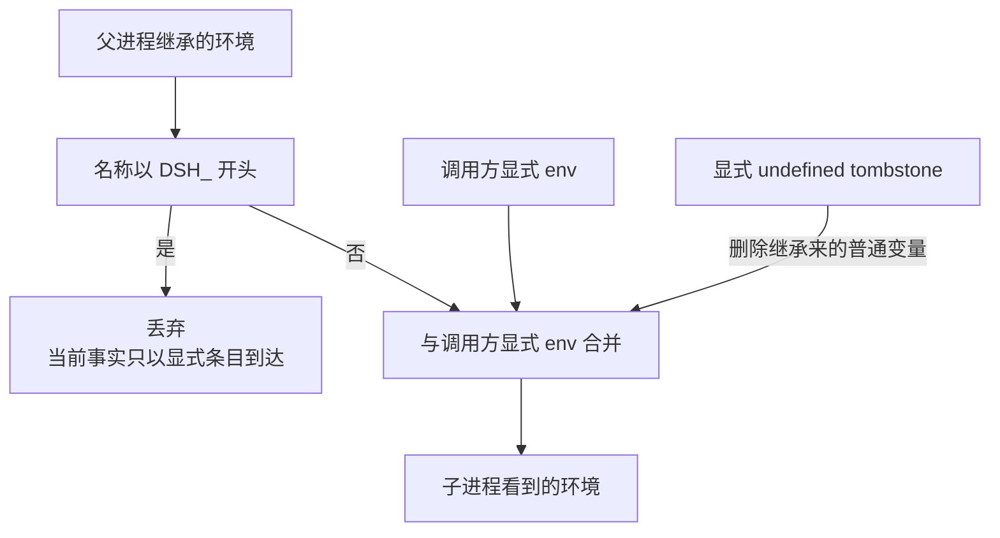

> **读完这篇你能**：知道让模型"跑一段代码"这件事在 DSH 里是怎么接的；理解为什么失败要被分成八个正交的类别、又为什么它是结果里的字段而不是异常；以及子进程那条缝上哪些环境变量归谁管。
>
> **前置**：[32-系统提示词的配置](32-系统提示词的配置.md)。约 30 分钟。
>
> **示例代码**：[dsh-code-lab](https://github.com/anthonyzhao-4926/blog/tree/main/code/dsh_plugin/dsh-code-lab)
>
> **DSH 版本**：0.2.0-rc.2

[32-系统提示词的配置](32-系统提示词的配置.md)讲的是"给模型立规矩"，这一篇讲"给它动手的地方"。

模型写一段代码、跑一下、看结果——听起来简单，但接的时候有几个决定要提前定清楚：**失败怎么报**、**它能看见什么**、**跑在哪儿**。这几条定错了，模型就没法从错误里恢复。

这条能力在 DSH 里叫 **PTC**（程序化工具调用）：宿主把一组函数作为**绑定**交给程序，程序用一个独立的执行基底跑完一段，回来交日志与完成值。PTC 预设下交进去的那份绑定，就是模型的工具表——模型不是一个个调工具，而是写一段程序去调它们。

## 目标

- 分清 PTC 里"请求"与"执行规格"的边界。
- 知道八个失败分类为什么必须分开。
- 理解绑定命名空间的作用与风险。
- 知道子进程那条缝上环境变量的归属规则。

## DSH 设计

**代码执行是一条可替换的能力缝，不是主循环的固定零件。** DSH 把每项能力组织成三件套：一份接口定义、一个实现方、若干使用方——这种结构叫能力缝（seam），换掉实现方，使用方一行不用改。跑代码这件事叫 PTC（程序化工具调用：宿主把一批函数交给一小段程序，程序在独立的执行环境里跑完，交回输出与结果）；子系统文档把它的身份写死：可选能力，不属于驱动对话的主循环。部署可以不装它，装了也可以换——程序跑在 worker 线程、独立进程还是容器里，由实现方决定，接口只如实报告、不作安全承诺。「可换」甚至延伸到命名：程序里看到的全局变量名必须落在各种语言都合法的标识符子集里，`$tools` 这种只在 JavaScript 里合法的拼写是被设计明确拒绝的——同一份名字表要对每个后端都成立，换实现方才不会废掉已经写好的程序。

**默认值与上限的决定权归实现方，所以请求要先「落定」成规格。** 调用方提交的请求里，工作目录、时间预算都可以留空；实现方先用一步 `resolve()` 校验支持的选择、套上出厂默认值与上限，产出一份不再有任何待定项的执行规格，`run()` 只执行规格，绝不替谁补一个缺失的选择。同一条原则在更底层的子进程缝上推得更彻底：那条缝不设任何默认值——每条输入输出流怎么接、上限多少、在哪个目录跑，全部要在请求里逐项写明，由调用方自己的配置决定，而不是被某个隐藏的服务默认值悄悄决定。

**失败被分成互不重叠的类别，并且作为结果里的字段返回。** 执行接口的 `run()` 永远不抛异常：程序跑挂了，错误放在结果的一个字段上，调用方读字段，而不是写 try/catch。失败类别有八种，设计要求彼此正交——预算耗尽不是异常，被取消不是超时，执行环境整个崩掉（比如内存耗尽）又不是其中任何一个。分这么细不是洁癖：每一类指向一种不同的补救动作；压成一句「运行失败」，能用来自救的信息就全丢了。

**子进程缝是底座，不是工具。** 它的使用方不是模型，也不是普通插件（挂载进系统的功能代码），而是其他能力缝：跑命令的执行器、语言服务器的协议管道、长驻终端、自动化子助手，都架在它之上起进程。它还替整个系统看住一类环境变量：凡是以 `DSH_` 开头的变量都归运行时自己所有——起子进程前先把环境里已有的同名变量丢掉，只放行调用方显式写出的条目；想删掉一个从父进程继承来的普通变量，也有正式的「留空即删除」写法，而不是塞一个空字符串。



各次运行彼此隔离、失败分类各指一条自救路、默认值只住在实现方一侧——这三件事合起来，就是「执行环境可以换」在接口上的样子。

## 一条可选的缝

PTC 执行是一个标准的能力 seam：**Service Definition 用宿主提供的异步绑定，运行一段模型编写的程序，报告它的输出、完成值与适用的沙箱事实。**

有一句话要留意：**PTC 执行是可选的，不属于 agent loop 主干。** 这就是为什么它的词汇定义在子系统页而不是 `core.md` 里——主干上的东西不能是可选的。

一次运行交给服务的是一份请求：

```ts
interface PtcRunRequest {
  program: string
  bindings: PtcBindingNamespace[]
  cwd?: string
  timeoutMs?: number | null
  sandboxPolicy?: SandboxExecutionPolicy
  signal?: AbortSignal
}
```

请求里的可选项在真正执行前都会被定下来，中间隔着一个 `resolve()`：

> **`resolve(request)` 校验支持的选择并套上部署默认值与上限，返回一份目录与截止时间都明确的 `PtcRunSpec`；`run(spec)` 执行它。** 也就是说 `run` 永远不会去补一个缺失的目录或截止时间选择。

```ts
interface PtcRunSpec extends PtcRunRequest {
  cwd: string
  timeoutMs: number | null
}
```

所以那几个可选字段各自的含义是：

- **`cwd`**：程序在挂载的文件系统与子进程执行世界里的工作目录。省略时由提供方从沙箱策略的工作区根解析，`resolve` 之后必须是绝对路径。
- **`timeoutMs`**：经过时间预算（含嵌套的工具与审批等待）。省略用提供方默认值，给数值会被截到部署上限，**`null` 表示明确要求不设截止**。
- **`sandboxPolicy`**：这次执行的授权。不做约束的提供方会拒绝显式传入的策略。

服务上还有一个 `timeout` 只读属性：支持逐次覆盖的提供方在这里报告**默认值与上限**（`dsh-ptc-runtime-node` 出厂是 120 秒默认、600 秒上限），不支持逐次覆盖的返回 `undefined`——消费者在这种提供方上就不该露出超时旋钮。

`program` 会**作为 async 函数的函数体运行**，所以顶层 `await` 和 `return` 都能用，而完成值会成为结果的 `value`。

把请求、规格与执行放在一起看：



## 绑定：宿主函数作为程序全局变量

`bindings` 是把宿主能力交给程序的方式：

```ts
interface PtcBindingNamespace {
  global: string
  functions: Record<string, PtcBindingFunction>
  errorClass?: PtcBindingErrorClass
}

type PtcBindingFunction = (args: unknown) => Promise<PtcJsonValue>
```

**一个命名空间一个全局对象。** 也就是说你声明 `global: 'lab'`、里面有个 `upper` 函数，程序里就能直接写 `lab.upper({ ... })`。

这里有几个判断要做对：

**给多宽？** demo 里只给了两个函数。把整个 `ctx` 递进去的那种做法很方便，但它等于把插件的全部能力（包括注册、销毁、访问服务）暴露给一段模型写的代码。PTC 预设自己交进去的命名空间叫 `tools`，装的就是模型的工具表——**一个命名空间的宽窄，就是一段程序能碰到的边界**。

**名字要可移植。** `global` 必须是 `[A-Za-z_][A-Za-z0-9_]*`，不能是任一目标语言的保留字；后端自己占用的名字（`console`、`__dsh_main__`、`__builtins__`、`__name__`、`__debug__`）也被统一拒绝。这条故意不按后端分家：**一份在 TypeScript 后端能用的命名空间表，在 Python 后端上也必须能用**。

**参数与返回值都是无损 JSON。** 绑定函数只收一个参数：程序那边写 `lab.upper({ text: 'x' })`，宿主这边收到的就是那个对象。传一个不能无损序列化的值会被拒绝，而不是把这次运行弄坏。

**异步。** 绑定函数的签名是返回 Promise 的，所以程序里调它们得 `await`。

还有一个容易漏的约定，写在 `signal` 的注释里：

> **in-flight 的绑定调用是调用方自己的事——runtime 只是不再问了。**

也就是中止时，runtime 会硬停下那段程序（**即使在循环中间**），但**已经在执行中的绑定调用不会被它收回**。那些调用的结算归调用方。如果你写的绑定是"发一个网络请求"，那它得自己处理中止。

## 失败是字段，不是异常

这套接口最反直觉的一条在这里。

`run()` **不会返回被拒绝的 Promise**。它总是正常兑现，把错误放在结果里的一个字段上：

```ts
interface PtcRunResult {
  sandbox?: PtcRunSandbox
  value?: PtcJsonValue
  logs: string[]
  error?: PtcRunFailure
}
```

理由和 shell 执行器那条约定一致：**报告程序失败是调用方的职责，不走异常路径。**

这两条路带来完全不同的写法。用异常的话，调用方要 `try/catch`，而 catch 到的东西和"程序自己抛的异常"混在一起——你分不清"这段代码写错了"和"这段代码里真的 throw 了"。用字段的话，这两件事天然分得开（后者是 `kind: 'exception'`）。

`sandbox` 还要单独说一句：它是一份**独立的事实**——这次执行用了哪种文件效果模式、有没有观察到拒绝、约束后端报告的完整性如何，各说各话。**程序成功并不证明每一项请求限制都被强制执行了。**

## 八个失败分类

失败类型是**正交的结果、独立报告**的：

```ts
interface PtcRunFailure {
  kind: 'exception' | 'timeout' | 'abort' | 'worker-exit' | 'invalid-output' | 'output-limit' | 'protocol' | 'sandbox-unavailable'
  message: string
}
```

子系统文档对"正交"的解释写得很直白：

> 预算耗尽不是异常，中止不是超时，基底崩溃（如 OOM）也不是二者中的任何一个。

逐个看这八个，能看出它们对应的是**八种不同的自救方式**：

| kind | 什么情况 | 模型该做什么 |
| --- | --- | --- |
| `exception` | 程序抛出，或解析/转换失败 | 改代码 |
| `timeout` | 实现自己的预算到期 | 缩短任务、别写死循环 |
| `abort` | 请求的 `signal` 触发了 | 这是被叫停的，不是它的错 |
| `worker-exit` | 执行基底死了（如 OOM） | 少占内存，或任务本身太大 |
| `invalid-output` | 完成值不是无损 JSON | 返回值改成可序列化的 |
| `output-limit` | 序列化的日志/值/诊断超过上限 | 少打印点东西 |
| `protocol` | 程序发出的控制流量非法或超出预算 | 别绕过顶层 `return` 与 `console` 那条通道 |
| `sandbox-unavailable` | 要求的约束没能建立起来 | 不是代码的问题，是环境的问题 |

如果这八种被压成一个"运行失败了"，模型能做的只有瞎猜。分开了，它至少知道**是改代码、还是改任务规模、还是别打印那么多**。`message` 的定位也写在注释里：**适合喂回给模型让它自我修正**。

八类成因都从同一条出口出来：



## 输出与上限

关于捕获的输出，有几条实现层面的约定：

- **日志是纯字符串。** `logs` 是一个字符串数组，每个来源通道保留自身的发出顺序；但**通道元数据不属于这条缝**，所以相互独立的通道之间怎么交错由后端决定——别依赖两个通道之间的相对顺序。
- **上限作用在"可变载荷"上**：序列化后的外层日志数组，加上完成值或失败消息的组合载荷。**固定的结果封装语法与 Consumer 展示空白不计入这份计量**——也就是说你不用担心格式化开销吃掉了你的预算。
- **超限或完成值不合法都会显式失败**（`output-limit` / `invalid-output`），**而不会在值里插入替代内容**。这一点和 [21-文件访问的三层管控](21-文件访问的三层管控.md)里"截断要说清楚"是同一种态度：悄悄塞个 `...` 进去，模型会以为那就是全部。

## 两个只读描述符

服务上还有两个描述符，是给消费者做展示与前置判断用的：

- **`language`**：程序必须使用的语言。已知值是 `'typescript'` 和 `'python'`——**TypeScript 后端已发布，Python 后端为实验性且私有（未发布）**。它只是信息、不做门禁：生成语言相关展示的消费者要据此切换，**遇到自己无法展示的语言时应显式报错**，而不是硬渲染。[27-一批任务的并行编排](27-一批任务的并行编排.md)那条 workflow 路子的实现（`@deepseek-ai/dsh-workflow-ptc`）就是这么用的：运行时不是 TypeScript，它直接拒绝。
- **`isolation`**：执行基底，取值 `'worker-thread'` / `'process'` / `'container'`。这个字段有个必须点明的限制——它是**仅为诊断标签，不构成安全承诺**。别看着 `container` 就以为得到了沙箱隔离的保证；安全边界是 [21-文件访问的三层管控](21-文件访问的三层管控.md)讲的那三层（沙箱、观察策略、权限预设）在管，PTC 这边真正做约束的是那次执行的 `sandboxPolicy`。

另外两条实现在自身上的约束：**各次运行必须彼此隔离（无跨运行状态）**；**dispose 时要等系统完全停稳**——teardown 会等到所有进行中的运行都已经终止并结算才完成。

## 子进程

代码执行是一条缝，子进程是另一条，两者常一起用。

子进程 seam 的消费者**不是插件，而是其他能力 seam 与进程外后端**：bash 执行器家族用收集模式的批量输出、LSP 用原始协议管道、PTY 后端用终端原语、ACP subagent 后端用管道传输的 ndjson 并让 stderr 走 inherit。所以它是**底座**，不是给模型直接用的工具。

它拥有三样东西，其中第一样最容易被忽略：

**受管的 `DSH_*` 环境命名空间。** 规则是：实现会在**合并调用方显式 `env` 之前，丢弃环境中已有的 `DSH_*` 名称**。所以当前事实**只会以有意提供的字符串条目形式到达**子进程。反过来，**显式的 `undefined` tombstone 会删除普通环境中已有的值**——这是一条正经的"删除环境变量"的路子，而不是"给个空字符串"。

子进程环境的合并规则：



**共享的凭据清除**（`scrubbedParentEnv`）。父进程的环境不会原封不动传下去。

**`CollectedOutput` 形状。** 每条被收集的流都报告自身的截断与 spill 恢复状态：`text` 在截断时是流的**尾部**，`truncated` 标明有没有丢字节，`spillPath` 指向装着完整流的文件（截断且可用时）。

可执行文件的查找走 `resolveExecutable(command, env?, signal?)`：**要么是验证过的绝对路径，要么通过提供方清理后的 `PATH` 加有意覆盖来解析裸名称**。

还有一句描述解释了"显式 spawn"这个说法的由来：**一个提供方的 spawn 工作目录、可执行文件路径、普通进程与终端会话，和挂载的文件系统提供方处于同一路径与进程命名空间**。也就是说子进程看到的世界和你挂的文件系统是同一套坐标——这是它能被权限与沙箱策略有效约束的前提。

## 跑一段代码

工具侧现成的那条路是 `run_code`：PTC 预设里，`@deepseek-ai/dsh-agent-tool-presentation` 会以 `mode: ptc` 声明这个 agent 的工具呈现方式，于是 `@deepseek-ai/dsh-tools` 只把 `run_code` 一个工具交给模型——它把模型的工具表作为名为 `tools` 的绑定交给程序，并声明**只有 `run_code` 能被直接调用**。这个工具名被运行时保留，别的插件既不能注册也不能遮蔽它。

想在自己的插件里跑程序，就直接消费 `ctx.ptcRuntime`。demo `dsh-code-lab` 的核心就是一次运行加上对结果的正确处理：

```ts
// 请求进，规格出：resolve 校验支持的选择、套上部署默认值与上限。
const spec = ctx.ptcRuntime.resolve({
    program,
    // 绑定 = 暴露给这段程序的全局变量，一个命名空间一个全局对象。
    // 只暴露该给的，别把整个 ctx 递进去。
    bindings: [{
        global: 'lab',
        functions: {
            now: async () => new Date().toISOString(),
            // 绑定函数只收一个参数：程序那边写成 lab.upper({ text: 'x' })。
            upper: async (args: unknown) => {
                const text = (args as { text?: unknown }).text
                return typeof text === 'string' ? text.toUpperCase() : ''
            },
        },
    }],
    // 省略 timeoutMs 用提供方默认值；给了数值会被截到部署上限。
    ...timeoutMs === undefined ? {} : { timeoutMs },
    signal: exec.signal,
})

// run 拿的是规格，不是请求：目录与截止时间在规格里已经明确。
const result = await ctx.ptcRuntime.run(spec)
```

注意**没有 `try/catch`**——因为失败不会走出异常路径：

```ts
// 失败是字段，不是异常——所以这里不需要 try/catch。
if (result.error !== undefined) {
    // 每个分类都值得原样告诉模型：它据此知道下一步该改什么。
    return `运行失败（${result.error.kind}）：${result.error.message}`
}
```

那行 `return` 里把 `kind` 和 `message` 都带上，是因为**这两样都是给模型自我修正用的**。只报一句"运行失败"等于把它能用的信息全丢了。

最后把两个描述符一并报出去，便于排查"为什么这段在别的机器上跑不了"：

```ts
return JSON.stringify({
    打印输出: result.logs.join('\n'),
    返回值: result.value ?? null,
    // 基底与语言是服务上的只读描述符，报出来便于排查「为什么这段跑不了」。
    语言: ctx.ptcRuntime.language,
    执行基底: ctx.ptcRuntime.isolation,
}, null, 2)
```

## 验证

```bash
cd code/dsh_plugin/dsh-code-lab && ./install.sh
```

四步，后两步是重点：

```bash
# 1. 配置对不对（一行：我们的工具；PTC 运行时提供方由 dsh-base 配置）
dsh --profile test --dump-config | grep -A3 'id: code-lab'

# 2. 跑一段正常的
dsh --profile test "用 run_snippet 算一下 1 到 100 的和，把返回值打印出来"

# 3. 跑一段会抛异常的
dsh --profile test "用 run_snippet 运行 throw new Error('boom')"

# 4. 跑一段死循环，并把预算显式压到 5 秒，省得等提供方的默认值
dsh --profile test "用 run_snippet 把 timeoutMs 设成 5000，运行 while (true) {}"
```

第三步应当返回 `运行失败（exception）`，第四步返回 `运行失败（timeout）`。

**这两个必须不一样。** 如果它们都变成一句"运行失败了"，模型就没有任何线索去区分"我代码写错了"和"这个任务太大"——而这两种情况的下一步动作完全不同。

## 注意事项

- **请求与规格是两步。** `resolve` 套默认值与上限，`run` 只执行规格；`run` 不会替你补目录或截止时间。
- **失败是字段，不是异常。** `run()` 总是不被拒绝地兑现，错误在 `result.error` 上。用 `try/catch` 去接它反而会盖住真正的异常。
- **别把八个分类压成一个。** 它们的价值就在于各自指向不同的自救方式。转发给模型时要带上 `kind` 与 `message`。
- **预算是请求里能调的，但会被截到部署上限。** 省略用提供方默认值，`null` 是明确要求不设截止；服务上的 `timeout` 报出这套默认与上限。
- **`signal` 是硬停止，但不收回进行中的绑定调用。** 那些调用的结算归调用方。写绑定函数时要自己处理中止。
- **绑定给多宽是个安全决定。** 一个命名空间一个全局对象，递进去的东西模型都能直接用。别把整个 `ctx` 递进去。
- **绑定名要可移植，值要无损 JSON。** `global` 得是各目标语言都合法的标识符，参数与返回值都得能无损序列化。
- **`isolation` 不是安全承诺。** 它只是诊断标签。真正的边界在沙箱、观察策略与权限预设那三层。
- **超限与非法完成值都会显式失败，不会静默替代。** 这是好事：静默插入的省略号会让模型以为那就是全部内容。
- **别依赖不同输出通道之间的相对顺序。** 每个通道内部有序，通道之间的交错由后端决定。
- **`DSH_*` 归 Harness 所有。** 调用方提供的同名变量会被丢弃；要删一个继承来的普通环境变量，用显式的 `undefined` tombstone，而不是空字符串。
- **Python 后端还没发布。** 已知语言值里有它，但当前只有 TypeScript 后端可用；写展示逻辑时遇到不认得的语言要显式报错。

---
