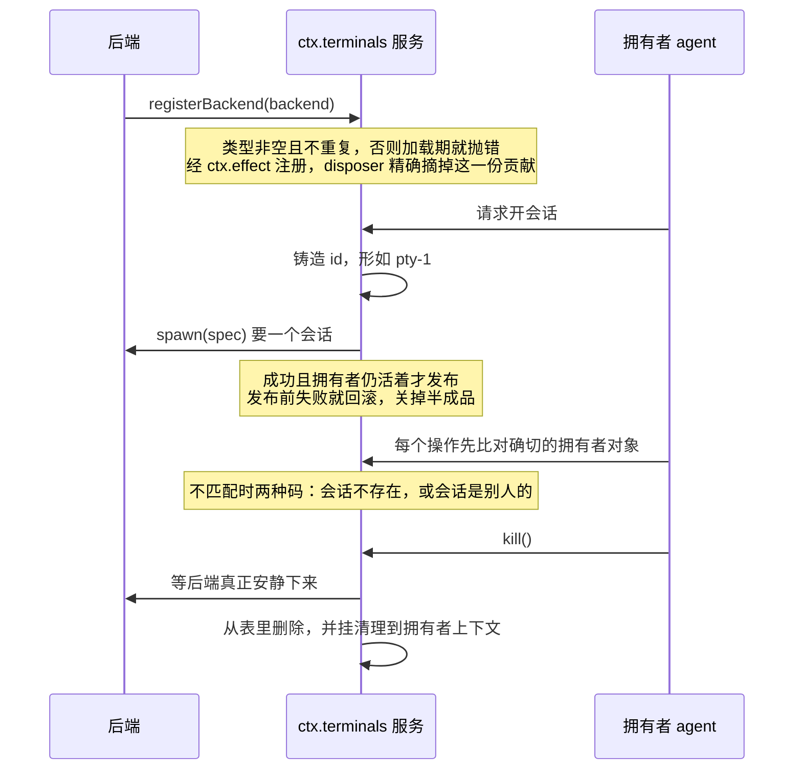
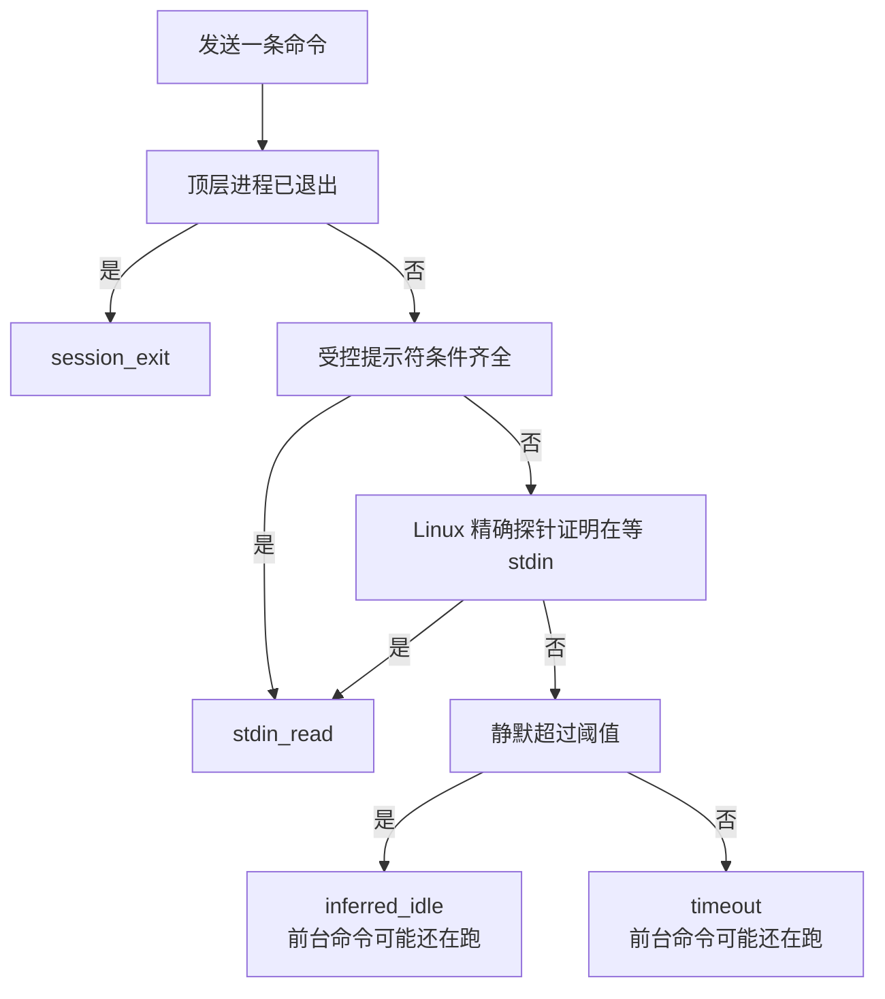
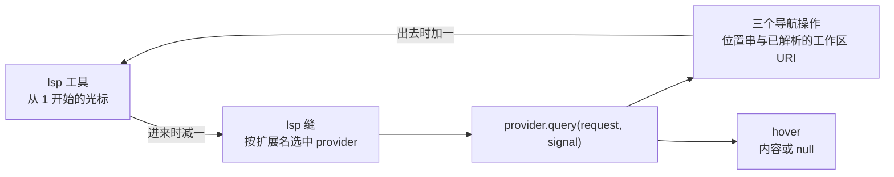

> **读完这篇你能**：知道"长驻终端"和"一次性跑命令"差在哪、为什么前者在大多数人的机器上根本不存在；理解一次发送有四种结束原因、而其中两种并不代表命令跑完了；搞清终端的三层字节上界各管什么；以及让模型会跳转定义、找引用需要几行代码。
>
> **前置**：[代码执行环境的接入](33-代码执行环境的接入.md)。约 35 分钟。
>
> **示例代码**：[dsh-nav-kit](https://github.com/anthonyzhao-4926/blog/tree/main/code/dsh_plugin/dsh-nav-kit)

上一篇讲的是"给它一个动手的地方"，跑完一段代码就结束。这一篇讲两件更靠后的事：**同一个地方连着用很多次**，以及**让模型会导航代码**。

它们排在同一篇里，只因为它们是相邻的需求，不是因为有关系——下面第一节就说清这一点。

## 目标

- 分清长驻终端与一次性子进程各适合什么，代价是什么。
- 知道一次"发送"结束的四种原因，以及为什么 `inferred_idle` 不能当成"命令跑完了"。
- 搞清终端的三个字节上界分别拦在哪一层。
- 知道 LSP 这条缝上四种操作与 provider 契约的形状。
- 明白"找引用永远包含声明"这种设计为什么要把开关删掉。

## 两件互不相干的事

先说一件容易搞错的事：**终端能力和 LSP 能力在装配上完全独立，而且出厂都不生效。**

| 能力 | 包 | 出厂装配 |
| --- | --- | --- |
| 终端服务定义与后端 | `dsh-terminal`、`dsh-terminal-bash` | 只在 `minimal` 预设里 |
| 六个终端工具 | `dsh-tool-terminal` | **一处都没有**，包也不在 dsh 自带的那批里 |
| LSP 三个包 | `dsh-lsp`、`dsh-lsp-stdio`、`dsh-tool-lsp` | **一处都没有** |

`standard` / `ptc` / `cordis` 三个常用预设里，终端的行数是零。工具目录对那六个终端工具的原话是"需要选择启用"。LSP 那边更彻底：三个包出厂一处都没有，全仓只在测试用的组合里出现过（一个远程执行世界的集成测试和一个会话快照夹具），包组 README 的话是 `Deployments must supply and configure their language servers; this group ships none.`

好消息：这三个包和终端那两个都发布在 npm 上，profile 装得到。**所以这一篇实操的第一步是补装配，不是写代码。**

另外还有一个叫 `tmux-context` 的插件，名字里有 tmux，但它和终端能力**没有任何关系**——它不读终端服务，只是把自己在 tmux 里的位置告诉模型。后面单独一节说它。

## 长驻终端与一次性子进程

第 33 篇那条子进程缝：起一个进程，拿到退出码就结束。它丢掉的正好是交互式终端最要紧的东西——**工作目录、导出的环境变量、shell 函数，以及还活着的前台子进程**。

包组 README 给的适用情形很具体：调试器单步、Python/Node REPL 里探索、或者打断一条前台命令之后回到 shell。一次性命令留给"该在一次调用里开始并结束的有界命令"。

还有一条更硬的差别：**终端是一次发送、多次读的**。一次性子进程的结果就是它的全部输出；终端会话保留一份 scrollback，能被反复翻页。

代价也要照实说：**会话不跨进程**。进程退出，PTY 状态和原始字节一起消失。所以它不适合"跑一个要一小时的构建然后下次再来看"。

## 三件套的另一份实例

读者在第 08 篇见过服务定义 / 提供方 / 消费者这三件套。终端就是它的另一份实例：

| 角色 | 包 | 服务键 |
| --- | --- | --- |
| 服务定义 | `dsh-terminal` | `ctx.terminals` |
| 提供方（后端） | `dsh-terminal-bash` | 注册到 `ctx.terminals` |
| 消费者（模型面） | `dsh-tool-terminal` | 注册到 `ctx.tools` |
| 消费者（出厂在跑的那个） | `dsh-tool-bash-persistent` | 也消费 `ctx.terminals` |

最后一行是重点：读者平时用的那个 `bash` 工具，就是**持久会话的一个消费者**——它在首次调用时开一个会话并记住 id，后续调用复用。也就是说这套机制一直在跑，只是没暴露给你。

后端契约只有两样东西：

```ts
/** Replaceable provider for one PTY session type. */
export interface TerminalBackend {
  readonly type: string
  spawn(spec: TerminalBackendSpawnSpec): Promise<TerminalBackendSession>
}
```

一个后端只需要说明自己叫什么类型、以及怎么开一个会话。终端状态归后端，服务不管这些细节——它管的是 id、发布、授权与等待完成的清理。这句话是这套设计的中心，后面几节都从它推出来。

## 会话的生命周期与所有权

一次会话走五个阶段：

1. **报名**。`registerBackend(backend)` 检查类型非空、不重复，然后走 `ctx.effect` 注册，返回的 disposer 精确摘掉这一份贡献。空类型直接抛，重复注册也抛——加载期就失败，不等到第一次开会话。
2. **铸造身份**。id 由**服务**铸造，形如 `pty-1`、`pty-2`。名字只是拥有者本地的显示元数据，不参与任何判定。
3. **未发布的创建**。`spawn()` 先向后端要一个会话，**成功并且拥有者仍然活着时才开始发布**。发布前失败就回滚，把半成品关掉。
4. **授权**。每个操作先比对拥有者——比的是**确切的那个 agent 对象**，不是 id、也不是名字。失败有两种码：会话不存在、或者会话是别人的。
5. **清理**。`kill()` 在后端真正安静下来之后才把会话从表里删掉；另外还挂了一条清理在**拥有者自己的上下文**上，所以 agent 消失时会话不会漏。

第 3 步的"先建、后发布"和第 5 步的"挂到拥有者身上"，是两个可以直接抄走的写法。它们的共同点是：**任何时刻失败，都不会留下一个谁也管不到的东西。**

有一个反直觉的取舍值得点出来：**服务拥有的是会话的所有权，不是终端状态的所有权。** 后端拥有终端状态、负责让资源停稳；服务只负责 id、发布、授权和等待清理完成。

五个阶段串起来是这样：



## 就绪不是一个布尔值

这一节讲的是最容易搞错的默认预期。

读者大概会默认"发送一条命令，等到它结束，拿结果"。真实的设计是：**一次发送有四种结束原因**，而且它们不是一回事。

```ts
type TerminalWaitReason = 'stdin_read' | 'inferred_idle' | 'timeout' | 'session_exit'
```

| 原因 | 含义 |
| --- | --- |
| `stdin_read` | 有证据表明前台进程在等输入，或者 shell 已经拿回前台 |
| `inferred_idle` | 静默了足够久，**推测**它空闲了 |
| `timeout` | 撞上了绝对上限 |
| `session_exit` | **顶层 shell 退出了** |

后两个尤其要分清：`timeout` 与 `inferred_idle` 只是"我等到这儿先回去"，**前台命令可能还在跑**；`session_exit` 说的是顶层 shell 退了，也**不代表某个前台子进程退了**。

这不是文档里的模糊表述，是系统提示词、后端 README 和子系统文档各自独立强调过的同一句话。给模型的工具提示里甚至专门写了一句防这个误解。

后端到底怎么判定？`dsh-terminal-bash` 按顺序试三层证据，外加一个绝对上限：

1. **顶层进程已退出** → `session_exit`。
2. **受控提示符**：见过提示符标记、见过提示符文本、静默达到一个轮询周期、并且前台进程组就是 shell 自己 → `stdin_read`。
3. **Linux 上的精确探针**：过了起始延迟之后，如果前台进程组"可证明地在等 stdin" → `stdin_read`。这个探针**只在 Linux 上有**，macOS 上"就绪"更依赖提示符与静默。它在判定时还要排除"写入之前就已经存在的那个等待"，否则一条本来就卡在输入上的命令会被当成刚跑完。
4. **静默兜底**：静默超过阈值 → `inferred_idle`。
5. **绝对上限**：`timeoutMs` 在发送开始时就挂好了。

提示符不是猜文本，是**受控提示符**：后端给 bash 注入一个固定的 `PS1`，并让 `PROMPT_COMMAND` 在每次提示前发一个 OSC 标记。这样"提示符出现了"是一个标记事件，不是模式匹配。

静默兜底那里有个细节值得看：多等的那段宽限**只在见过提示符时才有**。原因是前台子进程会继承 `PROMPT_COMMAND`，所以不能光靠标记判断 shell 拿回了前台——静默才是那个兜底。代码里那段注释把这个推理写全了。

可调项与默认值：

| 字段 | 默认 | 作用 |
| --- | --- | --- |
| `pollIntervalMs` | 50 | 就绪轮询间隔 |
| `exactProbeAfterMs` | 150 | 开始做精确探针的延迟（Linux 专属） |
| `idleSilenceMs` | 3000 | 静默多久判 `inferred_idle` |
| `handoffGraceMs` | 500 | 见过提示符后额外等 shell 拿回前台的宽限 |
| `timeoutMs` | 30000 | 一次发送的绝对上限 |
| `disposeGraceMs` | 3000 | 拆除升级到 SIGKILL 前的宽限 |

还有一条**加载期校验**：宽限必须不小于轮询间隔，理由是"宽限窗口里至少得跑一次就绪轮询"。这类约束放在配置校验里而不是运行时断言，意味着写错配置时你会在启动时看到一条人话，而不是在某个凌晨三点看到一次莫名的超时。

后端判定就绪的顺序：



## 三层字节上界

终端输出的量级不可控：一条 `yes`、一个几万行的构建日志。DSH 用三层布防，缺一层都会被真实使用打穿。

1. **单次发送的结果是有界的**。写入时用的是一个有上限的文本缓冲，结算时把它快照成 `viewport`，并置一个 `truncated` 标志。
2. **保留的 scrollback 是有界的**。超行先丢最老的，超字节再按 UTF-8 尾部截。
3. **每次读也是有界的**。`read()` 的 `count` 默认 500 行，但真正生效的是最后那一步字节截断。

默认值：单次读上限 256 KiB、保留 10000 行、保留 4 MiB。另有一条组合约束：**单次读的上限不得超过保留的上限**。工具的产出口径还有自己的上限，默认 256 KiB。

要留意的是第一层：**`maxReadBytes` 不只管 `read()`，它也管发送结算时那份 viewport。** "有界读取"这个说法容易让人以为界只在读那一侧。

分页的坐标系是"相对最新一行"：`offset` 是从最新往回的偏移量，`lineBegin` / `lineEnd` 是同一坐标系下的半开区间。往前翻页就是让 `offset` 加上上一页的行数。

## 发送独占，读和信号不排队

- **同一个会话不允许两个进行中的发送。** 服务层拦一道（报错里带 id），后端再兜一道。后端那道报错可能还带后缀，注明它正卡在"排空 provider 写入"或"排空前台中断"上。
- **`read()` 与 `signal()` 不排队**，直接打到后端会话上。
- **取消不是往终端写一个 `\x03`**，而是对当前前台进程组发真正的 `SIGINT`。后端 README 明说了它从不靠写控制字符来模拟中断。
- **后台发送不是终端自己的能力**，是工具插件把发送操作注册进后台作业服务的结果。

第三条是那种"读代码才能发现、但行为差别很大"的设计：写 `\x03` 只会影响前台的读循环，发信号才真的能中断一个进程组。

## tmux-context 与终端无关

这个插件做的事一句话能说完：**在每一轮的第一步，如果模型进程真的跑在某个 tmux pane 里，就往会话里追加一条带来源标记的位置消息。**

它是 `agent/pre-step` 上的一个 waterfall 监听器，而且开了 `prepend`。门槛有三条：只在第一步、决定不是拒绝、且没被取消时执行。

值得学的是它**怎么确认"真的在 tmux 里"**：拿 pane 的 tty 和本进程的控制终端比对，不匹配就什么都不注入。为什么不直接看环境变量？因为 VS Code 的集成终端会继承 `TMUX` 和 `TMUX_PANE`——变量在，pane 不一定在。

它还有**变更抑制**：把上一次注入的稳定状态块存进一个 session projection，渲染出来的状态没变就不重复注入。这是"请求期注入上下文"这一类插件的基本修养——每次请求都塞一段一样的话，纯粹是烧上下文。

失败一律是 no-op：没有 shell、不在 pane 里、字段数不对、非零退出，全都直接返回原决定。只有执行器本身 reject 才记一条 warning。**"注入位置信息失败"绝不该弄崩当前这一轮。**

配置只有一个字段，它是纯 opt-in（出厂没有任何装配挂过它）。

## LSP 的四种操作

LSP 这条缝暴露的操作是一个**闭合联合**：

```ts
type LspOperation = 'goToDefinition' | 'findReferences' | 'goToImplementation' | 'hover'
```

| 操作 | 解决什么问题 |
| --- | --- |
| `goToDefinition` | "这个名字定义在哪"——文本搜索在重名时给不出唯一答案 |
| `findReferences` | "改它会影响谁" |
| `goToImplementation` | "接口的实现是谁"——文本搜索找不到这层关系 |
| `hover` | "这个符号的类型/文档是什么" |

注意这里**没有**符号列表（documentSymbol）、也没有调用层级。类型注释明说这两样不属于这里的操作，因为它们需要不同的 schema。闭合联合的用意就是：消费方 `switch` 到穷尽，将来新增一个操作会让所有没处理它的地方编译失败。

结果只有两个分支：三个导航操作归一化成"一串位置 + 一个已解析的工作区 URI"，`hover` 归一化成内容或 `null`。

**坐标系要小心。** 这条缝和 LSP 协议一致，用**从 0 开始的 UTF-16**；而面向模型的工具用**从 1 开始**的光标。所以路径上有两次翻转：进来时减一，出去时加一。错一位的典型表现是"明明有定义却查不到"。

还有一条把"容易忘的事"从接口上删掉的设计：**`findReferences` 永远包含声明本身**，因为 host 固定发 `includeDeclaration: true`——**调用方拿不到那个开关**，也就没有忘掉的可能。

一次 LSP 查询在这条缝上的形状：



## provider 契约

这条缝的服务键是 `ctx.lsp`：`registerProvider(provider)` 注册，`query(request, signal)` 按文件扩展名选一个 provider 去执行。一个 provider 只有三样东西：

```ts
interface LspProvider {
  readonly id: LspProviderId
  readonly extensionToLanguage: Readonly<Record<string, string>>
  query(request: LspProviderQuery, signal?: AbortSignal): Promise<LspQueryResult>
}
```

**没有进程、没有协议帧、没有文档同步。** 那些都是 stdio provider 自己的事。这一点让"写一个 provider"变几十行就能做完。

注册是**原子的**：id 与每一个扩展名一起校验、一起预留，任何冲突都不发布任何东西，返回的 disposer 一起释放。扩展名必须是小写、带前导点；一个 provider 内部把 `.TS` 和 `.ts` 都写上也报错。

选择是**按扩展名、每次查询独立、与注册顺序无关**的。`foo.d.ts` 会被归一成 `.ts`，`.bashrc` 这类点文件判成无扩展名，谁都不匹配。

`languageId` **不由请求携带**，而是由缝从 provider 的映射里派生之后再交给 provider，而且它只用于同步瞬态文档、从不参与选择。

另外，这条缝**刻意不提供逃生口**：没有协议类型、没有进程或文档控制、没有通用 JSON-RPC 通道。想直接跟语言服务器说协议，得自己写 provider、自己管进程。

## 一个不依赖语言服务器的 provider

demo `dsh-nav-kit` 把 `[[笔记名]]` 当成符号，注册了一个 provider。核心就是这个对象：

```ts
const provider: LspProvider = {
    id: PROVIDER_ID,
    // 键必须是小写、带前导点。同一个扩展名只能归一个 provider。
    extensionToLanguage: { '.md': 'markdown' },

    async query(request: LspProviderQuery): Promise<LspQueryResult> {
        // 工作区根由调用方给，provider 自己规范化，再把权威 URI 一起回传。
        const root = await ctx.fs.resolve(request.workspaceRoot)
        const resolvedWorkspaceUri = ctx.fs.fileUrl(root)
        const source = await ctx.fs.readText(
            await ctx.fs.resolve(request.filePath, { cwd: request.workspaceRoot }),
        )
        const target = targetAt(source, request.position.line)
        // ……按 operation 分派
    },
}
```

那段注释不是客套话。`locations` 变体专门带一个 `resolvedWorkspaceUri`，就是为了让调用方相对化位置 URI 时有个权威依据——**不能**拿请求里那条可能含符号链接的进程路径、按调用方自己平台的规则去拼。

四个操作的实现长短不一，这是刻意的：

- `goToDefinition`：在所有 Markdown 文件里找同名的那篇，返回它的第 0 行。
- `findReferences`：扫所有笔记里出现 `[[目标` 的行。**结果自然包含声明那一行**——因为声明行本身就写着这个链接。
- `goToImplementation`：返回空数组。

最后一条是这个 demo 最想显形的地方：**这个"语言"里没有接口与实现之分，返回空是合法的。** 四种操作是缝的闭合联合，不是对 provider 的四个承诺。写 provider 时不必为了"凑齐"而编造语义。

另外，`ctx.fs.listDir` 与 `ctx.fs.readText` 都是缝上的方法，不是 `node:fs`。换成沙箱后端或远端后端时这里一行都不用改——这也是"provider 自己规范化工作区"那句话的另一半含义。

## demo 的另一半

`dsh-nav-kit` 的第二个插件是终端的**消费者**：它注册一个 `terminal_journal`，从有界 scrollback 里取一页。

```ts
const page = ctx.terminals.read(owner, TerminalSessionId(args.sessionId), {
    offset: args.offset ?? 0,
    // count 只是请求：后端还会按 maxReadBytes 从 UTF-8 尾部再截一次。
    count: config.pageLines,
})
```

注意它做了两件事：先用 `ctx.terminals.list(owner)` 列一遍，再调 `read`。前一步不是为了安全（真正的归属校验在服务里，比的是确切的 owner 对象），只是为了给出一句人话的报错。

返回值把四个分页字段原样交给模型，因为**它们就是翻页的全部信息**。

## 验证

```bash
cd code/dsh_plugin/dsh-nav-kit && ./install.sh
```

四步：

```bash
# 1. 装配对不对（五行：lsp、md-links、terminal-journal、pty、pty-bash）
dsh --profile test --dump-config | grep -n 'nav-kit'

# 2. 开一个长驻终端，跑一条会刷很多行的命令，再用 terminal_journal 往回翻
dsh --profile test "用 terminal_open 开一个会话，跑 seq 1 20000，然后读最后 200 行"

# 3. 查一个 wiki 链接的定义
dsh --profile test "用 lsp 工具查一下 [某篇笔记] 里 [[另一篇笔记]] 的定义在哪"

# 4. 用同一行查引用
dsh --profile test "对同一行用 lsp 的 findReferences，看看有多少处引用"
```

第三步应该跳到目标笔记的第 0 行；第四步的结果应该**包含声明它自己的那一行**。

第二步要留意返回里的分页坐标：`count` 说 200 行，但真正回来的可能更少——字节上限在后端那一步先生效。

## 注意事项

- **出厂没有终端，也没有 LSP。** 六个终端工具与整个 LSP 家族连包都不在 dsh 自带的那批里。这一篇的第一步是补装配。
- **`inferred_idle` 与 `timeout` 不代表命令跑完了。** 它们只代表"等到这儿先回去"。前台命令可能还在跑；这两种情况和"shell 退了"必须分开报给模型。
- **界有三层，第一层不在 `read()` 里。** 发送结算的 viewport 与保留的 scrollback 都受字节上限约束，`read()` 的 `count` 只是请求。
- **`maxReadBytes` 不只管读。** 它同时是发送结算那份 viewport 的上限。
- **取消是发信号，不是写 `\x03`。** 后者只影响前台的读循环。
- **一个会话同时只能有一次发送，但读和信号不排队。**
- **LSP 的位置有两次翻转。** 缝是从 0 开始的 UTF-16，面向模型的工具是从 1 开始。
- **`findReferences` 一定包含声明。** 这是 provider 内部的责任，调用方没有开关——别在 provider 里再加一个"要不要含声明"的参数。
- **同一扩展名不能给两个 provider。** 冲突与重复都在注册时被原子拒掉，不会等到查询时才炸。
- **`goToImplementation` 返回空是合法的。** 四种操作是闭合联合，不是四个必须填满的槽。
- **provider 必须自己回传权威工作区 URI。** 调用方要相对化位置时用它，不要拿请求里的路径按本地平台规则猜。
- **`isolation` 那样的描述符不是安全承诺**（第 33 篇）。语言服务器本身也没有沙箱——`dsh-lsp-stdio` 信任你配的那个 server。
- **硬杀 harness 会留下孤儿语言服务器。** 同理，暴力终止也会留下 PTY 子进程；后者的清理保证属于子进程提供方，不属于终端后端。
- **`tmux-context` 与终端能力无关。** 它不读 `ctx.terminals`，只是通过 shell 跑两条只读命令。它的失败策略是 no-op：注入位置信息失败绝不该弄崩这一轮。

---

**主线到此结束。** 到这里，从最小插件、事件与工具、界面两半、走出本机，到多 agent 与自动化，再到系统提示词、代码执行、长驻终端与代码导航，这条线走完了。想回头补：[把插件配置搬进设置页](14-把插件配置搬进设置页.md)、[接上公司内部系统](29-接入 MCP 服务.md)、[把 DSH 嵌进自己的应用](31-把 DSH 嵌进自己的应用.md)。
