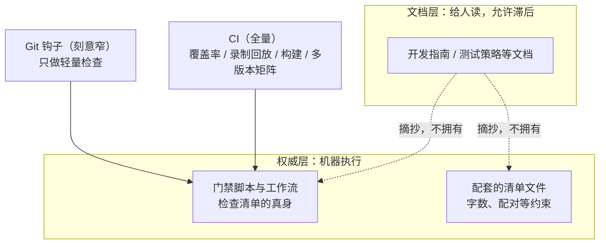
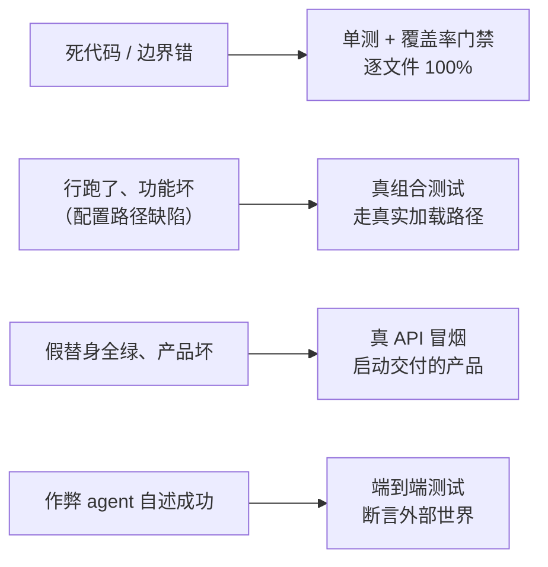

> **读完这篇你能**：知道改一处 DSH 内核代码要过哪些门禁、这些门禁的权威写在哪；知道测试不是"三种"而是七层，以及每一层各管什么；知道哪些文档是机械生成的、改它等于白改；知道能力缝与不变式这两套自检机制在管什么。
>
> **前置**：[35-给团队加一条命令](35-给团队加一条命令.md)。约 40 分钟。
>
> **示例代码**：[dsh-kernel-map](https://github.com/anthonyzhao-4926/blog/tree/main/code/dsh_plugin/dsh-kernel-map)
>
> **DSH 版本**：0.2.0-rc.2

前面三十多篇都在写**仓库外面**的插件。这一篇换到里面：你想改 DSH 自己。

换过去之后，规矩是另一套——而且这套规矩里有相当一部分，写在仓库里就能读到，不用问任何人。

## 目标

- 知道"给 DSH 提 PR"这件事现在到底能不能做，以及不能做时有什么替代。
- 分清文档分了几层、什么东西不许写在哪一层。
- 知道门禁清单的权威在脚本里，不在文档里，而且文档已经漂过。
- 把"三种测试"更正成七层，并分清其中最容易被误读的三条规则。
- 认得"生成物"：哪些文件不许手改，改完该跑哪条命令。
- 知道不变式与防御模式分别防什么，以及外部插件能不能用。
- 会用 postmortem 当反面教材。

## DSH 设计

动手改 DSH 之前，先得知道规矩写在哪一层。开发指南开篇就声明了自己的分工：设计依据与实现细节属于链接的决策记录（Agent Note）和脚本；讲到 CI 时把话说死——门禁清单「以 `scripts/run-gates.ts` 和工作流文件为准」。「门禁」是合并前必须通过的自动检查，「CI」是服务器上对每次提交自动跑的全量检查。在这个分工里，文档天生是二手摘要：它摘抄脚本里的清单，但不拥有它，滞后与抄错是这种分工的成本。所以查证仓库里的任何「事实」之前，先想清楚它的权威住在哪一层。

同一套思路也决定了检查在哪一头跑。「Git 钩子」（提交或推送时在本地自动触发的小检查）被刻意做窄：文档原话是「有意不运行测试、快照、文档检查、构建」，贡献者只跑与改动相关的检查。全量覆盖率、构建冒烟、多个 Node 版本的兼容性矩阵，全部归 CI。提交路径要轻、验证深度靠后放，是同一个设计的两半。



测试也不是三种，是七层；不是数量堆砌，是每种逃逸通道各配一道闸。覆盖率门禁要求逐文件 100%，但它「证明行被执行过，不证明功能按交付预期工作」，必要而不充分，所以后面还有六层。「真组合测试」存在，是因为手工把插件挂进内存会绕开加载器这条真实配置路径。「冒烟测试」把交付的产品真启动一遍、发一条提示词再检查外部世界，专抓「单元测试全绿、产品却坏了」这一类，用假替身（mock）代替真实组件的测试发现不了它。「端到端测试」要求「验证外部世界，而非自我报告」：重跑命令、重读文件，因为只探测 agent（智能体，运行中的对话实体）自己的输出，会放过一个作弊的 agent。



仓库里还有一批文件是脚本从源码机械生成的：模块依赖图、能力目录、持久化目录，乃至文档里粘贴的类型定义块。它们只许重新生成，不许手改。每一块都配着可执行的「与源码一致」检查：校验用解析器把文档内容同源码逐符号比对，不一致就拒绝。文档想引用源码事实又不许漂移，这是唯一的办法。所以「生成物过期」的正确响应永远是改源码或生成器再重新生成，手改投影只会被门禁打回。

运行期也有自检，它的力量来自「独立观察」。DSH 有一张运行期自检注册表：各包把自己的检查挂上去，在系统运行中持续断言。它的准入判据比直觉严得多，只允许断言「包自己拥有的、可被独立观察的关系」：权威事件流或可变数据，「绝不是服务或方法是否存在」（依据 `local/deepseek-harness-dsh-v0.2.0-rc.2/docs/subsystems/invariants.zh.md`）。对比两种写法就明白了：

```ts
// 无效检查：只是确认服务在不在，没有独立观察可言。
(ctx, fail) => {
    if (ctx.get('tools') === undefined) fail('tools 服务丢了')
}

// 有效检查：监听权威事件流，断言它承诺过的关系——
// 流式协议约定 finish 之后不许再有内容块，犯了就报。
(ctx, fail) => {
    ctx.on('llm/stream', (_options, next) => validateStream(next(), fail))
}
```

「检查某个服务在不在」没有独立观察可言、被判为无效检查，就是这个道理。

最后是故事的去处。文档分层里，唯一允许写故事的一层是事故复盘。另一份「防御模式」文档开篇声明：「每条模式都是本项目实际发布或差点发布的一类缺陷，以防止其复发的规则形式陈述」。也就是说，它把故事折成了规则。故事在出事之后归档，规则在写生命周期、并发、子进程代码之前先读。两者是同一枚硬币的两面。

## 一个必须先说的前提

这个仓库的 `CONTRIBUTING.md` 第 9 行写得很直白：

> DeepSeek Harness is still at an early stage and under active development. We are sorry that we cannot accept external pull requests at the moment.

同一个文件紧接着列了官方认可的其他参与方式：在 GitHub Discussions 里报问题、做生态插件（仓库打 `dsh-plugin` topic）、写教程，它甚至补了一句"官方仓库里的包并不比社区创建的包更重要"。

所以这一篇的定位要摆正：**它不是"如何让你的改动被合并"，而是"动手改内核之前要知道什么"。**

这意味着有两条路：

- **想影响 DSH 的行为而不碰它的代码**：写仓库外的插件与 bundle，也就是前面三十五篇在做的全部事情。这条路不受上面那句话影响。
- **想在 fork 里改内核**：这篇文章讲的每一件事都适用——门禁、测试、文档契约、不变式。你只要在 fork 里按同一套规矩跑通，改动就是"能过门禁的改动"，合不合由上游政策决定。

下面讲的内容里，有一小部分（栈式 PR、`gh stack`、加权审批）只在第二条路上才有意义，讲到时会点出来。

## 改内核前先读三份东西

仓库不指望你从代码里猜规矩。三份读前置：

| 文档 | 什么时候读 | 它管什么 |
| --- | --- | --- |
| `docs/architecture.md` | 改 `packages/` **之前** | 有序地图：组合、核心包、循环、能力缝、扩展点 |
| `docs/AGENTS.md` | 改任何文档或 README 之前 | 文档分层、写作规则、字数上限、slop 清单 |
| `docs/defensive-patterns.md` | 写生命周期、并发、子进程、拆卸代码之前 | 七个已经付过学费的缺陷类 |

第一份里最有用的是 `Where new behavior goes` 那张表：一组"想做的事 → 挂在哪"的对应。**新行为要挂在已文档化的扩展点上**，而不是改 `agent-loop`——真要改循环，就得同步更新 `architecture.md`。

## 一处一个事实

DSH 的文档不是"一堆 md"，而是一套**一处一个事实**的分层制度。`docs/AGENTS.md` 里那张表逐层规定了"谁负责什么、什么不许写在那里"（下面是节选，原表还包含 persistence 历史、user 指南、development.md 与 Skills 四层）：

| 层 | 职责 | 不该写的 |
| --- | --- | --- |
| 根 / 子树 `AGENTS.md` | 常驻规则，一到三行，细节链到 owner | 故事、走查、情境性流程 |
| `docs/architecture.md` | 有序地图 | 类型定义、单包细节、决策理由 |
| `docs/subsystems/` | 每个子系统一页参考：类型、语义、生成的 Cordis API | 行为叙述 |
| `.agents/notes/` | 决策记录：为什么、放弃了什么、要验证什么 | 已实现后的计划口吻 |
| `docs/postmortem/` | 事故叙事——**唯一**允许写故事的一层 | — |
| `docs/cookbook/` | 带编号验证步骤的操作指南 | 设计理由 |
| 生成型参考 | 从源码重新生成、有新鲜度门禁 | 手改 |
| 包 README | 单个包的契约 | 别的包的事 |

放置规则一句话：bug → postmortem；理由 → Agent Note；流程 → cookbook；类型 → subsystems；包契约 → README；常驻命令 → 根 `AGENTS.md`。

还有一条写作原则会直接影响你写 PR 说明与文档：**写当前状态，不写变更史**。文档里点名的是活着的机制，不是 PR、提交或"以前/现在"；变更史留在提交、PR、Agent Note 与 postmortem 里。这个仓库的根目录也确实没有 CHANGELOG。

## 门禁的权威在脚本里

最容易被误会的是一件事：**门禁清单不在文档里。**

`docs/development.md` 自己承认这一点——文档只给摘要，明细的权威是 `scripts/run-gates.ts` 与 `package.json`。`run-gates.ts` 里 `gatesForMode()` 是个 switch，按模式返回门禁数组；你要知道自己这个改动属于哪个模式，就去读那段 switch。

常用入口：

| 命令 | 是什么 |
| --- | --- |
| `pnpm run check:all` | 本地全套近似：字面十几项，展开后七十来个门禁 |
| `pnpm run check:ci` | CI 主泳道：静态族 + 契约 + 覆盖率 + 冒烟 + 快照 + 文档 + 构建 |
| `pnpm run doc-sync` | 文档门禁的合集（四十余条） |
| `pnpm run test:docs` | 上面那些里带 `quick: true` 的子集，不构建、不重新生成 |

**Git 钩子刻意很窄**：`pre-commit` 只做暂存区的配对记录校验、归档 Agent Note 校验、暂存 TS 的 lint 与一次有界修复、必要时重生成第三方声明文件、空白检查、vendor 清单守卫；`pre-push` 只跑一次增量 typecheck。测试、快照、文档检查、构建、hygiene 全都不在钩子里——那是 CI 的事。

文档漂过一处，正好是这套制度自己的例子：`docs/AGENTS.md` 那段文字里写 `testing.md` 的字数上限是 **1,300**，而门禁真正读的 `scripts/doc-budgets.manifest.json` 里是 **1350**。**权威是清单**，因为门禁读它。

## 测试是七层

规划里写的是"三种测试"。快照里的 `docs/testing.md` 列了七项：

| 层 | 命令 | 覆盖什么 |
| --- | --- | --- |
| 单测 | `pnpm run test` | 包与脚本的 spec；每个注册表都要有 HMR 安全测试 |
| 覆盖率 | `pnpm run test:coverage` | **CI 真正的门禁**：`packages/*/*/src` 逐文件 100% |
| 真 API e2e | `pnpm run test:e2e` | 真供应商；无 key 自跳过 |
| owner-local 期望 | `pnpm run test:expected` | 无 key 的配置后 CLI/进程期望 |
| 性能基准 | `pnpm run test:bench` | `benchmarks/` 的时间/堆/伸缩预算 |
| 会话快照 | `pnpm run test:snapshot` | 场景的父代提供输入与模型回放，同时作为期望的持久化结果 |
| Web 浏览器快照 | `pnpm run test:web` | Chromium 里比对会话驱动输出与纯 UI 输出 |

三条最容易被误读的规则：

1. **覆盖率是必要的、不是充分的。** 逐文件 100% 只证明"这些行跑过"。这句话有具体的来处，下一节说。
2. **产品可见的插件需要一次真组合测试。** 手工 `ctx.plugin(...)` 挂起来的套件不够——得把 test-only 的 `cordis.yml` 通过 Loader 与进程真启一遍。
3. **要验证世界，不要验证自述。** e2e 的断言要外部重跑命令或重读文件；对 agent 自己输出的关键词探测，会放过一个作弊的 agent。

还有一条硬约束：**任何非平凡的、模型/协议/人可见的改动，都要在同一个 PR 里加或更新一个无 key 的记录会话场景。** 包级测试、e2e、只 mock 的套件都不能替代"组装之后跑出来的那份 transcript"。改了 agent-loop、session-lifecycle 或事件类型的，还要同时更新 TypeScript 与 Python 两个 SDK 的期望输出。

## 生成物：不许手改

仓库里有一批文件是机械生成的。它们首行通常带一句 `do not edit by hand`：

| 生成物 | 生成器 | 新鲜度检查 |
| --- | --- | --- |
| `docs/module-graph.md` | `gen-module-graph.ts` | `verify-module-graph` |
| `docs/graph-atlas.md`、`docs/capability-seams.md`、`docs/event-producer-consumer.md`、组合页、工具执行管线与 agent 生命周期页 | `gen-doc-graphs.ts` | `verify-doc-graphs` |
| `docs/tool-catalog.md`、`docs/config-catalog.md` | 各自 `gen-*` | 各自 `verify-*` |
| `docs/persistence-catalog.md` | `gen-persistence-catalog.ts` | `verify-persistence-catalog` |

**多数 `verify-*` 不是独立脚本，而是同一个生成脚本的 `--check` 模式**——`gen-module-graph` / `gen-doc-graphs` / `gen-tool-catalog` / `gen-config-catalog` / `gen-persistence-catalog` 各有对应的 verify；也有天生没有生成器的（比如 `verify-md-wrap`、`verify-package-invariants`）。所以看到"生成物过期"不要去改那份 md，要去改源码或生成器，再跑它提示的那条 `gen-*`。

两份图谱的分工有一处不对称：

- `gen-module-graph.ts` 拥有**包拓扑**——只画 peer 依赖（"需要共享实例"），普通的 runtime 依赖不画。
- `gen-doc-graphs.ts` 拥有其余的关系页与索引。

它们的陈旧检测**不在同一处跑**：`verify-doc-graphs` 在 `doc-sync` 里，而 `verify-module-graph` 不在（它在 `check-all`、CI 的 static/primary 阶段）。也就是说，只改文档不会碰到模块图，但只要你动了任何一个包的 `peerDependencies`，CI 静态阶段就会红。

新增一个 `ctx` 服务时还有一道机械守卫：`capability-seams` 页的条目来自 `gen-doc-graphs.ts` 里的一张 `SERVICE_ROLES` 表。忘了加，`verify-doc-graphs` 会直接抛 `missing service role classification: <key>`。

报错文案不统一：跑它提示的那条 `gen-*` 就对了，没有固定后缀可背。

```text
gen-module-graph: stale — <文件>. Run `pnpm run gen-module-graph` and commit the result.
gen-config-catalog: stale — <文件>. Run `pnpm run gen-config-catalog` and commit the result.
gen-session-format-catalog: <文件> is stale; run pnpm run gen-session-format-catalog
```

## 能力缝的三角色

想加一个新能力时，第一件事是判断它该不该拆成"缝"。定义在 `architecture.md`：

> A **seam** is a swappable capability with three roles: a **Service Definition** declaring the interface, a **Service Provider** implementing it, and a **Consumer** using it, commonly a model-facing tool. A package may combine roles, but one role alone is not a seam.

三点容易写错：

- **服务定义是 Cordis 的 `Service`**（抽象类，比如 `ShellExecutor`；或具体注册表，比如 `WebRuntime`），**不是 TypeScript `interface`**。命名里的 `ctx` 键与词汇都归它。
- **一个包可以同时占多个角色。** `dsh-user-approval` 就在同一个包里既是定义又是实现。
- **不要预拆。** 设计依据那份 Agent Note 的原话是：只有一个可能的实现和一个消费者时，它就该是一个包，等到第二个出现再拆。

**什么时候拆、按什么命名**，是新增包最容易踩坑的地方——`adding-a-package.md` 里有一张十七个角色词（Controller / Store / Directory / Registry / Runtime / Resolver / Executor / Gateway / Provider / Backend…）的"用/不用"判据表，还有 `ctx` 键单复数的规则（单引擎用单数、注册表用复数，且必须与类角色的数量一致）。

## 不变式：只断言自己拥有的关系

`ctx.invariants` 是一个可配置的注册表服务，用来装**运行期**自检。它的准入判据比大多数人以为的严：

> **只断言包自己拥有的、可独立观察到的关系**；服务存在性、插件元数据、effect、写死的例子都算无效检查。

也就是说，"检查 `ctx.tools` 在不在"不是不变式，那叫"我以为在自检"。真的不变式长这样：包把观察到的事件折成一份可变数据，companion 独立地重折同一条权威事件流，然后比对两者。

**不是每个包都发伴生插件。** 一个包只有在真的拥有"可独立观察的关系"时才发布 `./invariant` 子路径，并按自己完整的 npm 包名注册检查；没有这种关系的包**省略**这个子路径、导出、发布与构建条目，改成在包 README 里写一句它自己的原因。**空安装器会被门禁拒绝**——"源码不存在 + README 里那句解释"才是"决定过"的表达。

这条规则换过一次代，正好是这一篇主题的又一个实例：`docs/subsystems/invariants.md` 那一节至今还写着"每个 workspace 包都拥有一个 companion，没有可查的就导出一个以 `No runtime invariant:` 打头的空安装器"，而 2026-08-28 的简化注记与 `scripts/package-invariants.ts` 已经改成"省略加 README 说明、空安装器被拒"。这份快照里实测是 38 个 `src/invariant.ts` 对 316 个 `package.json`。

两个对外部插件开发者有用的结论：

- **这套机制外部插件能用。** companion 就是普通插件，`register()` 只校验名字形状，不校验你是不是 workspace 包。限制是 `verify-package-invariants` 覆盖不到你，得自己守那个机械约定。
- **`dsh-base` 故意不挂运行期自检。** 想用就得在组合里自己插一行 `@deepseek-ai/dsh-invariants`，加你要的 companion。没有 companion 就没有任何检查。

## 防御模式：七条读前置

`docs/defensive-patterns.md` 只有三十几行，每一条都是一个"真的上线过或差一点上线"的缺陷类：

| 模式 | 一句话 |
| --- | --- |
| 正交结果分开报 | 一个进程可以同时超时和退出码 0；`timedOut` / `signal` / `exitCode` 各报各的，别嵌在彼此分支里 |
| 公开契约两侧都要守 | 实现拿到的多种表示要在返回前归一，契约写在类型定义处 |
| 异步状态不是同步状态 | 别把 `whenIdle()` 当成某次 follow-up 的结果；没有可等待的东西时要显式处理那个分支 |
| 拆卸要到达静止 | 杀进程之后要 await 它真的退出；并且在杀之前先摘掉监听器 |
| 派发器里兜住回调异常 | 一个监听器抛错不得饿死后面的监听器 |
| 别把环境交给不可信输出 | 衍生命令拿洗过的环境；临时文件用私有目录、随机名、独占打开 |
| link 形状的路径用 unlink | 可能是符号链接的路径先 `lstat` 判断，再 `unlink`；Windows 上递归删 junction 会报错 |

它是**读前置**：写这几类代码之前先读，而不是出事之后才查。

## i18n：三件套

文档是双语的，一对文档 = 同一个目录下的三个兄弟文件：`foo.md`、`foo.zh.md`、`foo.i18n.yaml`。没有 locale 目录，也没有独立翻译仓，而且**一个 PR 不会只落一种语言**。

`.i18n.yaml` 存的是两侧内容的 sha256：每个仍含语言特定内容的标题段一条记录，值是 `{ en: <hash>, zh: <hash> }`，取摘要的前 16 位。改了一侧的内容，就在同一个 PR 里按术语表更新另一侧，然后：

```sh
pnpm run verify-translation-pairing --write <pair>
```

那条 yaml 的 diff 就是"已确认一致"这个动作的证据。门禁的边界也要老实说：**绿只证明这些内容上双方被确认过一致，不证明确认得对**——它查哈希与结构，判断不了两侧是不是说了同一件事。

两个容易漏的点：生成型的英文源**不加**语言切换那一行（加了生成器就过期）；被排除清单点名的文件**不能**有 `.zh.md`，有就报错。

## postmortem 当反面教材

`docs/postmortem/` 是唯一允许写事故叙事的一层。它的准入条件有三条同时成立：机制微妙、原因系统化（逃逸是测试/工具/约定的缺口，不是一次性手误）、重新发现代价高；每篇开头是一段 30 秒能读完的 Executive summary。

四篇里有两篇对写插件的人特别有用。

**0001：`export default` 丢掉了插件的 `inject`。** ACP 服务器在真实编辑器连上的瞬间就崩，而当时的状态是 178 个绿色单元测试 + 100% 行覆盖。那篇的原话是：

> 100% line coverage was satisfied the whole time. Coverage proves lines *ran*; it says nothing about whether the feature works *the way it ships*.

两个 bug 被同一个错误串挡住，测试漏掉它们的原因也相同：所有测试都通过一条**不会触及真实加载方式与服务解析方式**的路径挂载插件。这条事故直接催生了本栏前面反复提到的那条规矩——用命名空间形态（`name` / `inject` / `Config` / `apply`）就不要加 `export default`；可选服务用 `ctx.get(name)`，不要用 `ctx.<name>`。

**0002：一个字面量 `!!js` 对象永久禁用了文件系统工具。** `!!js` 只在插件 `config` 里求值，不作用于 entry 的 `disabled`，于是那个表达式对象恒为 truthy。它的次生伤害更要紧：快照刷新把 `UNKNOWN_TOOL` 当成了新的期望输出——**刷新期望会把 bug 固化成契约**。所以 `test:snapshot:refresh` 之后必须逐条审 diff。

## demo

`dsh-kernel-map` 演示一件比"读懂内核"更可操作的事：**内核里有一部分是机械生成的，所以插件可以依赖它。**

它读的是 `docs/event-producer-consumer.md`——由 `gen-doc-graphs.ts` 用仓库的 TypeScript Program 解析出来，每一行都带 `路径:行号` 与分发模式。插件把这份地图读成一个只读工具和一个 HTTP 报告面：

```ts
function parseEventMatrix(markdown: string): EventRow[] {
    const rows: EventRow[] = []
    for (const line of markdown.split('\n')) {
        const cells = line.split('|').map(cell => cell.trim())
        const event = /^`([^`]+)`$/u.exec(cells[1] ?? '')?.[1]
        const mode = /^`([^`]+)`$/u.exec(cells[2] ?? '')?.[1]
        const declaredIn = /^\[`([^`]+)`\]/u.exec(cells[3] ?? '')?.[1]
        if (event !== undefined && mode !== undefined && declaredIn !== undefined) rows.push({ event, mode, declaredIn })
    }
    return rows
}
```

它刻意避开 `dsh-tool-cordis` 那条路：那个包把内核 API 目录暴露成工具，但 `files` 只发 `lib/index.js` 与类型声明，源码不进包，导出的目录数据不能被树外插件按子路径 import；而且[19-运行期动态挂载插件](19-运行期动态挂载插件.md)的 `dsh-self-cordis` 已经占了那条路。

这个 demo 与这一篇的关系在最后一步：**改内核时你最先改的就是这些生成物背后的源码。** 改一行、跑一次 `pnpm run gen-doc-graphs`，地图的行号跟着变，插件立刻能看出差异。手抄一份清单就没有这个性质——那正是 `docs/AGENTS.md` 里被点名的 slop。

## 验证

```bash
cd code/dsh_plugin/dsh-kernel-map

# 默认读仓库里自带的快照；换了检出目录就设 DSH_REPO_ROOT
DSH_REPO_ROOT=/path/to/deepseek-harness ./install.sh
```

```bash
# 1. 插件行在不在
dsh --profile test --dump-config | grep -A4 'id: kernel-map'

# 2. 问模型「DSH 里有哪些 waterfall 事件」——它调 kernel_event_map，
#    它会返回命中总数与前几条（默认 10 条），每一条都带 路径:行号；waterfall 一共 17 条

# 3. 报告面（要开 web）
curl -s http://127.0.0.1:3080/api/dsh-kernel-map/report

# 4. 在检出目录里改一行事件声明所在的源码，重新生成，再问一次
cd /path/to/deepseek-harness && pnpm run gen-doc-graphs
```

这份快照上，地图一共 **81 条**事件：emit 59、waterfall 17、parallel 3、serial 2。第 4 步之后这个分布可能变，但"每一行都指得回源码"这一点不变。

## 注意事项

- **现在不收外部 PR。** 想影响行为就走仓库外的插件与 bundle；想在 fork 里改内核，按同一套规矩跑通即可。
- **门禁清单在 `scripts/run-gates.ts` 与 `package.json`，不在文档里。** 文档只给摘要，而且已经漂过一处（`testing.md` 上限 1300 vs 清单里的 1350）。
- **测试是七层。** 覆盖率是必要不充分的，逐文件 100% 与"功能正确"是两件事。
- **产品可见的改动要有真组合测试。** 手工 `ctx.plugin(...)` 抓不到 Loader 层的问题——postmortem 0001 就是这么漏出去的。
- **非平凡的模型/协议/人可见改动，同一个 PR 里要加无 key 的记录会话场景。**
- **生成物不许手改。** `verify-*` 就是 `gen-* --check`；看到过期就去改源码或生成器。
- **两份图谱的陈旧检查不在同一处跑。** `verify-doc-graphs` 在 `doc-sync` 里，`verify-module-graph` 不在；动了 `peerDependencies` 就会在 CI 静态阶段红。
- **新增 `ctx` 服务要给 `SERVICE_ROLES` 加条目**，否则 `verify-doc-graphs` 抛 `missing service role classification`。
- **能力缝是三个角色的整体。** 服务定义是 Cordis 的 `Service`，不是 `interface`；一个角色不是缝，也不要预拆。
- **不变式只断言自己拥有的关系。** "检查服务存在"是无效检查，门禁会拒。
- **`dsh-base` 不挂运行期自检**，要用得自己插那一行。
- **防御模式是读前置**，七条，三十几行，写并发/子进程/拆卸代码前读一遍。
- **双语三件套缺一不可**，`--write <pair>` 那条 diff 才是"确认过一致"的证据。
- **刷新快照期望会把 bug 固化成契约。** 每一份 diff 都要看。
- **栈式 PR、`gh stack`、`--force-with-lease`、加权审批**那套只在"在这个仓库里提 PR"时才有意义；外部读者可以跳过。

---
