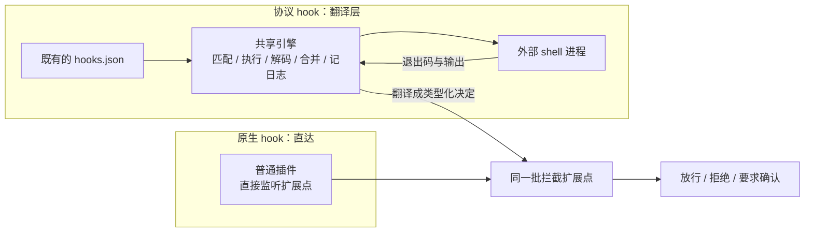

> **读完这篇你能**：知道 DSH 里"hook"其实是两条不同的路，以及各自适合什么；知道那两个兼容桥能承接 Claude Code 与 Codex 的哪些 hook、哪些逐字迁不过来；知道"native hook"的准确定义；以及为什么官方文档会劝你别用桥。
>
> **前置**：[36-给DSH提PR](36-给DSH提PR.md)。约 30 分钟。
>
> **示例代码**：[dsh-native-hook](https://github.com/anthonyzhao-4926/blog/tree/main/code/dsh_plugin/dsh-native-hook)

从 Claude Code 或 Codex 迁过来的第一件事，通常是看一眼自己那份 `hooks.json`：这些东西在 DSH 里还要不要重写？

答案分两半——**一部分能原样接着跑，一部分从根上迁不过来**。这一篇讲清楚分界线在哪。

## 目标

- 分清协议 hook（外部进程 + JSON 配置）与 native hook（普通 Cordis 插件）。
- 看懂那条线协议：stdin、stdout、退出码、超时、失败怎么降级。
- 知道两个桥各承接哪些事件、各自有哪些不支持项。
- 拿三条判据把自己的 hook 分成"照搬 / 改写 / 丢弃"。
- 知道 `hook/*` 这对审计记录是谁写的。

## DSH 设计

**拦截点先于任何 hook 存在。** DSH 的对话循环留出几个固定的插手时刻：会话建立、模型要发请求之前、工具执行之前与之后、一轮要停下时。这些时刻叫扩展点；其中能"说不"的几个是 waterfall（瀑布式）事件——监听器排成一列，每个要么调用 `next()` 把决定权交给下一个，要么返回一个类型化的决定：放行、拒绝，或要求人工确认。官方扩展手册把"钩子系统"直接列成这些扩展点上的监听器，并给出一句话定义：原生钩子（native hook）是在拦截点上运行的普通插件——插件是 DSH 里一切功能的基本单位，一个名字加一个挂载时执行的函数——不需要任何外部协议。

**桥是后加的翻译层，存在理由是复用。** Claude Code 与 Codex 是另外两个 AI 编程助手，它们的 hook 机制都是"JSON 配置加外部 shell 进程"：到了某个时刻起一个进程，把上下文用 JSON 打进它的标准输入，再看退出码——2 表示阻断，错误输出是理由。DSH 的两个桥接包各自认领一种方言：把既有配置里的事件映射到同一批扩展点上，进程跑完再把退出码与输出翻译回类型化决定。两个桥把定位写成同一句设计理念："兼容适配器，而非强力工具"——只承诺运行既有配置中显式受支持的子集，没有对应物的定制行为应该写成原生插件。按这个口径，Claude Code 官方的 30 个事件里桥接 7 个，Codex 官方的 10 个里桥接 5 个；落在子集之外的配置在解析阶段就被忽略，不会让整份配置失效。那一长串"不支持的事件"因而是边界，不是没做完。



**引擎的每条设计都在为"外部进程不可信"兜底。** 两个桥共用一个引擎，它的设计理念写得很直白："绝不向循环抛异常"——畸形 JSON、无效正则、进程启动失败，全都降级成受控结果，一个 hook 永远不能弄崩当前这一轮（turn：从接下输入到模型停下的一个来回）；进程控制交给已有的 shell 执行服务，洗过的环境、取消与超时是现成能力，引擎不自己起进程；两种方言只差在"匹配模式怎么解读"这一根轴上，所以差异被收拢成一个参数，而不是复制成两套引擎（依据 `local/deepseek-harness-dsh-v0.2.0-rc.2/packages/hooks/hook-protocol/README.zh.md`）。

**方言的形状被刻意保留，而不是做到能力最大化。** Codex 桥有一条另一条桥没有的设计理念：数据保持那个产品自己的字段形状，标准输入不补尾随换行，也不实现工具前审批与参数改写——按它的原话，"即使 harness 本可以做得更多，也保留协议的形状"（依据 `local/deepseek-harness-dsh-v0.2.0-rc.2/packages/hooks/hooks-codex/README.zh.md`）。桥的目标是"那份配置搬过来还能跑"，不是借那份配置长出一个更强的机制。

**"要求人工确认"这一档不是所有方言都有。** 退出码与输出翻译回类型化决定时，大多数拦截点上只有"拒绝"一档；"要求人工确认"只在工具执行之前这个点、且只有 Claude Code 方言才有，Codex 方言在同一个点上只能拒绝。决定的词汇表由扩展点定义，方言能填几档由桥认领。

**添加上下文不是否决。** 只贡献上下文的 hook 必须先调用 `next()` 把决定权交下去，再把自己的那段文字折进下游传回的决定里——排在后面的监听器仍然可以拒绝或改写。桥不让自己附带的内容堵住别的策略层，因为 hook 只是拦截点上的贡献者之一。

**审计记录成对出现，且必须落在一轮之内。** 桥每执行一个 hook，就往会话日志（一次对话里只增不改的事件记录）写一对只写日志的事件：`hook/invoked` 与 `hook/result`，作为"运行了什么、决定了什么"的持久证据。匹配到的多个 hook 按配置顺序串行执行、不去重，为的就是每个 hook 的这对记录在日志里相邻，而且"最严格者优先"的合并与顺序无关。这对记录必须落在已打开的一轮之内——发生在轮外的时刻（比如会话刚建立时）不写，还有专门的运行期自检拒绝轮外记录。原生插件不是桥、没有记账人，这对记录它一条都不写；要审计得自己在事件流上折。

两条路不是新旧替代关系：桥翻译存量配置，原生插件写新行为，它们站在同一批扩展点上。

## 两条路

DSH 里"hook"这个词指两件不同的事，而且**官方在劝你用后面那件**。

第一条路是**协议 hook**：`packages/hooks/` 那三个包，把 Claude Code / Codex 的 shell hook 配置读进来，在对应时机起一个外部进程。它的存在理由写在包组 README 里：让 DSH 的运行能**复用为别的 agent 写的 shell hooks**。

第二条路是 **native hook**，定义只有一句，在 `docs/cookbook/extension-cookbook.md`：

> A "native hook" is an ordinary Cordis plugin on an interception point; it needs no external protocol.

两个包的 README 把边界写得更直白：协议桥是一个**兼容适配器，不是增强版插件机制**；没有历史配置要保住时，"bespoke behavior belongs in a native plugin on the same extension points"。

所以这一篇的骨架就是这两条路的对照。先把桥看清楚。

## 桥是三个包

| 包 | 角色 | 你会直接装它吗 |
| --- | --- | --- |
| `dsh-hook-protocol` | 两个桥共用的引擎：匹配、执行、解码、合并、事件、拆卸 | **不会**，纯库 |
| `dsh-hooks-claude-code` | 跑你已有的 Claude Code `hooks.json` | 会 |
| `dsh-hooks-codex` | 跑你已有的 Codex `hooks.json` | 会 |

引擎按单职责拆成一串函数：校验 matcher → 用 `ctx.shell` 的执行器跑命令 → 解码结果 → 把每个命中 hook 折成"最严格"的一个 → 记一对日志。它刻意不自己 `spawn`：`dsh-shell` 的执行器已经提供了洗过的环境、进程组取消与超时，协议没必要再实现一遍。

**每一步都降级成"被容纳的结果"，而不是抛出去**——畸形 JSON、执行器拒斥、超时，全都不会让当前这一轮崩掉。唯一的例外在装载期：非法 matcher 会让整份配置被拒（见下面第 2 跳）。

## 线协议

输入是 JSON 打进 stdin（CC 桥末尾补一个换行，Codex 桥不补），输出看三样东西：

| 退出码 | 含义 | 结果 |
| --- | --- | --- |
| `0` | 成功 | stdout 若以 `{` 开头就宽松解析成结构化字段，否则当纯文本 |
| `2` | **阻塞** | `decision: 'block'`，**stderr 作为 reason** |
| 其它数字 | 非阻塞错误 | 记日志，动作继续 |
| 无（被杀/启动失败） | 非阻塞错误 | 同上 |

结构化 stdout 的两个层次：顶层有 `continue`、`stopReason`、`systemMessage`、`decision`（只认 `approve` / `block`）、`reason`；`hookSpecificOutput` 里有 `hookEventName`、`permissionDecision`（`allow` / `deny` / `ask`）、`additionalContext`、`updatedInput`。其中 `hookSpecificOutput.hookEventName` 必须与本次事件相符，不符就丢掉它那些事件作用域字段。

两条规则：

- **`exit 2` + stderr 是唯一的阻断通道。** 迁移的判据有一大半落在这句上。
- **超时默认 600 秒**（10 分钟）。CC 的 `timeout` 单位是秒；两边都接受配置项 `defaultTimeoutMs` 覆盖默认值。顺带一提，CC 官方的 `UserPromptSubmit` 默认是 30 秒，这里统一成了 600。

matcher 的语义在两个方言里不一样，这是第二个容易踩的地方：

| 方言 | 规则 |
| --- | --- |
| Claude Code | 纯词字符加 `\|` 的模式按**字面量**处理（`Bash` 匹配 `Bash` 但不匹配 `BashTool`；`Bash\|Read` 是精确枚举）；其余按正则 |
| Codex | **永远**是非锚定正则 |

缺省、空串、`*` 都是"全匹配"。另外两个事件没有匹配主体，写了 matcher 也会被丢掉：`UserPromptSubmit` 与 `Stop`。

多个 hook 命中时**串行**跑、**不去重**（参考实现是并发 + 去重），换来的是日志里 `invoked` / `result` 相邻。合并规则是 `deny > ask > allow`；第一个 `continue: false` 是粘滞的，reason 只留获胜档位的那条。

## 一次 PreToolUse 的完整轨迹

以"拦截 bash"为例，逐跳来看：

1. **装载时读一次配置**。`JSON.parse(readFileSync(configPath))`，读或解析失败就记一条 warning 后返回——**一条 hook 都不注册，agent 照常启动**。
2. **解析成"事件 → matcher 组"**。只认 `CLAUDE_EVENTS` 里那七个；组内只有 `type: 'command'` 的 hook 会留下，其余进 skipped；命令字符串在解析期做 `${CLAUDE_PLUGIN_ROOT}` / `${CLAUDE_PROJECT_DIR}` 替换；若某个要用的 matcher 正则非法就抛 `SyntaxError`——它最终落到与上一步同一条 warn-and-return 路径上：整份配置被放弃，一条 hook 都不注册。
3. **注册监听器**：`SessionStart` → `agent/created`，`UserPromptSubmit` → `agent/pre-step`，`PreToolUse` → `tools/pre-execute`，`PostToolUse` → `tools/post-execute`，`Stop` → `agent/turn-stopping`，还有 `subagent/start` 与 `subagent/end`。
4. **构造 stdin 载荷**：基座是 `session_id`、`transcript_path`、`cwd`、`hook_event_name`，`PreToolUse` 再加 `tool_name` / `tool_input` / `tool_use_id`。
5. **匹配 → 串行执行**，工作目录是 agent 的会话 workspace。
6. **写日志对**：turn 打开时先 `hook/invoked`，跑完再 `hook/result`，`handlerId` 形如 `claude-code:PreToolUse:<n>`。
7. **解码与折叠**：得到 `{ output, durationMs }`，逐个 push 再 `merge`。
8. **映射成类型化 Decision**：`deny` → `{ kind: 'deny', reason }`、`ask` → `{ kind: 'ask' }`，否则 `next()` 委派。

第 8 步有一处细节：**只带 context 的 hook 必须先 `next()`，再把自己的消息折进下游的决定**，这样后面还有监听器时仍然可以拒绝或改写。

## 能承接什么

CC 桥的权威事件集合就是那七个常量；Codex 桥五个。把它们并排：

| Claude Code | Codex | 桥接后能做什么 |
| --- | --- | --- |
| `SessionStart` | `SessionStart` | 注入该会话可见的上下文 |
| `UserPromptSubmit` | `UserPromptSubmit` | 拒绝 prompt，或附加上下文（拒绝时**没有任何模型可见消息**） |
| `PreToolUse` | `PreToolUse` | CC：拒绝或**要审批**；Codex：只能拒绝（没有 ask） |
| `PostToolUse` | `PostToolUse` | 带反馈阻断结果，或附加上下文 |
| `Stop` | `Stop` | 带 reason 强制再走一步 |
| `SubagentStart` | — | 给仍在运行的进程内子 agent 注入上下文 |
| `SubagentStop` | — | 只观察，不能阻断 |

不支持的清单同样是权威事实，写在两个包的 Known Limitations 里：CC **不支持 23 个**（官方当前 30 个），Codex **不支持 5 个**。这些事件上的配置**在组解析之前就被忽略**，所以写错了不会让整份配置失效——这一点和非法 matcher 的待遇正好相反。

还有一类 hook 两边都不跑：`http`、`mcp_tool`、`prompt`、`agent` 这几种处理器只解析、不执行，各给一条 warning。

## native hook 是什么

native hook 不是包，就是**订阅扩展点的普通 Cordis 插件**。桥能做到的事它都能做到，而且更直接——没有序列化边界、拿得到完整的 `ctx`、返回的是类型化对象：

```ts
// 这个监听器必须是 async：事件契约要求的返回类型是 Promise<PreToolDecision>。
ctx.on('tools/pre-execute', async (exec, next): Promise<PreToolDecision> => {
    const command = bashCommandOf(exec)
    if (command === undefined) return next()
    if (!patterns.some(pattern => pattern.test(command))) return next()
    return { kind: 'deny', reason: config.denyReason }
})
```

选点规则（都在那份 cookbook 里）：可重排的策略层用 `tools/pre-execute` 的 waterfall；需要**单调的最终拒绝**用 `ctx.tools.guard()`；要包裹派发生命周期用 `tools/execute`；要变换结果用 `tools/post-execute`；只观察不可变的最终结果用 `tools/result`。

两者最硬的一条分界在日志上：**native hook 不是桥，不写 `hook/invoked` / `hook/result`。** 走桥你白得一对审计记录，走 native hook 你白得完全的自由——要审计就自己在 `session/event` 上折一份。

| 维度 | native hook | 协议 hook |
| --- | --- | --- |
| 载体 | TypeScript，`ctx.on(...)` | JSON 配置 + 外部 shell 进程 |
| 阻断方式 | 返回类型化 Decision | `exit 2` + stderr |
| 能要审批吗 | 能 | CC 能；Codex 不能 |
| 覆盖的事件 | 全部扩展点 | CC 7/30，Codex 5/10 |
| 审计日志 | 无 `hook/*`，自己折 | 自动写一对 |
| 工具参数改写 | 不能 | 不能（`updatedInput` 只解析不生效） |
| 适用 | 新行为、要 `ctx` 全能力 | 复用既有配置、少改代码 |

注意倒数第三行：**两条路都不能改写工具参数。** `PreToolDecision` 里根本没有那条通道，桥那边则是解析了 `updatedInput` 之后记一条 warning 然后忽略。

## 迁移判据

拿三条判据过一遍手上的 hook：

**X：落在那七/五个事件上的 command hook → 照搬（有条件）。**

把多层配置合成**一个** JSON 文件（CC 那套 user / project / plugin / policy 的分层发现没有实现，只读一个文件），然后在 profile 里挂一行：

```yaml
- insert:
    - id: hooks-claude-code
      name: '@deepseek-ai/dsh-hooks-claude-code'
      config:
        configPath: './hooks.json'
```

**Y：用了下面任一能力的 → 改写或放弃。**

| 你依赖的 | 会怎样 |
| --- | --- |
| `transcript_path` | 恒为空——持久化 seam 不暴露产物路径，默认会话日志又是 zstd 压缩的，脚本读不了 |
| `updatedInput` 改写参数 | 只解析不生效；改成 native hook 也不会有这条路 |
| `{"continue": false}` 硬停 | 只会被折成 stop 记下来，拦截点上没有硬停原语 |
| `systemMessage` 给人提示 | 只记日志 + warning，不会浮到界面上 |
| CC 的"纯 stdout 当 context" | CC 桥不支持（Codex 桥的 `SessionStart` / `UserPromptSubmit` 反而支持）；改写成 `additionalContext` |
| `PreToolUse` 的 `allow` 预批准 | 不生效；要预批准得写 native 插件返回 `{ kind: 'allow' }` |
| `async: true` 或非 command 类型的处理器 | 被跳过 |
| 靠 `stop_hook_active` 自限的 `Stop` hook | 它恒为 `false`，而无条件阻断没有次数上限——会每一步都强制续跑 |
| 按 `agent_type` 匹配具体种类 | 恒为 `general-purpose` |

**Z：落在那 23 / 5 个不支持事件上的 → 丢弃或改成 native 插件。**

改写时的落点：`Notification` / `SessionEnd` 这类去监听 `agent/created`、`session/event`；`PreCompact` / `PostCompact` 那类属于 compaction 的扩展面；`PermissionRequest` 用 `tools/pre-execute` 返回 `{ kind: 'ask' }`——顺带一提，Codex 桥连这个都没有。

## 一对 hook/* 记录

协议 hook 落两条 log-only 事件：

```ts
'hook/invoked': { turn, point, dialect, matcher?, handlerId }
'hook/result':  { turn, point, handlerId, decision, exitCode?, stderrSummary?, durationMs }
```

几个约束：**必须落在已经打开的 turn 内**——`SessionStart` / `SubagentStart` / `SubagentStop` 因此不写这对记录（它们发生在 turn 之外）。`dialect` 是 `'claude-code' | 'codex'`，用来区分是哪个桥跑的。`stderrSummary` 默认截到 500 字符。

协议自己的不变式会拒绝这几种情况：事件落在任何打开的 turn 之外、事件里写的 turn 与当前 turn 不符、`point` 或 `handlerId` 为空、`dialect` 不认识、`hook/result` 找不到配对的 `hook/invoked`、`durationMs` 不是非负有限数。

## 一处文档与代码不一致

两个包的 README 都在 Known Limitations 里写着：`SessionStart` **detached** 跑，所以它的上下文**可能错过第一个请求**。

同版本的代码不是这样，两个桥都一样：`SessionStart` 的监听器挂在 `agent/created` 上，而且是 `async` 加 `await run(...)`；`agent/created` 是 **serial、监听器会被 await 之后创建才算完成**。所以那段上下文在第一个请求之前必然已经就绪。

桥的 README 内部就自相矛盾，而且不止一处：讲事件接线的那节写"`SessionStart` 通过 **awaited** 的 `agent/created` 初始化、在第一个 turn 之前注入上下文"；另一节把 `SessionStart`、`SubagentStart`、`SubagentStop` 三个并列为"detached 跑，没有任何扩展点 await 它们"；Known Limitations 里又说它 detached、可能错过第一个请求。

源码解释了这处含混的来处：`SessionStart` 那次运行**既被登记进拆卸追踪**（`detached.track(run)`，为的是插件卸载时能排空还在跑的 hook 进程），**又被 `await`**。两个 subagent 事件才是真的不 await——它们挂在 emit 型的 `subagent/start` / `subagent/end` 上。把三者并列成一句话，这个差别就被抹掉了。

桥自己的测试也分两种口径：一个用例先等注入落到待发件箱、再发第一条请求，然后断言它看得到那段文本；另一个用例专测"请求发得很快"时不崩不阻塞，注释里把这种情况描述成 best-effort、可能错过。后者证明的是容错，不是"一定会错过"。所以这一条以源码为准。

真正剩下的、仍然成立的注意点是 `Agent.inject()` 自己的调度语义：**它可能错过一个 pre-step 已经认领了自己批次的请求**。这是注入这个动词的性质，不是桥的缺陷。

所以读 DSH 的文档时，这类"句子级不一致"要按代码判。归档的 Agent Note 里那批文本用的是更旧的事件名 `agent/session-start`，而它在当前源码里一次都没有出现——照它写插件，订阅会静默永不触发。

## demo

`dsh-native-hook` 把同一个行为做两遍，A / B 两面在 `cordis.patch.yml` 里互相注释，换面就重装一次：

- **A 面**是 native hook：一个普通的 Cordis 插件。
- **B 面**是同语义的一条 Claude Code `hooks.json`，交给桥。

A 面的两个动作：

```ts
ctx.on('tools/pre-execute', async (exec, next): Promise<PreToolDecision> => { /* 命中就 deny */ })

ctx.on('agent/created', async ({ agent }) => {
    if (config.sessionNote === '') return
    agent.inject(createUserMessage({
        content: [{ type: 'text', text: config.sessionNote }],
        source: { kind: 'dsh-native-hook' },
    }))
})
```

第二段有两处容易漏的细节。一是**事件名**：`agent/created`，不是别处见过的 `agent/session-start`。二是 **source 的声明**：消息来源是个 merge-extensible 的映射，**没有通用的 `plugin` kind**——每个生产者要在自己的模块里声明一个：

```ts
declare module '@deepseek-ai/dsh-llm' {
    interface MessageSourceMap {
        'dsh-native-hook': { kind: 'dsh-native-hook' } & ContextFormed
    }
}
```

B 面就是那份 JSON 配置，一行命令靠 stderr 加 `exit 2` 拒绝 bash。

这个 demo 的构建链也演示了一件事：`build.mjs` 走 esbuild，**只转译、不求值类型**。事件契约要的返回类型是 `Promise<PreToolDecision>`，写成同步箭头函数它一声不响，`lib/index.js` 照样产出、插件照样加载，只是类型是错的。`install.sh` 里因此先跑 `pnpm run typecheck`——这条命令本身就是从一次静默失效里长出来的。

## 验证

```bash
cd code/dsh_plugin/dsh-native-hook && ./install.sh
```

```bash
# 1. A 面的插件行
dsh --profile test --dump-config | grep -A6 'id: native-hook'

# 2. 让模型跑 rm -rf /tmp/x —— 被拒，原因就是配置里那句；
#    查会话日志：没有 hook/ 开头的记录

# 3. 换成 B 面（把 patch 里两半对调）重装，同一个 prompt 再跑一次
dsh --profile test --dump-config | grep -A4 'id: hooks-claude-code'
#    同样被拒，但日志里多了一对 hook/invoked + hook/result：
#    dialect 是 claude-code、exitCode 是 2、reason 来自 stderr
```

第 3 步之后可以顺手验一下前面那处不一致：看看自己这个会话的开头，那段 `SessionStart` 注入的上下文到底在不在第一个请求里。

## 注意事项

- **桥是兼容适配器，不是插件机制的升级版。** 两个包的 README 都主动写着"自己的行为请写在 native 插件里"。
- **桥不在任何出厂配置里。** 全仓 `packages/bundle/*` 与 CLI 配置都没有挂它；它只出现在测试固件与快照的 `cordis.yml` 里。要用得自己插一行。
- **`configPath` 是进程级的**：装载时读一次，相对路径按**启动目录**解析，不是每个会话各读一份。多个项目共用一个进程时这是个坑。
- **CC 的分层发现没有实现。** 只读你指的那一个文件，多层配置要自己合成。
- **`exit 2` + stderr 是唯一阻断通道**，其它退出码都是非阻断失败。配置读不到也只是 warning，agent 照常起。
- **非法 matcher 会拒掉整份配置**；不支持的事件则静默忽略。两种待遇不一样。
- **matcher 语义两方言不同。** CC 的纯词模式是字面量，Codex 永远是非锚定正则——同一条 `Bash.*` 两边行为可能不同。
- **`transcript_path` 永远是空串（CC）/ `null`（Codex）。** 依赖它的 hook 从根上迁不过来。
- **`updatedInput`、`continue: false`、`systemMessage` 都只记不生效。**
- **`Stop` 的 `stop_hook_active` 恒为 false**，连续阻断上限没有实现；写无条件阻断的 Stop hook 会一直强制续跑。
- **`SubagentStart` 的 `agent_type` 恒为 `general-purpose`**，按具体种类匹配的配置永远不触发。
- **Hook 串行执行、不去重**，为的是日志里 invoked/result 相邻。
- **`hook/*` 只由桥写。** native hook 不写；要审计就自己在事件流上折。
- **`hook/*` 必须落在已打开的 turn 内**，所以会话级那几个事件不写这对记录。
- **文档里的 `agent/session-start` 是旧名**，当前是 `agent/created`；包 README 里"`SessionStart` detached、可能错过第一个请求"的说法与同版本代码和测试矛盾。
- **给注入的消息声明 source。** 没有通用 `plugin` kind；漏了声明会静默失效。
- **构建不 typecheck。** 走 esbuild 的项目记得自己跑一次 `tsc --noEmit`。

---
