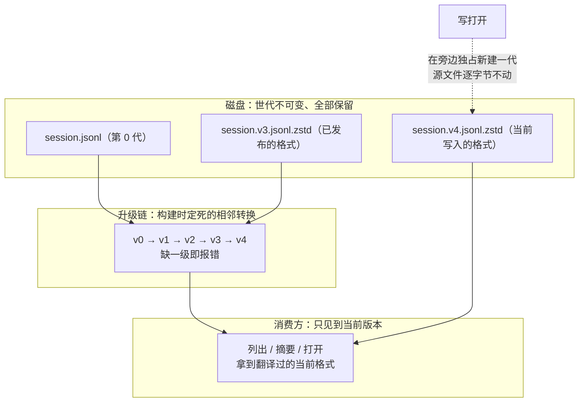

> **读完这篇你能**：知道会话在磁盘上长什么样、几个版本号分别是谁；知道那条"逐级相邻"的迁移链是怎么保证不跳级的；知道打不开时你看到的两种方向性拒绝分别是什么意思；知道 DSH 里"备份"为什么就是"前代文件还在"；以及写插件时该怎么读会话才不怕格式变。
>
> **前置**：[37-复用ClaudeCode的hooks](37-复用ClaudeCode的hooks.md)。约 30 分钟。
>
> **示例代码**：[dsh-session-audit](https://github.com/anthonyzhao-4926/blog/tree/main/code/dsh_plugin/dsh-session-audit)
>
> **DSH 版本**：0.2.0-rc.2

升级 `dsh` 之后老会话打不开，是这套持久化设计里最容易被误解的一件事。它既不是数据损坏，也不是"版本回退就能解决"的问题——而这一篇要讲的，就是为什么。

## 目标

- 认识会话目录的布局：一个会话一个目录、每个格式世代一个文件。
- 分清三个版本号：写入器、已定稿、已发布。
- 看懂迁移链的两条硬约束：**相邻**与**构建期固定**。
- 知道六种打不开的情况，以及"方向敏感"的拒绝文案。
- 明白为什么没有 `.bak`，以及迁移一次到底会多出什么。
- 会用正规 API 读会话，知道哪些做法迟早会坏。

## DSH 设计

DSH 把一次对话里发生的每件事按顺序记成一份只增不改的日志，这份「会话日志」是"模型所见的全部上下文"的唯一来源：模型历史从它推导出来，分叉、恢复、导出、遥测都从它派生，还有一条运行期自检专门检查"模型请求可从日志重建"。全部下游都压在这一份文件上，格式演化的代价因此远高于普通数据。所以读它的原则只有一句：宁可拒读也不猜。这一节的每条设计都是这句原则的某个切面——遇到不认识的词汇宁可拒读，升级链缺一级宁可报错，拿不准的历史宁可拒绝，谁也不替它编数据。

原则先落在读的分层上："看一眼"与"打开"是两种成本。架构文档写明一条分层：消费方只了解当前的逻辑格式。列会话、读摘要这类操作只重扫目录、挑出世代号最高的文件、翻译历史头，不加载事件，也不往磁盘写任何东西；只有真正打开才跑"解码 → 逐级升级 → 校验"的完整管线。这里的「世代」（generation）指同一个会话在磁盘上并存的几代文件：格式每升级一次就多一个按版本命名的文件，而已提交的世代绝不重命名、替换或删除。

升级的那一头同样保守：只能逐级，而且链条在构建时就定死。每一级升级由一个"从 vN 到 vN+1"的相邻转换负责，声明时就校验相邻、不许跳级。源码里这个校验就是一行比较（`local/deepseek-harness-dsh-v0.2.0-rc.2/packages/session/session-format/src/chain.ts`），效果是这样：

```ts
defineSessionFormatMigration({ name: 'demo', fromVersion: 1, toVersion: 3, /* … */ })
// 声明即抛错：demo must declare adjacent v1->v2 —— 想从 1 直跳 3，不被接受
```

链条也不是运行时拼装的，而是产品构建时就静态确定的，运行中的配置改不了它。跨多级升级（比如从第 0 代升到第 4 代）自动成立，因为每一级的输出交给下一级。



世代不可变又推出一个结果："备份"这个问题不存在。写打开才发布新世代：先编码、校验，再在未改变的源文件旁边以独占方式新建——重名视为"已有后继"，永不覆盖；只读打开什么都不发布。前代文件留在原地，不是备份策略的产物，而是"绝不改旧文件"的天然结果；所谓"恢复"也只是忽略掉那个新文件，不是回滚了一次升级。

最后是一件容易混的事：写入、定稿、发布是三件事，所以有三个版本号。状态文档开篇分工：代码常量拥有「写入器版本」（这个构建写出来的是第几代），「定稿」记录标识已接受的兼容性基线，「发布」记录标识已随产品发出去的格式，"其他文档链接到这里，不重复这些值"（依据 `local/deepseek-harness-dsh-v0.2.0-rc.2/docs/session-format-status.zh.md`）。三者分开，是因为变更时机与证据各不相同：写入器随代码走，定稿要检查点，发布要一个真实的产品标签。预发布同样算数——alpha、beta、rc 的发布一样确立"已发布格式"的义务：版本号可以带 rc，用户磁盘上的会话数据不可丢弃。

## 会话在磁盘上的样子

默认会话根是 `$DSH_HOME/sessions`（`$DSH_HOME` 默认 `~/.dsh`）。往下是三层：

```text
<root>/
  --<normalized-cwd>--/          # 可读的项目目录；没有 cwd 时是 _no-cwd
    <encoded-id>/                # 这个会话独占的目录
      session.jsonl.zstd         # 第 0 代（压缩后）
      session.v1.jsonl.zstd      # 第 1 代
      session.v2.jsonl.zstd      # 第 2 代
      session.v3.jsonl.zstd      # 第 3 代（已发布的格式）
      session.v4.jsonl.zstd      # 第 4 代（当前写入器；不压缩时没有 .zstd 后缀）
      session.lock               # POSIX flock 写租约
```

三个约定：

**一个会话一个目录，但可能有多个文件。** 每一次被发布出来的格式世代都占一个文件，而且**全部保留**。运行时选的是数值最高的那一代。

**文件名是规范化的。** 第 0 代的规范名就是不带后缀的 `session.jsonl`，之后每一代是 `.vN`（小写、无前导零、**没有** `.v0`）。压缩后缀 `.zstd` 是后端在规范名之后追加的，默认就是压缩。临时名、大写名、带前导零的名字在解析器眼里都不规范：

```ts
const CANONICAL_LOG_FILENAME = /^session(?:\.v([1-9][0-9]*))?\.jsonl$/u
```

**文件名里的版本必须等于文件首行的 `version`。** 每个规范文件的第一行是一个物理头：

```ts
interface HeaderLine {
  type: 'session'
  version: number          // 与文件名里的 N 相等
  id: SessionId
  createdAt: number
  cwd?: string
  parentSession?: SessionId
  isSeeded: boolean
  origin?: 'subagent'
  delegationDepth: number
  agentPreset?: string
}
```

而已退休的字段是被拒读的：`sandboxMode` / `approvalPolicy` 出现在头里，整个日志就拒读。这种结构性拒绝**不会被当成"可恢复的尾部"**——即使文件更早的地方本来就有一处损坏行。

## 三个版本号

这是最容易混的地方。会话相关有三个数，各自有各自的权威：

| 名字 | 当前值 | 权威在哪 | 含义 |
| --- | --- | --- | --- |
| 写入器 | **4** | `SESSION_FORMAT_VERSION`（`core/session` 的类型文件） | 这个构建**写出来**的格式 |
| 已定稿 | **4** | `docs/session-format-status.md` 的 finalization 记录 | 已被接受的兼容性基线 |
| 已发布 | **3** | 同文件的 release 记录（证据标签 `dsh-v0.1.5-alpha.1`） | 已经跟着产品**发出去**的格式 |

`session-format-status.md` 把这三个数的分工写得很清楚：代码常量拥有写入器；定稿与发布记录分别标识"被接受的历史"和"发布的证据"。

对比方式也就顺下来了：**写入器等于已发布，说明这个格式已经发货；更大，说明还没被记录为已发布。**

这里有一条容易被忽略的原则：**alpha / beta / rc 的发布同样建立"已发布格式义务"，GitHub 上的 prerelease 标记不会让持久用户数据变成可丢弃的。** 所以这份快照的状态是：写入器与已定稿都是 V4，而**已发布的是 V3**。

还要排除几个冒充者：包版本、codec 导出的名字、夹具文件名、投影缓存的 `stateVersion`，**都不是**会话格式的权威。

## 迁移链

从磁盘上那一代升到当前写入器，走的是一条链。它有两条硬约束。

**第一，边必须相邻。** 每条边由一个 `defineSessionFormatMigration` 声明，声明时校验 `to === from + 1`，否则直接抛错——文案以那个迁移包的名字开头，后半句是 `must declare adjacent vN->vN+1`。

**第二，链在构建期就固定了。** 边不是运行期注册的，而是生成器从各个迁移包的 `package.json` 元数据（`dsh.sessionFormatMigration`）读出来，产出到 `session-format-catalog` 的生成文件里。这个包的 README 说得很直白：

> A profile cannot add, remove, or reorder an edge by mounting a feature plugin.

于是"不跳级"变成了一条机械性质：链的构造函数从 0 开始逐级取边，缺任何一级就在构造期抛 `Session migration vN->vN+1 is missing`；出现了超出当前写入器的边也抛。多级跳（0 → 4）自动成立，因为每一步的输出交给下一步。

计划与执行是分开的：`plan(fromVersion)` 切出要跑的边，`createStream` 链式建 stage 逐级推进头，只有头要变的路径走 `migrateHeader`。

每一级做了什么：

| 边 | 做了什么 |
| --- | --- |
| 0 → 1 | 头版本归一，加一节有限的历史规范化（例如 `compact/*` → `compaction/*`） |
| 1 → 2 | 把顶层 `assistant/chunk` 的时间流**内嵌**进 `assistant/message`；没有产生消息的尝试记为 `assistant/attempt`；对存活事件与序号引用做密集重映射 |
| 2 → 3 | 把 system prompt 提升为 `system/message`；重映射本地事件引用；预设名转换（`code` → `ptc`） |
| 3 → 4 | 头版本推进；把 tool result 提升为 tool-role 消息、重命名消息来源、关闭有证据的中断轮次、**补齐父会话缺失的 `subagent/catalog` 事实** |

最后一行有个不寻常的前置条件：**V3→V4 的 body 迁移要求显式的历史子会话证据**——没有子会话也必须传一个空数组，否则它直接抛：

```text
V3 catalog migration requires explicit historical child facts, including an empty array for a parent without children
```

这是"迁移不是猜"这条原则的极端例子：它宁可拒绝，也不替历史编一份可能需要的数据。

## 打不开的六种情况

持久化这条缝对读的承诺是 fail-closed：**只校验当前格式的记录，遇到不认识的词汇就拒**。具体的判定点：

| 条件 | 结果 |
| --- | --- |
| 存储头的版本**高于**当前写入器 | `unsupported`，并给出带绝对路径的拒绝诊断 |
| 头不是 JSON 对象，或版本不是非负安全整数 | `malformed` |
| 该版本没有 codec | `unsupported` |
| 缺某级迁移边 | 构造期就抛错 |
| 某级 stage 拒绝这份 artifact | 包装成"`<边名>` refuses this format vN Session: `<详情>`" |
| 迁移后的结果过不了当前校验 | `refuses the transformed artifact: …` |

用户侧看到的是 `SessionFormatUnsupportedError`，措辞是：

> The stored log is intact but this runtime cannot faithfully interpret it.

也就是**日志是好的，是运行时读不懂它**。而且文案是方向敏感的：

- 更新 → `the log was written by a newer harness — upgrade the harness to open it`
- 更旧 → `older than the supported vM, and this build ships no upgrade path for it`

**没有回退，也没有降级。** 子系统文档的原话是：未来的最高世代会拒绝，**即使旁边还留着一个可读的更老世代**。仓库根那行规则说得更短：前代既不意味着回退，也不意味着降级支持。

## 没有备份文件

这一节回答一个很自然的问题：迁移会不会改坏我的数据？

不会，因为它根本不改。规则是：**读打开从不发布任何东西**——它把源解码、迁移一次、校验当前逻辑结果，然后原样返回，源文件一个字节都不动。

写打开才会发布"当前后继"，而且是**独占新建**：在同目录写临时文件、用 Worker 校验、重查源 revision、然后用 `link` 发布当前路径——`EEXIST` 被视为"已经有后继了"，**永远不覆盖**。源文件保持逐字节不变。

所以"备份"在这套设计里的答案很朴素：**前代文件还在那儿。** 当一个会话被**写打开**（你接着往下聊），它旁边会多出一个 `session.v4.jsonl[.zstd]`，老的那几个原样留着；只读打开不在磁盘上留下任何东西。没有任何 `.bak`。

删掉后继、回到前代，是可行的恢复方式——但那只是"忽略掉那个新文件"，不是"回滚了一次迁移"。

顺带说崩溃语义：不完整的末行会被丢弃；撕裂的 zstd 末端帧只贡献完整记录；已经完整提交的帧如果校验、解压或结构失败，判为损坏、拒读。

## 两个入口

想找 `dsh doctor` 或 `dsh migrate` 的话，没有。CLI 只有启动器 flag 与 `plugin` 子命令。

真正能用的是一个**一次性贡献者脚本**：

```sh
cd /path/to/deepseek-harness
pnpm run migrate:sessions-to-v4 --sessions-dir ~/.dsh/sessions --jobs 4
```

默认根就是 `~/.dsh/sessions`；已经是 V4 的会话只读打开；单个失败不阻断后续；文本日志与最终 JSON 摘要落在操作系统的私有临时目录里。

另有一个 `verify-v3-event-vocabulary` 命令，作用是核对某个源码提交上的 V3 词汇——它服务的是"V4 首次发布之前"那段窗口期，属于维护者工具箱。

## 三个产物

会话格式相关的文档产物有三个，各记各的：

| 产物 | 记什么 | 谁维护 |
| --- | --- | --- |
| `docs/persistence-catalog.md` | **当前**写入器的可读声明：逻辑头、物理头、事件 envelope、每个持久事件 | `gen-persistence-catalog` 生成，`verify-*` 在 `doc-sync` 里校验 |
| `docs/persistence-schema.json` | 同一份内容的机器清单：`formatVersion`、根与类型的摘要 | 同一个生成器 |
| `docs/persistence-changes/` | **历史**确认记录：每次被检测到的结构性变更一份带日期的记录，加 `finalized/vN.json` 定稿检查点 | 维护者打检查点 |

注意 `persistence-schema.json` 里那个 `formatVersion: 2` **不是**会话格式版本，它是**清单规范化版本**——两者没有关系，混淆了就会得出"格式才 2"的错误结论。

判断一份改动要不要新版本号，也有一张最小的判定表：加可选字段、加普通事件、必填改可选、普通事件加更高的 `data.version` 而旧 payload 不变——都留在同一版本，只记一条 `same-version` 确认；反过来把可选改必填、改类型、删或改名属性与事件、动会话头或事件 envelope——都是 `version-bump`，而且**不能复用已经接受的转换**。

## 插件怎么读会话

写插件时的规矩只有一条：**别碰文件。**

保持抽象的那一层之后，格式迁移、压缩、历史解码与崩溃恢复都是存储内部的细节。正规入口：

| 你想做的事 | 用哪个 |
| --- | --- |
| 列会话、读会话、按条件过滤、读事件或 surface、导出 | `ctx.sessionQuery` 的那组方法 |
| 只想知道会话存在与大小 | `ctx.sessionPersistence.stat(id)` / `list()` |
| 派生状态（计数、待办、目标） | `ctx.sessionProjections` 注册一个投影单元 |
| 只需要"这是第几代" | `parseSessionFormatLogFilename()`（`dsh-session-format`），别自己写正则 |

反面做法与各自的坏法：

- **硬编码 `session.jsonl`。** 那只对第 0 代成立；v1 之后的文件名带 `.vN`。
- **自己逐行 `JSON.parse`。** 默认是带校验的 Zstd 帧拼接，不是行文本。只有显式配成 `compression: 'none'` 的根才可行读，而且同一个根只允许一种编码。
- **绕过 catalog 自建"版本适配层"。** 会漏掉真正的拒读规则：未知的必需事件要拒、已退休字段要拒、v0/v1/v2 的历史迁移对未知类型即使标了 `ignorable` 也拒绝。
- **按 `session.header.version` 写分支。** 逻辑头恒为当前写入器版本，你的分支永远只走一支——历史信息在迁移中已经被抹平了，这是设计意图。

还有一条归属：`SessionLocation.path` 只出现在拒绝诊断里，**它不是给消费者查询用的入口**；日志访问走会话句柄的 `read`。

## demo

`dsh-session-audit` 是一个**只读**的体检插件。它把这一篇的两侧数据摆在一起：

```ts
// 一侧：磁盘上的物理世代——公开 API 不暴露它，只能扫文件名
const version = parseSessionFormatLogFilename(withoutCompressionSuffix(file))

// 另一侧：正规 API 给的逻辑头，版本恒为当前写入器
const logical = await ctx.sessionPersistence.list()
```

结论只有三种：`current`、`migration-required`（打开时会迁移，写打开会在旁边新增一代）、`needs-newer-harness`（要更新 harness 才能开）。工具把它们汇总成计数，并把正规 API 看到的会话数并排报出来——一眼能看出"磁盘上有几代"和"逻辑头写的是几"是两回事。

它刻意**什么都不写**：不 `open(id, 'write')`、不 publish、不迁移。所以跑完之后会话根一个字节都没变——这本身就是"读打开从不发布"那条规则的可执行版本。

也顺便暴露一个真实缺口：**公开 API 里没有一个字段告诉你磁盘上的存储世代**。`stat` / `list` 返回的是翻译过的逻辑头。所以想体检磁盘代际，就得自己扫文件名，再自己决定要不要管压缩后缀。

## 验证

```bash
cd code/dsh_plugin/dsh-session-audit && ./install.sh
```

```bash
# 1. 插件行
dsh --profile test --dump-config | grep -A4 'id: session-audit'

# 2. 让模型调用 session_format_audit
#    它会报写入器版本、磁盘上的会话数与需要迁移的数量

# 3. 手工对照：文件名里的 .vN 就是磁盘世代
ls ~/.dsh/sessions/*/*/ | head

# 4. 真要迁移的话（在 DSH 检出目录里跑，不是本目录）
cd /path/to/deepseek-harness
pnpm run migrate:sessions-to-v4 --sessions-dir ~/.dsh/sessions
ls ~/.dsh/sessions/*/*/ | head   # 多出了 v4 文件，老文件原样还在
```

第 4 步之后再看一次目录，就能看到"没有备份文件、前代即备份"这件事的实物。

## 注意事项

- **打不开不是数据坏了。** 拒绝诊断的原话是"日志完好，是运行时读不懂它"，而且分方向：更新就升级 harness，更旧就是没有升级路径。
- **没有回退与降级。** 最高世代拒绝时，旁边有可读的旧世代也不兜底。
- **写入器 / 已定稿 / 已发布是三个数。** 这份快照上是 4 / 4 / 3；alpha、beta、rc 的发布同样产生已发布义务。
- **包版本、codec 名字、夹具文件名、投影缓存版本都不是格式权威。** 权威只有 `SESSION_FORMAT_VERSION`。
- **迁移边必须相邻，且在构建期固定。** profile 不能加、删、重排一条边。
- **V3→V4 的 body 迁移要显式的子会话证据**，没有子会话也要给空数组。
- **读打开从不发布。** 写打开才在旁边的规范名上独占新建一代，源文件逐字节不变。
- **没有 `.bak`。** 前代文件就是备份；所谓"恢复"是忽略后继，不是回滚。
- **一个会话目录里所有世代都保留**，运行时选数值最高的那个。
- **默认压缩。** 自己读文件这条路走不通；要外部队读取只能在新根上显式配 `compression: 'none'`。
- **没有 `dsh doctor` / `dsh migrate`。** 迁移入口是检出目录里那个一次性脚本。
- **`persistence-schema.json` 的 `formatVersion` 不是会话格式版本**，是清单规范化版本。
- **插件别自己解析会话文件。** 走 `ctx.sessionQuery` / `ctx.sessionPersistence` / 投影；只有"判第几代"这一件事该用官方的文件名解析器。
- **按逻辑头版本写分支没有意义。** 它恒为当前写入器版本。
- **已定稿不等于已发布。** V4 现在就是"已定稿、待发布"。

---

**主线到此结束。** 从最小插件、事件与工具、界面两半、走出本机，到多 agent 与自动化、系统提示词与执行环境，再到"给人加一条命令"和"直接改 DSH 本身"，这条线走完了。想回头补：[14-把插件配置搬进设置页](14-把插件配置搬进设置页.md)、[08-替换内置能力的提供方与消费者](08-替换内置能力的提供方与消费者.md)、[31-把 DSH 嵌进自己的应用](31-把 DSH 嵌进自己的应用.md)。
