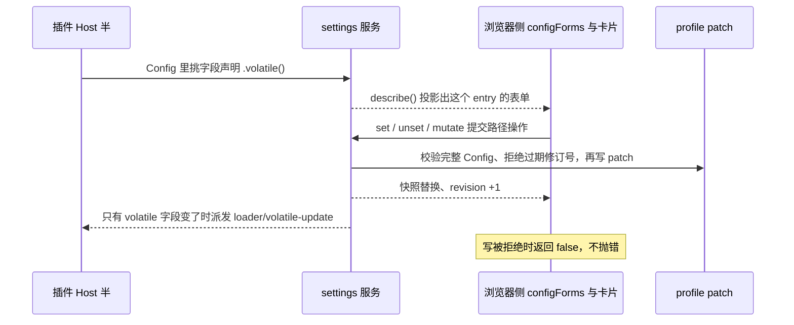

> 本文是知识卡，不用顺序读。给插件加设置项、或者在浏览器半里读写它时来查。
>
> **DSH 版本**：0.2.0-rc.2

**基准版本：dsh `0.2.0-rc.2`**（源码快照 `local/deepseek-harness-dsh-v0.2.0-rc.2/`）。文中每个成员名与行为都按这份源码核对过；换成别的版本时先读那一版的 `docs/subsystems/settings.zh.md` 与 `docs/cookbook/adding-a-settings-card.zh.md`。

对应源码：`packages/settings/settings/src/index.ts`（Host 侧 `SettingsForms`）、`packages/client/ui-settings/src/client/config-form.ts`（浏览器侧 `configForms` 与控制器的 Context 合并）、`packages/client/ui-plugin-manager/src/client/slot-contract.ts`（插件页的三个配置挂载点）、`packages/client/ui-plugin-manager/src/client/config-ledger.ts`（行配置的 key 规则）。

一次完整的注册与读写链路是：

## Host 侧：volatile 字段

设置页只投影**声明为 volatile 的字段**，普通字段被排除在外。插件不注册任何东西：字段标上 `.volatile()`，表单就随这个 profile 条目存在。

| 写在哪 | 说明 |
| --- | --- |
| `interface Config` | 字段类型写成 `Volatile<T>`（从 `@deepseek-ai/cordis` 导出）。它描述 `apply` 收到的值 |
| `Config`（schema） | 字段链上加 `.volatile()`，例如 `Schema.string().default(x).volatile()`。**不要**给这个常量写 `: Schema<Config>` 标注——volatile 字段的序列化形态与接口里的 `Volatile<T>` 引用不同，标注会与 schemastery 的 `default` 签名冲突 |
| 读值 | 所有用到配置的地方改成 `config.image.get()`。稳定引用：值变了引用不变，不必重启插件 |
| 默认值 | 仍写在 schema 的 `.default(...)` 里，层叠规则不变 |
| 密文 | `role('secret')` 的字段不进表单响应，改由凭据域管；要现场改的秘密字段标 `.volatile()` |

哪个该标 volatile：会被人现场调的（图片、透明度、上限）。影响加载行为的（依赖哪个服务、监听谁）不要标——volatile 提交不重启插件，只有重启才生效的字段要留在普通字段里。

## Host 侧：ctx.settings（SettingsForms）

| 成员 | 说明 |
| --- | --- |
| `describe(options?)` | 读活动条目上的 schema 与实时值，**按 profile 条目 id 建表**。远程调用要带 `redactSecrets` |
| `update(ns, patch, revision?)` | 合并提交的字段 |
| `replace(ns, section, revision?)` | 先把即时字段重置回继承配置，再应用提交的字段 |
| `mutate(ns, ops, revision?)` | 逐路径提交，**保留客户端响应里没返回的秘密值**。`ops` 是 `{ op: 'set', path, value } \| { op: 'unset', path }` |
| `configure({ auto }, owner?)` | 只改这个插件实例的页面策略，不动 Config。`auto` 默认 `true`（允许客户端按 schema 自动生成页面）；自带页面的插件传 `false`。同一实例注册两次会抛错 |
| `writable` | 当前 profile 收不收表单编辑 |
| `documentPath` / `prepareDocument()` | 原生配置编辑器要编辑的那份 profile patch |
| `settings/document-updated` | Loader 配置变化后表单描述符失效。这是给 UI 的通知；插件只在要刷新注册信息时才听它 |

## 表单的 namespace

namespace **就是条目在当前 profile 里可唯一定位的那个本地 id**，不是插件自起的字符串。我们的插件是 `dsh-chat-background-settings`：条目挂上，表单就存在；条目停用，表单跟着消失。同一个插件被配置两次时，两个条目 id 不同就是两份独立表单。

因此没有「namespace 命名规则」要遵守——唯一要求是这个 id 在 profile 里能被唯一定位。`content` 之类的嵌套条目仍只能改文件。

## 浏览器侧：ctx.configForms

| 成员 | 说明 |
| --- | --- |
| `get(entryId)` | 取（并按需创建）某个条目的表单。同一个 entryId 复用同一个实例，由服务持有，调用方不需要 dispose 它 |
| `whileServed(namespaces, register)` | 只在这些 namespace 被 Host 服务期间保留注册：register 跑一次并返回自己的 disposer，一旦没有任何一个被服务就撤销。**注册页面用它**，这样没配置该插件的部署里页面不留痕迹。调用方拿返回的 disposer 包进 `ctx.effect` |
| `describe()` | 跨 namespace 的只读面（schema 自省、已服务 namespace 目录），与 `get` 同源 |

## 快照字段表：ConfigFormSnapshot\<T\>

`getSnapshot()` 的返回，也是卡片组件 `props.form.state` 的类型。

| 字段 | 说明 |
| --- | --- |
| `status` | `'loading'` / `'ready'` / `'unavailable'`。Host 不服务这个 namespace，或连接把偏好留在进程内（memory 模式）时是 `'unavailable'` |
| `value` | 最后一次被接受的、经 schema 解析的 section。首次接受前是 `undefined` |
| `base` | Host 解析 `value` 时叠在上面的组合层，字段被清空后回落到的就是它 |
| `user` | 用户层原始内容。**字段出现在这里就算被覆盖过**，哪怕值和默认相同——判断「改没改过」看键在不在，不要比 value |
| `revision` | namespace 修订号，写的时候带上做并发围栏；首次拿到 Host 视图前是 `undefined` |
| `writable` | Host 文档收不收写入；memory 模式永远为 `false` |
| `mode` | `'host'`（与 Host 文档同步）/ `'memory'`（远程页面，进程内） |

## 写入方法表：ConfigForm\<T\>

| 成员 | 说明 |
| --- | --- |
| `getSnapshot()` | 当前快照，下次变化前返回同一引用，可直接喂给 `useSyncExternalStore` 或快照 store |
| `subscribe(listener)` | 订阅快照替换，返回取消订阅的函数 |
| `set(field, value)` | 写一个字段 |
| `unset(field)` | 清掉一个字段，让它回落到组合层 |
| `mutate(ops, expectedRevision?)` | 一次原子提交一组路径操作，所有操作共用一个修订号、一次校验、一次持久化。传 `expectedRevision` 就用读到的那个修订号做围栏 |
| 返回值 | 三个写方法都返回 `Promise<boolean>`：`true` 是 Host 接受，`false` 是拒绝或跳过（已做恢复读）。**传输层失败才 reject** —— 判断「存没存上」看返回值，不要靠 try/catch |

## 浏览器侧：卡片槽位

插件页（侧边栏「插件」，`dsh-client-ui-plugin-manager`）给别人的配置留了三个挂载点：

| 槽位 | 形态 | 给谁用 | 选项 |
| --- | --- | --- | --- |
| `plugins.item` | list | 排官方 bundle 后面的官方插件配置页（内置那几个设置页一个包一个） | `id` / `order` / `label`（可用 `() => t('...')` 跟语言走）/ `locale` |
| `plugins.bundle.config` | keyed | 整个 bundle 的配置，渲染在 bundle 页上 | `key` = 包名 |
| `plugins.row.config` | keyed | bundle 里某一行的配置，从那一行打开 | `key` = `<包名>#<行 id>` |

行配置的 key 由 `rowConfigKey(bundle, rowId)` 生成，就是 `<包名>#<行 id>`：包名是该行所在 bundle 的包名，行 id 以那份 patch 声明的为准（我们的 demo 两者同名，于是 key 是 `dsh-chat-background-settings#dsh-chat-background-settings`）。

条目组件收到的两个东西（`PluginConfigViewProps`）：

| prop | 说明 |
| --- | --- |
| `view` | `'summary'` 时渲染一句话摘要（行没有描述时顶上去），`'page'` 时渲染表单。同一个组件会被渲染两次，两种都要处理 |
| `form` | 只有 `'page'` 给，类型是 `ConfigPageForm`：`{ state: ConfigFormSnapshot, mutate }`。写入用它的 `mutate(ops, state.revision)`，不要自己再造一份状态 |

浏览器半只用**类型**引入声明这些槽位的包（`import type {} from '...'`），运行时一个都不 import——页面已经把实现放进模块表了。

## 落盘位置与形状

设置页的写入落在**当前 profile 的 patch**里（`packages/boot/config-editor` 负责写，`prepareDocument()` 给出路径）。Home patch 与命令行 `--patch` overlay 参与优先级解析，但**不是写入目标**。旧的 `$DSH_HOME/settings.yaml` 已经废弃：启动时它的分节被并进活动 profile，原文件改名留存，之后不再读写。

## 两条生效路径对照

| | 改装载层（`cordis.yml` / patch / `--patch`） | 设置页保存 |
| --- | --- | --- |
| 写哪份文件 | 装载层配置 | 当前 profile patch |
| 插件是否重启 | 是。这一行的 fiber 被 dispose，`apply` 带新 `config` 重跑 | 改动**只有 volatile 字段**时否：Loader 做 volatile 提交，新值直接进运行中的引用 |
| 谁读到新值 | 新一次 `apply` 里的 `config` | 插件下一次 `config.field.get()` |
| 改动里混着普通字段 | 照常重启 | 整个走普通重挂载——那是普通字段的既有待遇 |
| 通知 | 配置重载相关事件 | `loader/volatile-update`（只派给拥有这份配置的插件） |
| 失败时 | 该行回滚到原配置继续跑，告警 | 写被拒绝：返回 `false`，文件与运行值都不动；候选值不合法时 Loader 记日志、保持运行值 |
